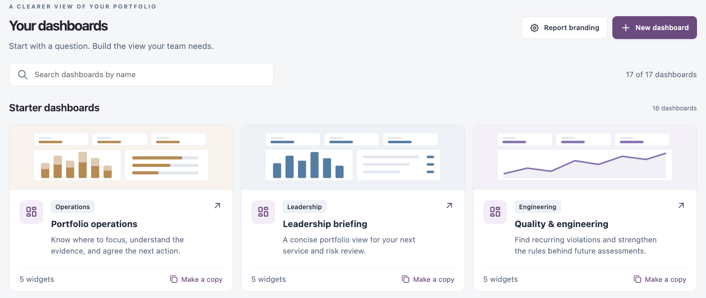
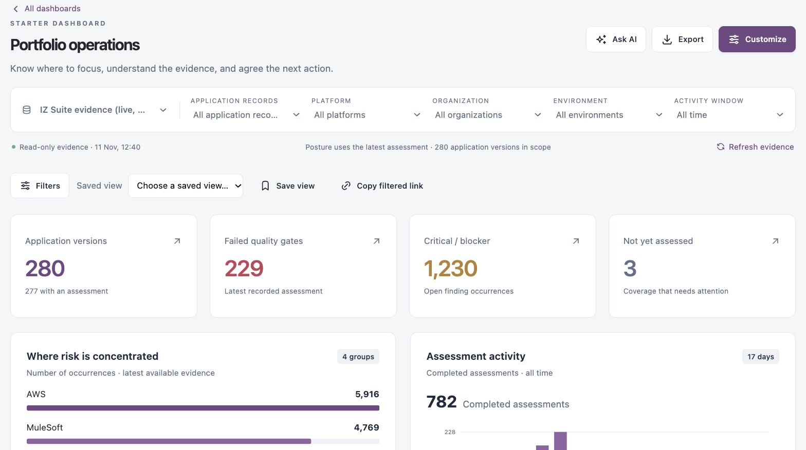
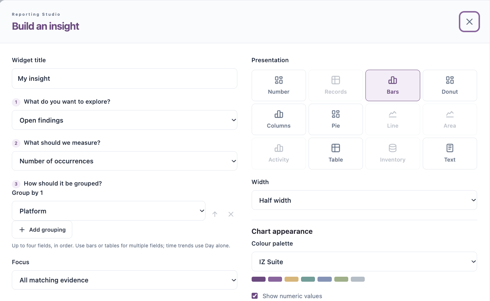

# Your Dashboards

**Your dashboards** is the dashboard library. Start from a ready-made starter dashboard, make a copy, or build a dashboard for your team from scratch.

Open it from **Dashboards** → **Your dashboards** in the sidebar.

<figure><figcaption></figcaption></figure>

## Dashboard Library

| Control                       | What it does                                                                             |
| ----------------------------- | ---------------------------------------------------------------------------------------- |
| **Search dashboards by name** | Filters the cards. The count shows how many dashboards match.                            |
| **Report branding**           | Sets the name, colour, logo and footer of generated PDFs. See **Report Branding** below. |
| **New dashboard**             | Creates a dashboard. See **Create a Dashboard** below.                                   |
| Dashboard card                | Opens the dashboard. The card shows its category, description and number of widgets.     |
| **Make a copy**               | Starts a new draft from that dashboard.                                                  |
| **Create a dashboard**        | The last card, **Start fresh or describe what you need**: same as **New dashboard**.     |

**Starter dashboards** come with IZ Suite and cannot be changed:

| Dashboard                   | Category                              | What it shows                                                                                                                      |
| --------------------------- | ------------------------------------- | ---------------------------------------------------------------------------------------------------------------------------------- |
| **Portfolio operations**    | Operations                            | Where to focus, the evidence behind it, and the next action.                                                                       |
| **Leadership briefing**     | Leadership                            | A concise portfolio view for your next service and risk review.                                                                    |
| **Quality & engineering**   | Engineering                           | Recurring violations, to strengthen the rules behind future assessments.                                                           |
| **Mule runtime & capacity** | MuleSoft operations                   | Java and Mule runtime versions, worker allocation and vCores across business groups and environments.                              |
| **Change Assurance**        | Change governance                     | Gate outcomes, human approvals and assessment readiness for changes in the selected activity window.                               |
| **Compliance & risk**       | Compliance                            | Mapped checks, current evidence coverage and treatment decisions.                                                                  |
| **Service status**          | Service operations                    | Latest monitor results and where coverage is assigned.                                                                             |
| **Customer trust overview** | Sales & account executives            | Evidence to share in customer conversations: security standards, compliance results, service objectives and incidents.             |
| **Account health review**   | Account executives & customer success | A quarterly view of the estate a customer relies on: posture, assessment cadence, failing gates and service stability.             |
| **Product quality story**   | Marketing                             | How quality is improving over time, for release notes and campaigns: fixed versus new issues, assessment cadence and gate results. |
| **Team weekly review**      | Team leads                            | This week for the team: failing gates, new and fixed issues, critical findings and IDE activity per developer.                     |
| **Developer feedback loop** | Developers                            | What the IDE extension and assessments find in your code: scans, issues by project and the most widespread rules.                  |
| **Developer productivity**  | Engineering managers                  | Developers with an IDE licence, the projects they scanned this week, and how issues are progressing.                               |
| **Security posture**        | Security leads                        | Where security risk sits: findings by standard and category, critical findings by platform and application, IDE vulnerabilities.   |
| **Service reliability**     | SRE & operations                      | Incidents, downtime and objectives across monitored services.                                                                      |
| **Compliance readiness**    | Compliance officers                   | Passing, failing and unassessed mapped checks per standard, and the decisions behind them.                                         |

**Custom dashboards** are the ones you and your colleagues created. Each card is tagged **Private** (only you) or **Shared** (everyone in the workspace can view it).

## Open a Dashboard

<figure><figcaption></figcaption></figure>

The heading shows whether it is a **STARTER DASHBOARD**, **YOUR DASHBOARD** or a **SHARED DASHBOARD**. Click **All dashboards** to return to the library.

| Control                     | What it does                                                                                                                                                       |
| --------------------------- | ------------------------------------------------------------------------------------------------------------------------------------------------------------------ |
| Scope bar                   | Evidence source, application records, platform, organization, environment and activity window. See [Dashboards](./).                                               |
| **Refresh evidence**        | Reads the evidence again.                                                                                                                                          |
| **Filters**                 | Opens **Filter the evidence** to add conditions on a field, including the attributes recorded on applications: **Is any of**, **Is none of** or **Contains text**. |
| **Saved view**              | Applies a filtered view saved on this dashboard.                                                                                                                   |
| **Save view**               | Saves the current filters as a named view. The dashboard itself must be saved first.                                                                               |
| **Copy filtered link**      | Copies a link to the dashboard with the current filters.                                                                                                           |
| **Ask AI**                  | Asks AI for a brief on the dashboard. Shown when AI is available and your role can run AI tasks.                                                                   |
| **Export**                  | Generates a PDF. See **Export a PDF** below.                                                                                                                       |
| **Customize**               | Edits the dashboard. On a starter dashboard, this starts your own copy.                                                                                            |
| **Make a copy**             | On a dashboard shared by someone else: starts your own copy.                                                                                                       |
| Delete                      | Deletes your own dashboard.                                                                                                                                        |
| **Schedule this dashboard** | At the bottom of the dashboard: opens a new schedule for it. See [Scheduled Reports](scheduled-reports.md).                                                        |

Click a number, bar or row in any widget to open the records behind it.

## Create a Dashboard

1. Click **New dashboard**.
2. Enter the **Dashboard name** (up to 120 characters). **Required.**
3. In **Start from**, choose **A blank canvas**, a starter dashboard to copy its widgets, or **An exported dashboard file** (see **Move a Dashboard to Another Workspace** below).
4. Select **Share with everyone in this workspace (view only)** to share it, or leave it clear to keep it private.
5. Click **Create draft**.
6. Add and arrange widgets, as described in **Customize a Dashboard** below.
7. Click **Save dashboard**.


You need a role that can create dashboards. A draft is not saved until you click **Save dashboard**; if you leave with unsaved changes, IZ Suite asks **Discard unsaved changes?** Click **Keep editing** to go back.


## Customize a Dashboard

1. Open the dashboard and click **Customize**.
2. Change the name if needed, and select or clear **Share with everyone in this workspace (view only)**.
3. Click **Add widget** (or the **Add a widget** tile) to open **What would you like to see?**. Search the ready-made widgets and click one to add it, or click **Build your own** to define one (see **Build Your Own Widget** below).
4. Rearrange the widgets: drag them, or use the move up and move down arrows. Use the gear to edit a widget and the bin to remove it.
5. Optionally, click **Report layout** to set the PDF layout, or **Suggest a layout** to have AI propose widgets.
6. Click **Save dashboard**, or **Cancel** to drop the changes.

### Report Layout

These settings are saved with the dashboard and apply to manual and scheduled PDFs.

| Field                                  | Description                                                                   |
| -------------------------------------- | ----------------------------------------------------------------------------- |
| **Add a branded cover page**           | Starts the PDF with a cover page in your report branding.                     |
| **Report subtitle**                    | Up to 300 characters, for example `Monthly engineering review`.               |
| **Prepared for**                       | Up to 150 characters, for example `Engineering leadership`.                   |
| **Add an automatic table of contents** | Adds a contents page that follows the widget order and links to each section. |

Click **Apply to dashboard**, then save the dashboard.

## Build Your Own Widget

**Build your own** (in **What would you like to see?** while customizing) opens **Build an insight**, where you ask your evidence a question and choose how to show the answer.

1. Enter a **Widget title**.
2. In **1 What do you want to explore?**, choose the evidence.
3. In **2 What should we measure?**, choose the measure. The list depends on what you explore.
4. In **3 How should it be grouped?**, choose **Group by 1**. Click **Add grouping** to add more fields.
5. In **Focus**, narrow the evidence if needed.
6. Under **Presentation**, choose how to show the result, and choose its **Width**.
7. Check the **Live preview**.
8. Click **Apply to dashboard**, then save the dashboard.

<figure><figcaption></figcaption></figure>

### What You Can Explore

You can explore **Application versions**, **Open findings**, **Assessment history**, **Published AI reviews**, **Recorded scan metrics**, **Application list metrics**, **Change Assurance records**, **Compliance mapped checks**, **Monitor status records**, **Security standard findings**, **Scan progression** (new and fixed issues per assessment), **Service incidents**, **Service objectives**, **IDE developer scans** and **IDE licences**.

Some evidence needs a licence or permission: AI reviews need a role that can view or run AI tasks, Change Assurance records need the Change Assurance licence and a role that can view changes or evidence, compliance checks need a role that can view compliance standards, and monitor records need a role that can view monitors. Evidence you cannot read is left out, and the evidence notes under the dashboard say so.

Measures include, for example, **Number of occurrences**, **Critical / blocker occurrences**, **Affected application versions**, **Number of application versions** and **Failed quality gates**.

### Grouping and Focus

You can group by up to four fields, in order (for example **Severity**, **Rule category**, **Platform**, **Organization**, **Environment**, **Asset type** or **Rule**). Use bars or tables for more than one field. Time trends use **Day** on its own.

**Focus** narrows the evidence: **All matching evidence**, **Mule runtime applications only**, **Critical / blocker only** or **Applications with failed gates**.

### Presentation

| Field                         | Description                                                                                                                                                                                            |
| ----------------------------- | ------------------------------------------------------------------------------------------------------------------------------------------------------------------------------------------------------ |
| **Presentation**              | **Number**, **Records**, **Bars**, **Donut**, **Columns**, **Pie**, **Line**, **Area**, **Activity**, **Table**, **Inventory** or **Text**. Choices that do not fit the current grouping are disabled. |
| **Width**                     | **Half width** or **Full width** on the dashboard.                                                                                                                                                     |
| **Colour palette**            | **IZ Suite**, **Ocean**, **Forest** or **High contrast**.                                                                                                                                              |
| **Show numeric values**       | Shows the values on the chart.                                                                                                                                                                         |
| **Category labels & colours** | Renames a category or changes its colour. Labels change presentation only; the original evidence and drill-through stay linked.                                                                        |
| **Reset chart styling**       | Returns the chart to its default style.                                                                                                                                                                |

A **Text** widget holds your own narrative, for example a summary for the report. It is saved with the dashboard and appears in every PDF, so review it when the evidence changes. Select **Start this section on a new PDF page** to begin a new page with it.

The dashboard's filters apply to the widget automatically, and clicking it opens the application versions and findings behind it.

## Export a PDF

1. Open the dashboard and set the scope and filters you want in the report.
2. Click **Export**.
3. Check **Included**: the widgets, source labels, scope and evidence notes that go into the PDF, and the row limits for tables.
4. Click **Generate PDF**, or **Schedule instead** to set up a schedule.

**Export configuration** in the same drawer downloads the dashboard's design as a file instead of a PDF. See **Move a Dashboard to Another Workspace** below.

The PDF is generated in the background with the current filters and evidence timestamp; the saved dashboard does not change. Follow its progress and download it in [Report History](report-history.md).

## Move a Dashboard to Another Workspace

You can copy a dashboard's design to another IZ Suite workspace as a file. The file holds the dashboard's name, description, widgets and report layout. It does not hold filters, sharing, owner or any evidence.

1. Open the dashboard, click **Export**, then **Export configuration**. A `.dashboard.json` file is downloaded.
2. In the other workspace, open **Your dashboards** and click **New dashboard**.
3. In **Start from**, choose **An exported dashboard file**, then select the file in **Dashboard file**.
4. Check the **Dashboard name** and sharing, then click **Create draft**.
5. Set that workspace's filters on the draft, then click **Save dashboard**.


A file exported from a newer version of IZ Suite cannot be imported until this workspace is updated to that version.


## Ask AI for a Brief

1. Open the dashboard and click **Ask AI**.
2. Type **Your question**, or choose a suggested one.
3. Click **Generate answer**.
4. Review the answer, marked **AI-generated · review before use**, and click **Add brief to this view** to show it above the widgets.

The brief cites the applications it used; click one to open its records. **Remove brief from this view** hides it again.


An AI brief is AI-assisted and needs human review before you share it. It uses your workspace AI model and budget.


## Report Branding

Report branding sets the defaults for newly generated PDFs in this reporting workspace.

| Field                         | Description                                             |
| ----------------------------- | ------------------------------------------------------- |
| **Organization / brand name** | The name generated reports carry.                       |
| **Report accent colour**      | The accent colour of generated reports.                 |
| **Logo**                      | A PNG, JPEG or WebP image up to 5 MB, embedded in PDFs. |
| **Footer / classification**   | Text for the footer, for example `Confidential`.        |

Click **Save branding**. New exports and scheduled reports use it.


You need a role that can edit global settings to change report branding.


## Next Steps

* [Scheduled Reports](scheduled-reports.md): generate a dashboard PDF once or on a recurring schedule.
* [Report History](report-history.md): download your PDFs.
* [Dashboards](./): back to the overview.
