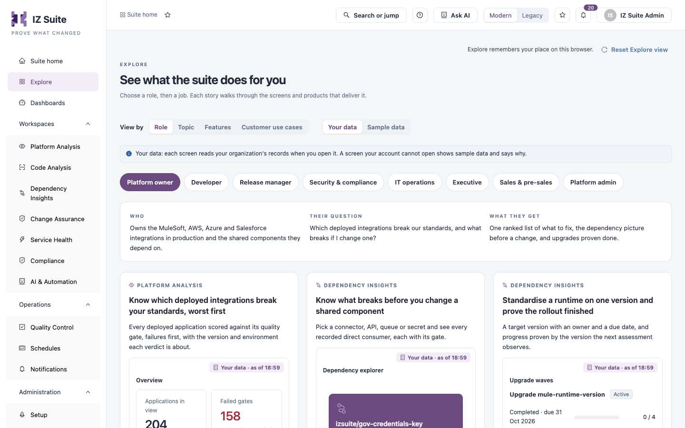
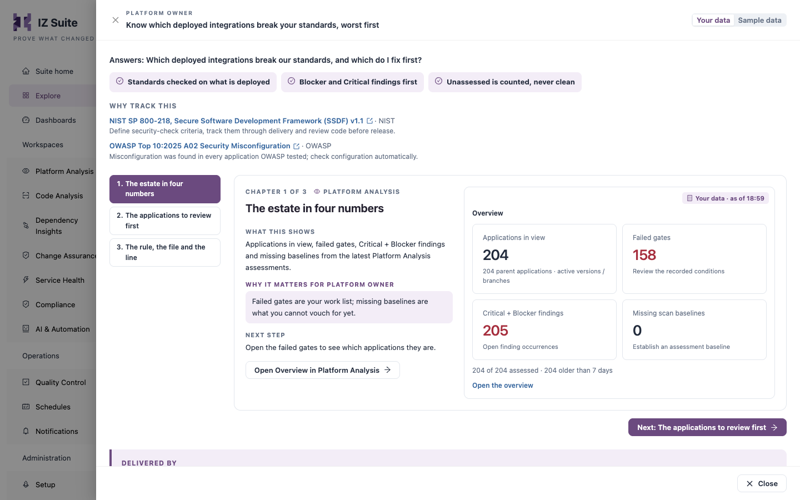
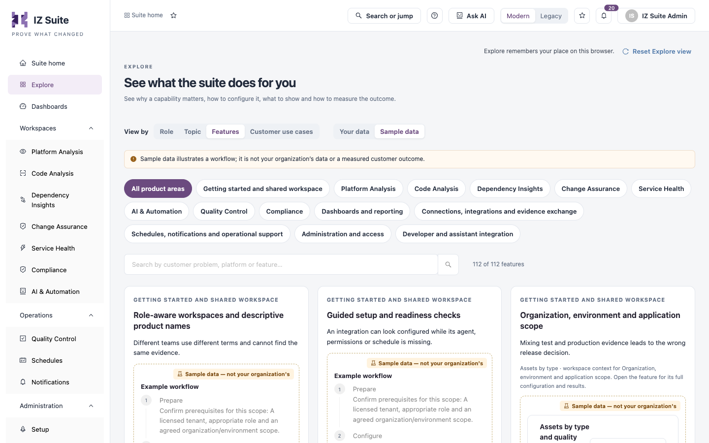

# Explore

Explore shows what the suite does for you. Choose a role or a topic, then a job: each story walks through the screens and products that deliver it. You can also browse every feature and follow complete customer use cases. Use it to learn the product, to plan a rollout or to show IZ Suite to someone else.

Open it from **Explore** in the sidebar.

<figure><figcaption>
Explore, viewed by role
</figcaption></figure>

## Choose How to Browse

| Control                         | What it does                                                                                           |
| ------------------------------- | ------------------------------------------------------------------------------------------------------ |
| **View by**                     | **Role**, **Topic**, **Features** or **Customer use cases**.                                           |
| **Your data** / **Sample data** | Chooses what the previews show. See [Your Data and Sample Data](explore.md#your-data-and-sample-data). |
| **Reset Explore view**          | Returns Explore to its starting view: by role, on sample data.                                         |

Explore remembers your place in this browser, and the page address keeps your choices, so you can share a link to a story.

## Your Data and Sample Data

| Option          | What the previews show                                                                                                                                                                                                                       |
| --------------- | -------------------------------------------------------------------------------------------------------------------------------------------------------------------------------------------------------------------------------------------- |
| **Your data**   | Each screen reads your organization's records when you open it, with the time it was read (for example **Your data · as of 18:50**). A screen your account cannot open shows sample data and says why. Missing evidence is shown as missing. |
| **Sample data** | A fictional company, Northwind Retail. It shows how each story works; none of it is your organization's data or a measured customer outcome. Previews are marked **Sample data — not your organization's**.                                  |

Explore starts on **Your data** when you can open at least one workspace, and on **Sample data** otherwise. The **Sales & pre-sales** role always starts on sample data. You can switch at any time, also inside a story.

## View by Role

Choose a role. A brief shows **WHO** the role is, **THEIR QUESTION** and **WHAT THEY GET**, followed by a card for each job that role does.

| Role                      | Their question                                                                    |
| ------------------------- | --------------------------------------------------------------------------------- |
| **Platform owner**        | Which deployed integrations break our standards, and what breaks if I change one? |
| **Developer**             | What did my change introduce, and what is mine to fix next?                       |
| **Release manager**       | Is this release ready, and is every change in it backed by evidence and approval? |
| **Security & compliance** | Where are we exposed, and can we prove our change controls actually ran?          |
| **IT operations**         | Is anything down, would we know, and how fast do we recover?                      |
| **Executive**             | Is delivery getting faster and safer, and where is the risk concentrated?         |
| **Sales & pre-sales**     | How do I show the value in five minutes, safely?                                  |
| **Platform admin**        | Is collection healthy, is access least-privilege, and what runs out next?         |

**Sales & pre-sales** covers people who show the suite to prospects, on sample data or on the prospect's own estate once it is connected.

Each story card shows:

* The product that delivers the job (for example **PLATFORM ANALYSIS**), the job's title and what it gives you.
* A live preview of the screen that does the work, with a link to open that screen or record.
* **Delivered by**: the products involved, in order (for example **Dependency Insights**, then **Change Assurance**).
* **See how it works**: opens the story.

## View by Topic

Choose a topic: **Security**, **Compliance & audit**, **Change & release**, **Reliability & service health**, **Code quality**, **Dependencies & lifecycle**, **Delivery performance** or **Setup & administration**. A brief shows **The question**, **What the suite gives** and **Who asks it**. The cards are the same as in the role view, and each card also lists the roles that ask for it.

## Follow a Story

<figure><figcaption>
A story, chapter by chapter
</figcaption></figure>

1. Click **See how it works** on a card.
2. Read the question the story answers and, under **Why track this**, the published references behind it (they open in a new tab).
3. Click a chapter in the list on the left, or use **Next** and **Previous**. The left and right arrow keys also move between chapters.
4. In each chapter, read **What this shows**, **Why it matters** for the role, and **Next step**, next to a preview of the screen.
5. Click **Open … in …** (for example **Open Overview in Platform Analysis**) to go to that screen. The button is disabled, with the reason, when your account cannot open it.
6. Click **Close** to return to the cards.

**Delivered by**, at the end of the story, lists each screen used and the product it belongs to.

## View by Features

The feature library lists every capability of the suite.

<figure><figcaption>
The feature library
</figcaption></figure>

1. Choose a product area, or **All product areas**.
2. Type in **Search by customer problem, platform or feature…** to narrow the list. The count beside it shows how many features match.
3. On a feature card, read the problem it solves, the example workflow and the value it brings.
4. Click **Set up** to open the setup guide for the feature in the help drawer, or **See how it works** to open the feature.

The feature drawer has four chapters:

| Chapter               | Contents                                                                                                                                                                                                  |
| --------------------- | --------------------------------------------------------------------------------------------------------------------------------------------------------------------------------------------------------- |
| **Why and how**       | What the feature does and how it helps.                                                                                                                                                                   |
| **Walkthrough**       | Actions in order: **Prepare**, **Open the workspace**, **Try the workflow**, **Verify the evidence**, **Measure progress**, each with what proves it worked. Use **Previous action** and **Next action**. |
| **Set up and verify** | The setup steps, with checks against your organization's setup when you view your data.                                                                                                                   |
| **Measure value**     | The measures (KPIs) that show the feature's value, with the evidence needed, the owner and how to read them.                                                                                              |

**Guide me through setup** and **Ask AI about this feature** are available from the drawer. Use the pager at the bottom of the list to change page or page size.

## View by Customer Use Cases

Customer use cases follow practical workflows across teams and platforms.

1. Optionally, type in the search box to narrow the list.
2. Click **See how it works** on a use case.
3. Read **The estate · illustrative**, **Why this is difficult** and **A useful outcome**.
4. Go through the steps. Each step names its owner, **What to do**, **What proves it worked** and the **Features used**, with a preview. **Guide me through setup** opens the setup guide for the step's feature.
5. Open **Measure value · KPIs and evidence** and **Limits and process responsibilities** for the measures and the limits of the workflow.
6. Click **Adapt this use case with AI** to ask Ask AI to fit the use case to your estate.

## Next steps

* [Suite Home](suite-home.md): see the platform reports for your estate.
* Navigating IZ Suite: page help and Ask AI on every page.
* About IZ Suite: how the workspaces fit together.
