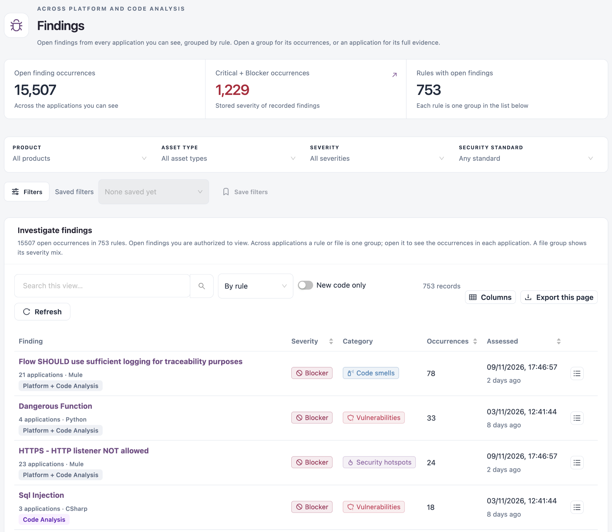

# Findings

**Findings** lists the open findings from the latest assessment of every application you can see, across Platform Analysis and Code Analysis, in one list grouped by rule. Use it to see which rules cause the most findings anywhere in your estate, then open a group for its occurrences or an application for its full evidence.

Open it from **Findings** in the sidebar, below **Dashboards**.


Requires the **Platform Analysis** or **Code Analysis** licence. The list shows the findings of the applications your roles let you see in each of them.


<figure><figcaption></figcaption></figure>

## Filters

| Filter                       | Description                                                                                                                                  |
| ---------------------------- | -------------------------------------------------------------------------------------------------------------------------------------------- |
| **Product**                  | **All products**, **Platform Analysis** or **Code Analysis**. Shown when you can see both.                                                   |
| **Asset type**               | The asset types of the chosen product that you can see.                                                                                      |
| **Severity**                 | **All severities**, **Critical + Blocker**, or one severity.                                                                                 |
| **Security standard**        | Findings mapped to a standard (CWE, OWASP, AWS Foundational Security Best Practices); once you choose one, you can also choose its category. |
| **Filters** → **Issue type** | Findings of one type, such as vulnerabilities, bugs or code smells. Choose it, then click **Apply filters**.                                 |

A finding must match every filter you set. Every filter is kept in the page address, so you can share the link or save the set with **Save filters** and choose it later from **Saved filters**.

## Tiles

| Tile                               | Description                                                                                                              |
| ---------------------------------- | ------------------------------------------------------------------------------------------------------------------------ |
| **Open finding occurrences**       | Every open occurrence that matches the filters, except severity. When a severity is set, click it to clear the severity. |
| **Critical + Blocker occurrences** | The Critical and Blocker occurrences. Click it to show only those in the list.                                           |
| **Rules with open findings**       | The number of rules with open findings: each rule is one group in the list.                                              |

## Open Findings

Use the list above the table to group findings **By rule** (the default), **By file**, or as single **Occurrences**. Turn on **New code only** to keep only the findings a change introduced: for a pull request, findings not open on its target branch; for a branch, findings new since its previous assessment.

The list has the same columns, grouping and finding detail as the [Platform Analysis Findings](workspaces/platform-analysis/findings.md) tab. Each row is tagged with its product. Opening an application takes you to its dossier in the workspace it belongs to.


**Time to fix** and **Exceptions** are kept per product. Use the **Findings** tab of [Platform Analysis](workspaces/platform-analysis/findings.md) or [Code Analysis](workspaces/code-analysis/findings.md) for them.


## Next Steps

* [Platform Analysis Findings](workspaces/platform-analysis/findings.md): effort estimates and the exceptions register for deployed applications.
* [Code Analysis Findings](workspaces/code-analysis/findings.md): findings of branches and pull requests.
* [Quality Gates](operations/quality-control/quality-gates.md): decide which findings fail an assessment.
