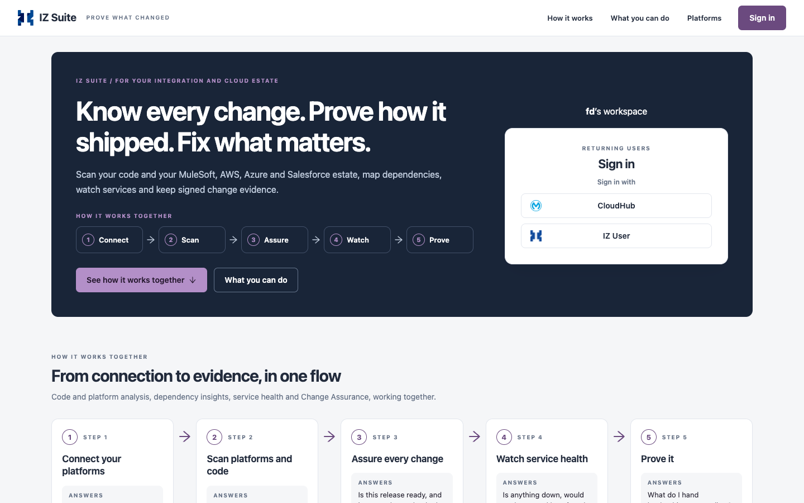

# Getting Started

Start here if you are new to the modern IZ Suite interface. These pages show how to sign in and how to move around the suite.

<figure><figcaption>
The landing page, where you sign in
</figcaption></figure>

| Page                                          | What it covers                                                                                                                      |
| --------------------------------------------- | ----------------------------------------------------------------------------------------------------------------------------------- |
| [Sign In](sign-in.md)                         | The landing page, the sign-in options, two-factor authentication, resetting a forgotten password and signing out.                   |
| [Navigating IZ Suite](navigating-iz-suite.md) | The sidebar, the breadcrumb, favourites, search, page help, Ask AI, the Modern / Legacy switch, notifications and the account menu. |

After you sign in, IZ Suite opens Suite Home, or the home page you chose in My Preferences.

## Next steps

* [Sign In](sign-in.md): open IZ Suite with your account.
* [Navigating IZ Suite](navigating-iz-suite.md): learn the sidebar and the top bar.
* About IZ Suite: see how the workspaces fit together.
