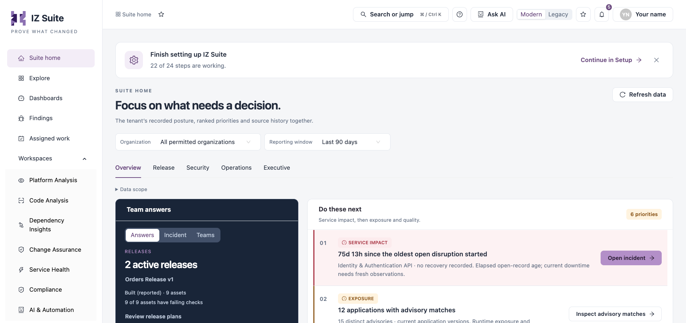
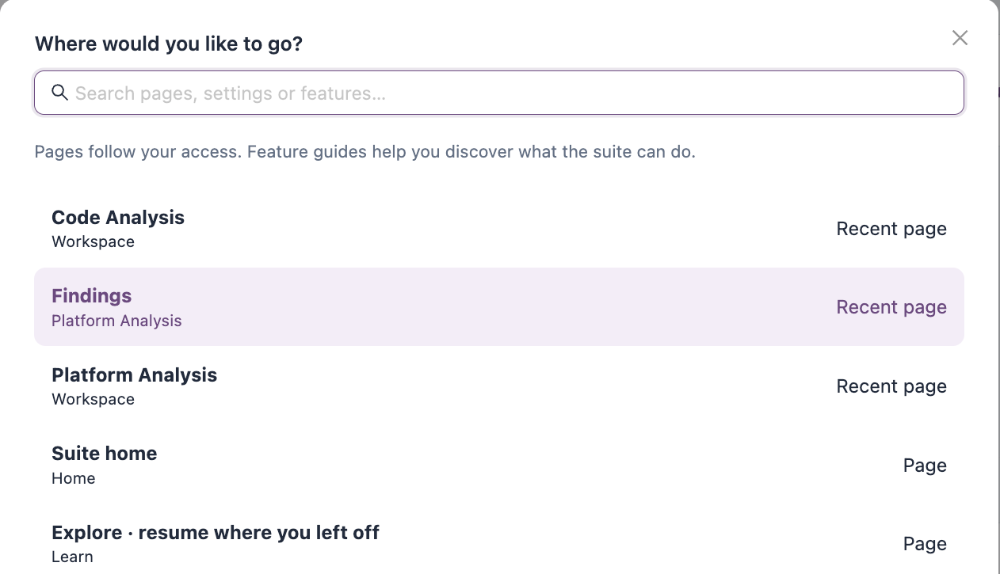
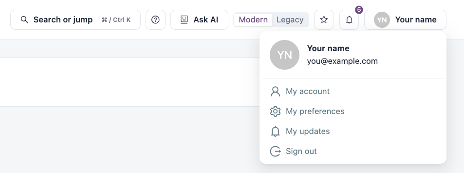

# Navigating IZ Suite

Every modern page shares the same frame: the sidebar on the left and the top bar above the page. This page describes both.

<figure><figcaption>
The sidebar, breadcrumb and top bar
</figcaption></figure>

## Sidebar

The sidebar lists only what your licences and roles allow.

| Entry or group     | Contents                                                                                                                                                                               |
| ------------------ | -------------------------------------------------------------------------------------------------------------------------------------------------------------------------------------- |
| **Suite home**     | Platform reports and what to act on next. See [Suite Home](../suite-home.md).                                                                                                          |
| **Explore**        | What each part of the suite does, by role, topic, feature or customer use case. See [Explore](../explore.md).                                                                          |
| **Dashboards**     | Your dashboards, queries, scheduled reports and report history. See [Dashboards](../dashboards/).                                                                                      |
| **Findings**       | Open findings across Platform Analysis and Code Analysis. See [Findings](../findings.md).                                                                                              |
| **Assigned work**  | Upgrade, maintenance and review work assigned to people, and your remediation tasks. See [Assigned Work](../assigned-work.md).                                                         |
| **Workspaces**     | **Platform Analysis**, **Code Analysis**, **Dependency Insights**, **Change Assurance**, **Service Health**, **Compliance** and **AI & Automation**. See [Workspaces](../workspaces/). |
| **Operations**     | **Quality Control**, **Schedules** and **Notifications**. See [Operations](../operations/).                                                                                            |
| **Administration** | **Setup**, **Organizations**, **System Activity**, **Global Settings** and **My Account**. See [Administration](../administration/).                                                   |

Click a group name to expand or collapse it. When you open a workspace or area, its own sections appear at the bottom of the sidebar under its name (for example **Your dashboards**, **Query**, **Scheduled reports** and **Report history** under **Dashboards**). The section you are on is highlighted.

Click the **IZ Suite** logo, or **Explore IZ Suite** at the bottom of the sidebar, to go back to Suite home.

## Breadcrumb and Favourites

The breadcrumb at the top left shows where you are, for example **Suite home** / **Dashboards** / **Report history**. Click any part of it to go back to that level.

The star next to the breadcrumb adds the current page to your favourites. A favourite keeps the page's filters, so you can save a filtered view and come back to it.

To add a favourite:

1. Open the page, and set any filters you want to keep.
2. Click the star next to the breadcrumb.
3. In **Add to favourites**, check or change the **Favourite name** (up to 80 characters).
4. Click **Add favourite**.

To remove a page from your favourites, click its filled star. You can keep up to 20 favourites.

To open a favourite, click the star button in the top bar (**Favourites** with the number you have). The **Favourites** drawer lists them all; the one you use as your home page is tagged **Home page**. Click **Rename, reorder or remove favourites** to manage them in [My Preferences](../administration/my-account/my-preferences.md).

## Top Bar

| Control                                            | What it does                                                                                            |
| -------------------------------------------------- | ------------------------------------------------------------------------------------------------------- |
| **Search or jump** (⌘ K on Mac, Ctrl K on Windows) | Opens **Where would you like to go?** to find a page, setting or feature guide.                         |
| **?** (page help)                                  | Opens **Help with this page**: what the page helps you do, why it matters and how to measure its value. |
| **Ask AI**                                         | Opens **Ask AI about IZ Suite** to ask how to use the product.                                          |
| **Modern** / **Legacy**                            | Switches between the modern interface and the classic one.                                              |
| Star (**Favourites**)                              | Opens the **Favourites** drawer.                                                                        |
| Bell (**Notifications**)                           | Opens your recent notifications. The badge shows how many are unread.                                   |
| Your name                                          | Opens the account menu.                                                                                 |

### Search or Jump

<figure><figcaption>
Search or jump to a page
</figcaption></figure>

1. Click **Search or jump**, or press ⌘ K (Mac) or Ctrl K (Windows).
2. Type part of a page name, task or customer problem in **Search pages, settings or features…**.
3. Use the up and down arrow keys to choose a result, and press Enter to open it. Press Escape to close.

Before you type, the list shows your recent pages first. Results are labelled **Page**, **Recent page** or **Feature guide**. Pages follow your access: you only see pages you can open.

### Page Help

Click **?** in the top bar to open **Help with this page**. For each feature on the page you see what it does, its customer value and the measures that show its value. From there you can:

* Click **Walk through this feature** for a step-by-step walkthrough.
* Click **Guide me through setup** to follow the setup steps. While a setup guide is in progress, a bar at the bottom of the screen offers **Resume guide** and **Dismiss**.
* Choose another guide in **Browse another feature…**.
* Click **Explore all features and use cases** to open the feature library in [Explore](../explore.md).

### Ask AI

**Ask AI** answers questions about features, configuration, customer use cases and proving value. Answers come from the product guide; Ask AI does not read your live records or make changes.

1. Click **Ask AI**.
2. Type your question under **What would you like to do?** (up to 3,000 characters), or pick one of the suggested questions.
3. Click **Ask AI**.

Each answer is tagged **AI guidance**, and **Supporting guides** lists the guides it used, with links. Click **Clear conversation** to start again.


Ask AI uses your workspace AI model and budget. Do not include credentials or personal customer data in your questions. If no AI model is available, the answer is tagged **AI unavailable**.


### Modern and Legacy

Click **Legacy** to open the classic interface, and **Modern** to come back. IZ Suite remembers your choice for your account in this browser. The classic interface is described in [IZ Suite (Legacy)](https://knowledgebase.autorabit.com/product-guides/integral-zone/iz-suite-legacy).

### Notifications

Click the bell to open the **Notifications** drawer.

| Control                  | What it does                                                                                                          |
| ------------------------ | --------------------------------------------------------------------------------------------------------------------- |
| **Unread** / **All**     | Shows only unread notifications, or all of them.                                                                      |
| Type                     | **All types**, **Errors**, **Warnings** or **Info**.                                                                  |
| **Mark all read**        | Marks every unread notification as read.                                                                              |
| **Mark read**            | Marks one notification as read.                                                                                       |
| Notification title       | Opens the record the notification is about, or expands its details.                                                   |
| **Open My updates**      | Opens [My Updates](../operations/notifications/my-updates.md).                                                        |
| **Manage subscriptions** | Opens [My Subscriptions](../operations/notifications/my-subscriptions.md).                                            |
| **Delivery log**         | Opens the [Delivery Log](../operations/notifications/delivery-log.md). Shown when your role can view global settings. |

### Account Menu

<figure><figcaption>
The account menu
</figcaption></figure>

Click your name in the top bar. The menu shows your picture, name and email, and these entries:

| Entry              | Opens                                                                                                                          |
| ------------------ | ------------------------------------------------------------------------------------------------------------------------------ |
| **My account**     | [My Account](../administration/my-account/): your profile, security credentials, IDE projects and activity.                    |
| **My preferences** | [My Preferences](../administration/my-account/my-preferences.md): picture, availability, home page, favourites and appearance. |
| **My updates**     | [My Updates](../operations/notifications/my-updates.md).                                                                       |
| **Sign out**       | Ends your session.                                                                                                             |

## Licence Messages

When the workspace licence is about to expire, has expired, or a licensed allowance reaches 90%, a banner at the top of the page says so. Click **View license details** if you can see them; otherwise contact your administrator.

## Next Steps

* [Suite Home](../suite-home.md): read the platform reports.
* [Explore](../explore.md): see what each part of the suite does for your role.
* [My Preferences](../administration/my-account/my-preferences.md): set your home page and manage favourites.
* [Getting Started](./): back to the overview.
