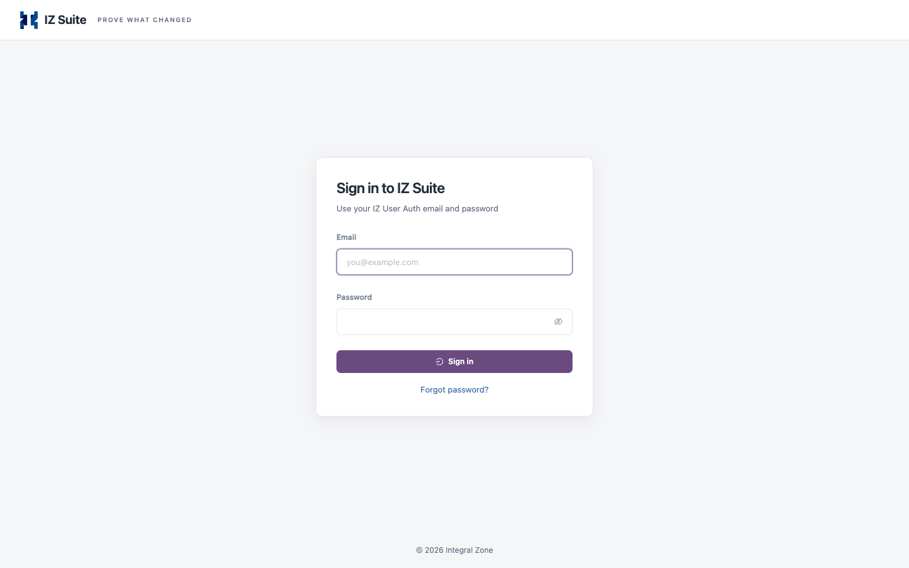
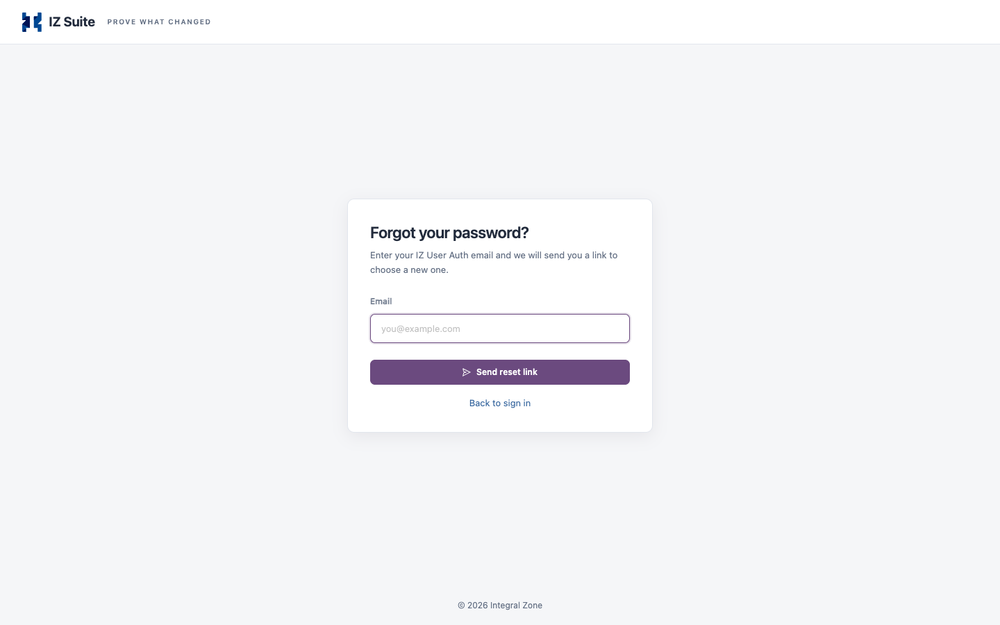

# Sign In

IZ Suite opens on its landing page. The landing page explains the suite and holds the **Sign in** panel for returning users.

## The Landing Page

The landing page has a menu with **How it works**, **What you can do**, **Platforms** and **Sign in**. Below it you find:

* The five steps **Connect**, **Scan**, **Assure**, **Watch** and **Prove**, with **See how it works together** and **What you can do**. See About IZ Suite.
* **Platforms covered**: what the suite collects from and scans on each platform, where Change Assurance reads change from, where Code Analysis runs and the AI tools it works with.
* **The big asks**: six outcomes, the roles that ask for them and the products behind each.

In a multi-tenant installation, the sign-in panel names the workspace (tenant) you are signing in to. When the tenant comes from the address rather than the host name, **Use a different tenant** takes you back to the general sign-in page.

## Sign In

The **Sign in with** list shows the sign-in options your administrator enabled. Possible options are **IZ User** (email and password) and single sign-on through Anypoint, Google or Azure. Your administrator can rename each option, so the button labels can differ from these names.

<figure><figcaption>
The IZ User sign-in form
</figcaption></figure>

To sign in with your email and password:

1. Open the IZ Suite address your administrator gave you.
2. Under **Sign in with**, click **IZ User**.
3. Enter your **Email** and **Password**.
4. Click **Sign in**.

To sign in with single sign-on, click your organization's option under **Sign in with** and complete the sign-in at your identity provider.

IZ Suite then opens the page you were trying to reach. Otherwise it opens the home page you chose in My Preferences, or Suite Home.


After several wrong passwords in a row the account is locked for a while, even with the right password. Your administrator sets both limits. See [Sign-in and MFA](https://knowledgebase.autorabit.com/product-guides/integral-zone/iz-suite-legacy/iz-core/sign-in-and-mfa) for the defaults.


### Two-Factor Authentication

When your administrator has switched on multi-factor authentication, IZ Suite asks for a code after your email and password. It applies to **IZ User** sign-in; single sign-on uses your identity provider's own checks.

The first time, IZ Suite shows **Set up your authenticator**:

1. Scan the QR code with Google Authenticator, Microsoft Authenticator, 1Password or any TOTP app.
2. Enter the **6-digit code** the app shows and click **Verify**.
3. On **Save your recovery codes**, copy the codes to a safe place.
4. Click **I have saved them, continue**.


Recovery codes are shown only once. Each code signs you in once if you lose your authenticator. Store them as you would a password.


On later sign-ins, **Two-factor authentication** asks for the **6-digit code** from your app. If you lost your authenticator, click **Lost your authenticator? Use a recovery code** and enter a **Recovery code**.

### When the Licence Has Expired

If the workspace licence has expired or was never applied, the sign-in panel shows **This workspace needs a license** instead of the sign-in options. An administrator with the licence key can click **Apply license key**.

## Reset a Forgotten Password

This applies to **IZ User** sign-in only.

<figure><figcaption>
Forgot your password?
</figcaption></figure>

1. On the IZ User sign-in form, click **Forgot password?**.
2. Enter your **Email** and click **Send reset link**.
3. Open the link in the email you receive.
4. On **Choose a new password**, enter the **New password** and **Confirm password**.
5. Click **Reset password**.
6. Sign in with the new password.

| Rule       | Value                                                               |
| ---------- | ------------------------------------------------------------------- |
| Password   | At least 12 characters, including a number and a special character. |
| Reset link | Valid for 30 minutes, and can be used once.                         |

For privacy, the page always says that a link is on its way, whether or not an account exists for that email. Click **Back to sign in** to return to the sign-in form.

## Sign Out

1. In the top bar, click your name to open the account menu.
2. Click **Sign out**.

## Next steps

* [Navigating IZ Suite](navigating-iz-suite.md): find your way around after you sign in.
* My Preferences: choose the page IZ Suite opens after you sign in.
* [Getting Started](./): back to the overview.
