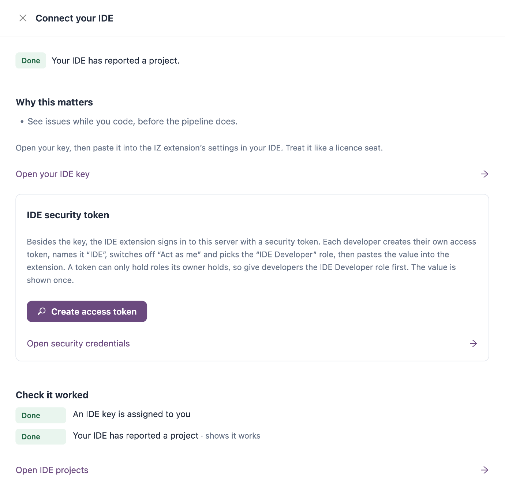
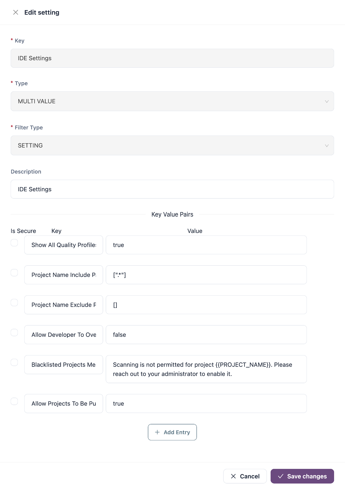

# IDE Extensions

The IZ IDE extensions analyze your project inside your editor, with the same quality rules and quality profiles your workspace uses in IZ Suite. You see issues as you work, before a pipeline or a scheduled assessment finds them, and you can fix many of them with one click.

Two IDEs are supported:

| IDE                    | What it analyzes                                                                                                                                                          | Page                                                |
| ---------------------- | ------------------------------------------------------------------------------------------------------------------------------------------------------------------------- | --------------------------------------------------- |
| **Visual Studio Code** | Mule, API (RAML and OAS), Kubernetes, Azure Logic Apps, Azure API Management, Azure Function Apps, C#, Python, PySpark, Java, AWS Lambda and AWS CloudFormation projects. | [VS Code Extension](vs-code-extension.md)           |
| **Anypoint Studio**    | Mule and API projects.                                                                                                                                                    | [Anypoint Studio Plugin](anypoint-studio-plugin.md) |

Both work the same way: on-the-fly analysis, autofix, the Custom Rule Editor and the quality profiles from your workspace. Anypoint Studio analyzes Mule and API projects only. After you connect, the extension lists the languages available to you.

## What the Extensions Do

| Feature                 | What it does                                                                                                                                                                                       |
| ----------------------- | -------------------------------------------------------------------------------------------------------------------------------------------------------------------------------------------------- |
| **On-the-fly analysis** | Analyzes the project of the file you are working on: when you open a file of another project, and each time you save. Issues are listed by severity with their rule, type, file and line.          |
| **Rule description**    | Double-click an issue to read the rule: severity, type, description and, where the rule has them, compliant and non-compliant examples.                                                            |
| **Autofix**             | Rules that come with a fix show **Fix** and **Preview** on their issues. **Preview** lists the changes without touching your files; **Fix** applies them. Each fix is logged.                      |
| **Custom Rule Editor**  | Write a custom rule, evaluate it against your open project, and publish it to IZ Suite, where it is added to your quality profile. See [Custom Rule Editor](rules-playground.md).                  |
| **Sync with IZ Suite**  | The extension downloads the quality profiles and rules from IZ Suite. **Sync Rules from Server** (VS Code) or **Sync Rules From Server** (Anypoint Studio) picks up rules your team changed since. |

## How the Extensions Connect to IZ Suite

Each developer enters three values in the extension:

| Value                                                         | Where it comes from                                                                                                                                                                                                                                                                                                                                     |
| ------------------------------------------------------------- | ------------------------------------------------------------------------------------------------------------------------------------------------------------------------------------------------------------------------------------------------------------------------------------------------------------------------------------------------------- |
| **Server URL** (VS Code) or **Service URL** (Anypoint Studio) | The address you use to sign in to IZ Suite, for example `https://izsuite.example.com`.                                                                                                                                                                                                                                                                  |
| **Security Token**                                            | A token you generate in [Security Credentials](../administration/my-account/security-credentials.md). The extension reads quality profiles, rules and IDE settings with it, so it acts with the roles you give the token. Publishing a rule from the Custom Rule Editor also needs roles that can edit quality rules and add rules to quality profiles. |
| **Developer Token**                                           | Your IDE key. An administrator assigns it to you in [IDE Keys](../administration/global-settings/ide-keys.md); you copy it from [IDE Projects](../administration/my-account/ide-projects.md).                                                                                                                                                           |


The extension checks the IDE key with the IZ key service at `https://license.integralzone.com`. Your computer needs access to that address and to your IZ Suite address.


### IDE Keys

Each IDE key is assigned to one developer. A key has an allowance: the number of different projects that can be analyzed with it. A project counts once, the first time it is analyzed with the key; analyzing it again later does not use more allowance. When the key is disabled, the extension stops analyzing; when the allowance is used up, it stops analyzing new projects. Either way it says that the developer token has either expired or exceeded the allowed projects.

To get developers started:

1. An administrator assigns a key to each developer in **Administration** → **Global Settings** → **IDE keys**. Setup lists this as **Assign IDE keys to developers**.
2. Each developer opens **Administration** → **My Account** → **IDE projects**, copies the key and pastes it into the extension. Setup lists this as **Connect your IDE**; it turns done when the developer's IDE reports a project.

<figure><figcaption></figcaption></figure>

## IDE Results in IZ Suite

While the IDE is open, the extension regularly publishes a summary of each analyzed project to IZ Suite: the project name and path, and the issue counts by severity and type. Your source code is not sent.

* Developers see their projects under **My Account** → **IDE projects**.
* Administrators see every key's projects with **Scanned projects** in **IDE keys**, and the key's **Usage** (projects analyzed out of the allowance).

IDE results are the developer's local analysis. They do not create assessments, findings or quality gate results in Code Analysis.

## Control Which Projects Developers Can Analyze

The **IDE Settings** setting in **Administration** → **Global Settings** → **Settings** controls the extensions for the whole workspace. Search for `IDE` and click its edit icon. See [Settings](../administration/global-settings/settings.md).

<figure><figcaption></figcaption></figure>

| Key                                | What it does                                                                                                                                                                                                                                                                                                                         |
| ---------------------------------- | ------------------------------------------------------------------------------------------------------------------------------------------------------------------------------------------------------------------------------------------------------------------------------------------------------------------------------------ |
| **Show All Quality Profiles**      | `true` lists every quality profile of the language in the extension. `false` lists only the profiles set as organization defaults for the organizations the developer belongs to (see [Quality Profiles](../operations/quality-control/quality-profiles.md)). The VS Code extension applies it; Anypoint Studio lists every profile. |
| **Project Name Include Pattern**   | Project folder names the extension may analyze, as a JSON list of regular expressions. The default `[".*"]` allows every project.                                                                                                                                                                                                    |
| **Project Name Exclude Pattern**   | Project folder names the extension must not analyze, as a JSON list of regular expressions. The default `[]` excludes nothing.                                                                                                                                                                                                       |
| **Allow Developer To Overwrite**   | `true` lets a developer analyze an excluded project anyway by reloading the results once. The default is `false`.                                                                                                                                                                                                                    |
| **Blacklisted Projects Message**   | The message shown instead of results for an excluded project. `{{PROJECT_NAME}}` is replaced by the project name.                                                                                                                                                                                                                    |
| **Allow Projects To Be Published** | `false` stops Anypoint Studio from uploading projects to IZ Suite for a full scan. The default is `true`. The VS Code extension ignores it.                                                                                                                                                                                          |

The patterns only apply to projects that have not yet been analyzed with the developer's key. The VS Code extension reads these settings when the developer saves the connection. The Anypoint Studio plugin reads them when the developer syncs metadata or rules, and on its own every six hours.

## Next Steps

* [VS Code Extension](vs-code-extension.md): install and connect the VS Code extension.
* [Anypoint Studio Plugin](anypoint-studio-plugin.md): install and connect the Anypoint Studio plugin.
* [Custom Rule Editor](rules-playground.md): write and publish custom rules from your IDE.
* [IDE Keys](../administration/global-settings/ide-keys.md): assign keys and review the projects developers analyzed.
