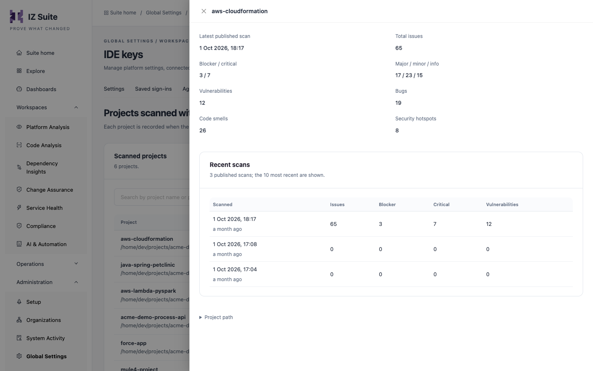

# Analyze and Fix in VS Code

Once the extension is connected to IZ Suite, it analyzes your projects as you work. This page explains when the analysis runs, where the issues appear, and how to fix them.


Install and connect the extension first. See [VS Code Extension](vs-code-extension.md).


## When the Analysis Runs

The extension analyzes one project at a time: the project of the file you are working on.

| Event                                 | What happens                                                                                                |
| ------------------------------------- | ----------------------------------------------------------------------------------------------------------- |
| You open a file from another project  | The extension finds the project's root folder and analyzes the whole project.                               |
| You save a file                       | The extension analyzes the current project again.                                                           |
| You click **Reload Analysis Results** | The extension analyzes the current project again, even when auto analysis is stopped.                       |
| You click **Sync Rules from Server**  | The extension downloads the rules of your active quality profiles again, then analyzes the current project. |

A workspace can hold several projects, and a project can have several modules. The extension finds a project's root folder and its language with the **Language Identifier Settings** setting from IZ Suite.

The extension analyzes a project only when:

* its language is one available to you,
* your IDE key is enabled and still has allowance for a new project (projects you already analyzed with the key always count as allowed), and
* the project name is allowed by the IDE settings in IZ Suite.

Otherwise the results view shows the reason instead of issues. See [IDE Extensions](./#control-which-projects-developers-can-analyze).

## Read the Results

### Fly Results

The **Fly Results** view in the panel (next to **Problems**, **Output** and **Terminal**) lists the issues of the current project. To open it, click the IZ tab in the panel, or run **View: Open View...** from the Command Palette and choose **Fly Results**.

Issues are grouped by severity, most severe first. When a severity has many issues, its group shows only part of them and says so, for example **(Displaying 100 of 340 issues)**. Fix the issues shown, or use **Problems** for the full list.

| Column        | Description                                                                                |
| ------------- | ------------------------------------------------------------------------------------------ |
| **Rule Name** | The rule the code breaks, with the severity icon.                                          |
| **Type**      | The rule type, such as **Bug**, **Vulnerability**, **Code Smell** or **Security Hotspot**. |
| **Line**      | The line of the issue.                                                                     |
| **Auto Fix**  | **Fix** and **Preview** when the rule has an automatic fix.                                |
| **File**      | The file, relative to your workspace folder.                                               |

* Click an issue to open its file at the line.
* Double-click an issue to open its **Rule Description**.

The view's toolbar has:

| Button                      | What it does                                                                                                                               |
| --------------------------- | ------------------------------------------------------------------------------------------------------------------------------------------ |
| **Sync Rules from Server**  | Downloads the rules of your active quality profiles from IZ Suite again and re-analyzes. Use it after your team changes rules or profiles. |
| **Reload Analysis Results** | Analyzes the current project again.                                                                                                        |
| **Stop Auto Analysis**      | Stops analyzing on save and on switching projects. The button turns into **Start Auto Analysis**.                                          |
| **Start Auto Analysis**     | Turns automatic analysis back on.                                                                                                          |

### Problems Panel

The extension also reports every issue in VS Code's **Problems** panel. The message is the rule name.

| Rule severity            | Shown in Problems as |
| ------------------------ | -------------------- |
| Blocker, Critical, Major | Error                |
| Minor                    | Warning              |
| Info                     | Information          |

### Rule Description

**Rule Description** opens beside your editor and shows the rule name, its severity and type, and its description. Most built-in rules include a compliant and a non-compliant code example that shows how to fix the issue.

You can also open a rule from the **Profile Rules \[In Use]** view in the extension's side bar, which lists every rule of your active quality profile per language.

## Fix Issues with Autofix

Rules that come with an automatic fix show **Fix** and **Preview** in the **Auto Fix** column.

1. Click **Preview** on the issue. A notification lists each change the fix would make and in which file. Your files are not changed.
2. Click **Fix** to apply the change.

After a fix, the extension analyzes the project again, so the results reflect the change. A fix can change more than one file, for example the code and a property file.


Commit or back up your work before you apply fixes, so you can review the change in your version control and undo it if needed.


### Autofix Logs

Every fix you apply is logged in the project, in `target/izanalyzer/autofix-log.csv`. To read the log, run **Auto Fix Logs** from the Command Palette: the **Auto Fix Logs** tab shows the log of the current project as a table.

## Commands

Run these from the Command Palette (`Ctrl+Shift+P`, or `Cmd+Shift+P` on macOS). Type the command name to find it.

| Command                                          | What it does                                                             |
| ------------------------------------------------ | ------------------------------------------------------------------------ |
| **IZ Suite Connection**                          | Opens the connection form.                                               |
| **Reload Connection and Profiles**               | Reloads the **Connection** view: languages and quality profiles.         |
| **Reload Profile Rules**                         | Reloads the **Profile Rules \[In Use]** view.                            |
| **Sync Rules from Server**                       | Downloads the rules again and re-analyzes.                               |
| **Reload Analysis Results**                      | Analyzes the current project again.                                      |
| **Start Auto Analysis** / **Stop Auto Analysis** | Turns automatic analysis on or off.                                      |
| **Auto Fix Logs**                                | Shows the autofix log of the current project.                            |
| **Custom Rule Editor**                           | Opens the Rules Playground. See [Rules Playground](rules-playground.md). |

## Your Results in IZ Suite

The extension publishes a summary of each project you analyze to IZ Suite: the issue counts by severity and type, not your code. Open **Administration** → **My Account** → **IDE projects**, click **Scanned projects** on your key, and click **Review results** on a project to see its latest published analysis and its recent ones. The first analysis of a project uses one project of your key's allowance.

<figure><figcaption>
Results published from the IDE
</figcaption></figure>

## Next steps

* [IDE Projects](https://knowledgebase.autorabit.com/product-guides/integral-zone/iz-suite/my-account/ide-projects): review the projects you analyzed.
* [Rules Playground](rules-playground.md): write a custom rule and try it on your project.
* [VS Code Extension](vs-code-extension.md): connection, profiles and settings.
* [Quality Profiles](https://knowledgebase.autorabit.com/product-guides/integral-zone/iz-suite/operations/quality-control/quality-profiles): the profiles whose rules the extension applies.
