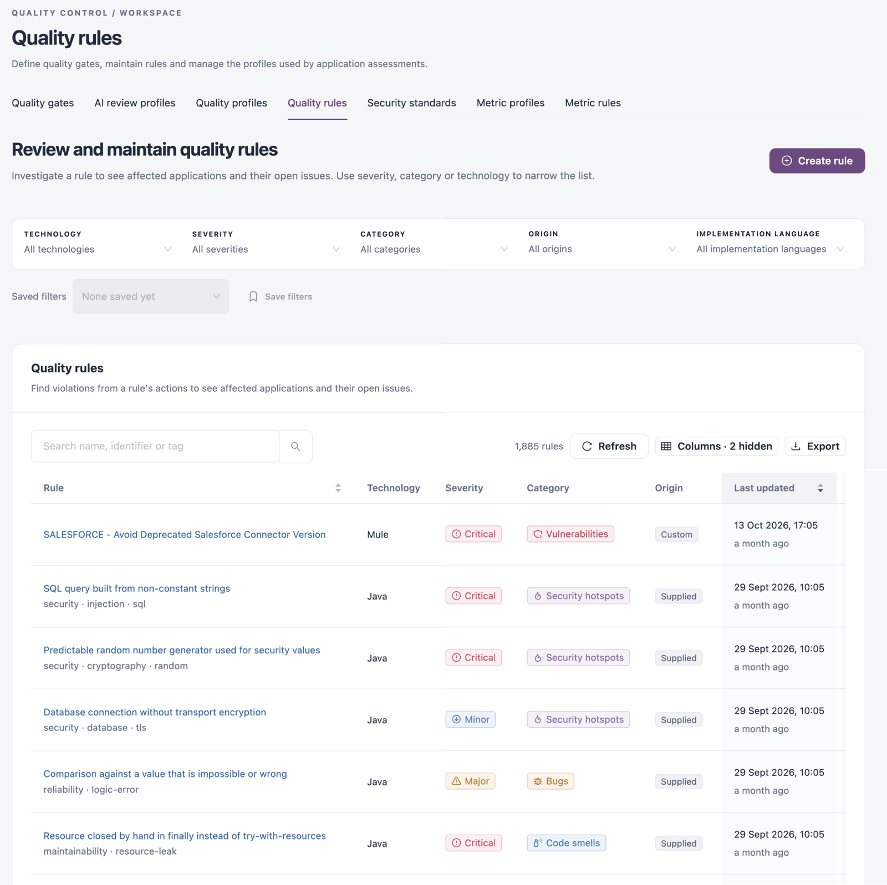

# Custom Rule Editor

The **Custom Rule Editor** is part of the IZ IDE extensions. Use it to write a custom quality rule in Groovy, evaluate it against the project open in your IDE, fix syntax errors right away, and publish it to IZ Suite when it works. A published rule becomes a custom quality rule in your workspace and is added to your quality profile, so the IDE, pipelines and scheduled assessments all apply it.


Install and connect the extension first: [VS Code Extension](vs-code-extension.md) or [Anypoint Studio Plugin](anypoint-studio-plugin.md). Keep a project open: the editor evaluates rules against it.


## How It Works

1. **Write** the rule: a name, a type and severity, a language, and a rule definition. The rule definition is a Groovy script that returns the code elements breaking the rule. Optionally add an autofix definition, which tells the autofix how to correct each issue.
2. **Evaluate** it. The editor runs the rule against the current project on your computer. The results list each line and file the rule matches, or the error in your script.
3. **Publish** it. The editor sends the rule to IZ Suite with a rule key and a description. IZ Suite creates the rule, or updates the rule that already has this key, and adds it to the quality profile you use for that language in the IDE.

The editor opens with a working example for Mule: a rule that finds database select queries that are not externalized to a property, with a matching autofix and description. Change it, or replace it with your own.

```groovy
def list =[]
if( COMPONENTS.containsKey('select') ) {
  COMPONENTS.get('select').each {
    it.'*'.each { sql ->
      if(sql.name() == 'sql' && !sql.text().startsWith('${')) {
        list.add(sql)
      }
    }
  }
}
return list
```


Publishing changes your workspace's rules and quality profile. The security token in your IDE needs roles that can edit quality rules and add rules to quality profiles. To keep a shared profile unchanged, activate a profile of your own in the IDE before you publish.


## Use It in VS Code

1. Open the Command Palette and run **IZ Scan: Custom Rule Editor**. The editor opens beside your code.
2.  Fill in the rule:

    | Field                   | Description                                                                                      |
    | ----------------------- | ------------------------------------------------------------------------------------------------ |
    | **Rule Name**           | The rule's name, shown on every issue it raises. **Required.**                                   |
    | **Rule Severity**       | The severities defined in IZ Suite, such as Blocker, Critical, Major, Minor and Info.            |
    | **Rule Type**           | The rule types defined in IZ Suite, such as Bug, Vulnerability, Code Smell and Security Hotspot. |
    | **Language**            | **Mule**, **API** or **Kubernetes**.                                                             |
    | **Rule Definition**     | The Groovy script. **Required.**                                                                 |
    | **Auto Fix Definition** | Optional Groovy that fixes each issue the rule finds.                                            |
3. Click **Evaluate Rule**. **Evaluation Results** shows **Valid rule definition. No matching issues found in the project**, the line and file of each match, or the error in your script.
4. Under **Publish Rule**, check the **Rule Key**. It is filled in with a unique key; change it to update an existing rule with that key. **Publish Rule** stays disabled until the key and the description are filled in.
5. Write the **Rule Description** in Markdown. Explain the rule and add compliant and non-compliant examples: developers read it in **Rule Description**.
6. Click **Publish Rule**. The result appears below the button.

## Use It in Anypoint Studio

1. Click **Window** → **Show View** → **Other...**, expand **IZ Scan** and select **Custom Rule Editor**.
2.  Fill in the rule:

    | Section                | Description                                                                        |
    | ---------------------- | ---------------------------------------------------------------------------------- |
    | **Rule Name**          | The rule's name.                                                                   |
    | **Rule Category**      | **Type** and **Severity**, from the rule types and severities defined in IZ Suite. |
    | **Rule Definition**    | The Groovy script, then the **Auto Fix rule definition**.                          |
    | **Select plugin type** | The language: `mule` or `api`.                                                     |
3. Click **Evaluate Rule**. **Evaluation Results** shows **Success** with each matching line and file, or **Error** with the problem. **Results of Auto Fix definition evaluation** shows whether the autofix definition is valid.
4. Optionally, under **Download Rule**, click **Download Rule** to save the rule as a JSON file in your project's folder.
5. Under **Publish Rule**, check the **Rule Key**. An existing rule with the same key is updated.
6. Write the **Rule Description** in Markdown.
7. Click **Publish Rule**. The editor shows **200 : Rule published successfully**, or the error.

## After You Publish

<figure><figcaption></figcaption></figure>

* The rule appears in **Operations** → **Quality Control** → **Quality rules** as a custom rule. Review or refine it there. See [Quality Rules](../operations/quality-control/quality-rules.md).
* It is active in the quality profile you used in the IDE. See [Quality Profiles](../operations/quality-control/quality-profiles.md).
* Developers who use the same profile get it the next time they sync rules in their IDE.

## Next Steps

* [Analyze and Fix in VS Code](analyze-and-fix-in-vs-code.md): see the new rule's issues in your project.
* [Analyze and Fix in Anypoint Studio](analyze-and-fix-in-anypoint-studio.md): the same in Anypoint Studio.
* [Quality Rules](../operations/quality-control/quality-rules.md): manage the published rule in IZ Suite.
* [IDE Extensions](./): how the extensions work with IZ Suite.
