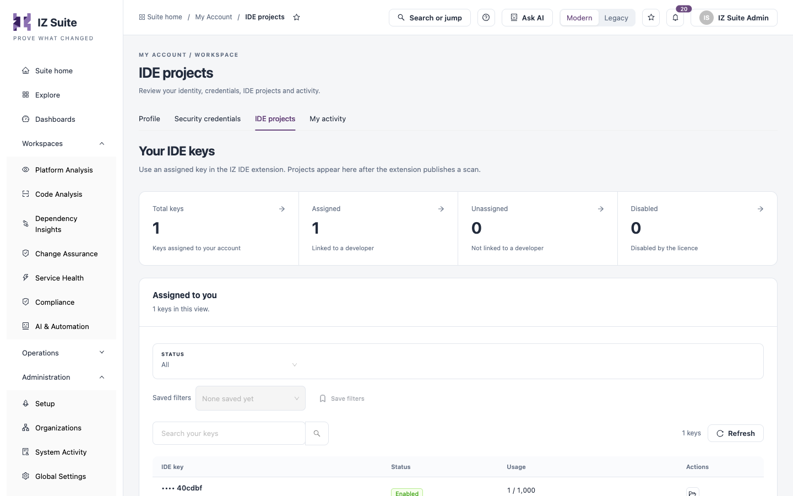

# IDE Projects

**IDE projects** lists the IDE keys assigned to you. You paste a key into the IZ IDE extension; the projects you scan in your editor then appear here once the extension publishes a scan. A key's usage is how many projects you can scan from the IDE with it.

Open it from **Administration** → **My Account** → **IDE projects** in the sidebar, or from the **IDE projects** tab of My Account.

<figure><figcaption>
Your IDE keys
</figcaption></figure>


IDE keys come from your organization's licence, and an administrator assigns them to people in IDE Keys. If no key is assigned to you, the page says **No IDE keys are assigned to you**; ask an administrator to assign one.


## Key Counts

| Tile           | What it shows                   |
| -------------- | ------------------------------- |
| **Total keys** | Keys assigned to your account.  |
| **Assigned**   | Keys linked to a developer.     |
| **Unassigned** | Keys not linked to a developer. |
| **Disabled**   | Keys disabled by the licence.   |

Click a tile to filter the list.

## Your Keys

| Control                              | What it does                          |
| ------------------------------------ | ------------------------------------- |
| **Status**                           | **All**, **Enabled** or **Disabled**. |
| **Saved filters** / **Save filters** | Re-apply or save the current filters. |
| **Search your keys**                 | Finds a key.                          |
| **Refresh**                          | Reloads the list.                     |

| Column      | Description                                                                                                                                                              |
| ----------- | ------------------------------------------------------------------------------------------------------------------------------------------------------------------------ |
| **IDE key** | The key, masked to its last six characters, and when it was added. Click it to open its details.                                                                         |
| **Status**  | **Enabled** or **Disabled**.                                                                                                                                             |
| **Usage**   | Projects scanned with the key out of the number of projects you can scan from the IDE, for example `1 / 1,000`. The allowance can be **Unlimited**, or **No allowance**. |
| **Actions** | **Scanned projects** opens the projects scanned with this key.                                                                                                           |

## Copy a Key into the IDE Extension

1. Click the masked key.
2. In the key's drawer, check **Status**, **Usage**, **Assigned to** and **Added**.
3. Under **Key for the IDE extension**, click the copy icon.
4. Paste the key into the IZ IDE extension settings.


Treat an IDE key like a licence seat: share it only with the person it is assigned to.


## Review Scanned Projects

1. Click **Scanned projects** for a key.
2. The page **Projects scanned with IDE key** lists each project with its **Last published scan**. Use **Search by project name or path** to find one.
3. Click a project, or **Review results**, to open its results.

The project drawer shows the latest published scan (**Total issues**, **Blocker / critical**, **Major / minor / info**, **Vulnerabilities**, **Bugs**, **Code smells** and **Security hotspots**) and **Recent scans**: the 10 most recent published scans by date, with **Issues**, **Blocker**, **Critical** and **Vulnerabilities**. Expand **Project path** for the project's full path.

Results are the developer's local scan in the editor, not a server assessment. Click **Your IDE keys** to return.

## Next steps

* [Security Credentials](security-credentials.md): tokens for your other integrations.
* [My Activity](my-activity.md): review what your account did.
* [My Account](./): back to the overview.
