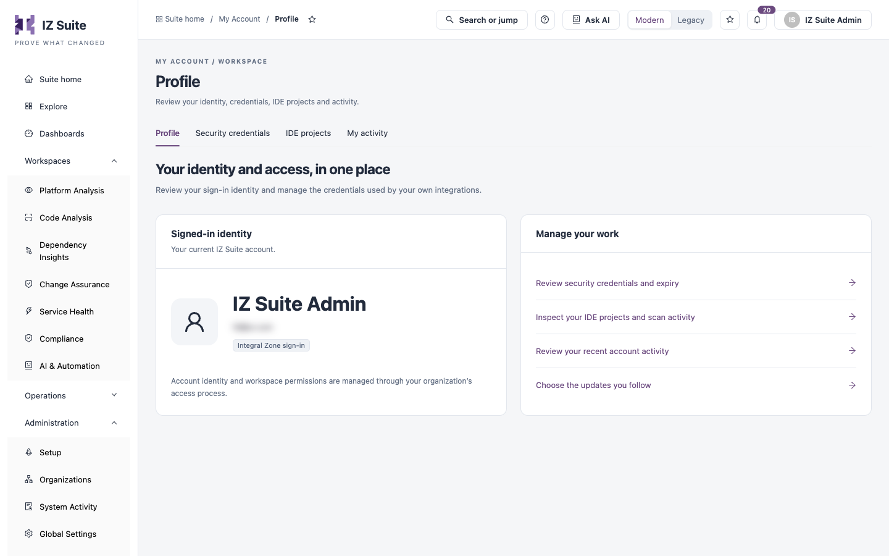

# Profile

**Profile** shows your identity and access in one place: the account you are signed in with, and shortcuts to the credentials and activity that belong to you.

Open it from the account menu (**My account**), or from **Administration** → **My Account** → **Profile** in the sidebar.

<figure><figcaption>
Your profile
</figcaption></figure>

The tabs at the top of the page open the other My Account pages: **Profile**, **Security credentials**, **IDE projects** and **My activity**.

## Signed-In Identity

| Item           | Description                                                                              |
| -------------- | ---------------------------------------------------------------------------------------- |
| Name and email | The account you are signed in with.                                                      |
| Sign-in tag    | How you signed in, for example **Integral Zone sign-in** or the single sign-on provider. |

Your account identity and workspace permissions are managed through your organization's access process. To change your name, email or roles, ask your administrator; see Users and Roles. To change your picture, use [My Preferences](my-preferences.md).

## Manage Your Work

| Link                                            | Opens                                            |
| ----------------------------------------------- | ------------------------------------------------ |
| **Review security credentials and expiry**      | [Security Credentials](security-credentials.md). |
| **Inspect your IDE projects and scan activity** | [IDE Projects](ide-projects.md).                 |
| **Review your recent account activity**         | [My Activity](my-activity.md).                   |
| **Choose the updates you follow**               | My Subscriptions.                                |

## Next steps

* [Security Credentials](security-credentials.md): manage your integration tokens.
* [My Preferences](my-preferences.md): set your picture, availability and home page.
* [My Account](./): back to the overview.
