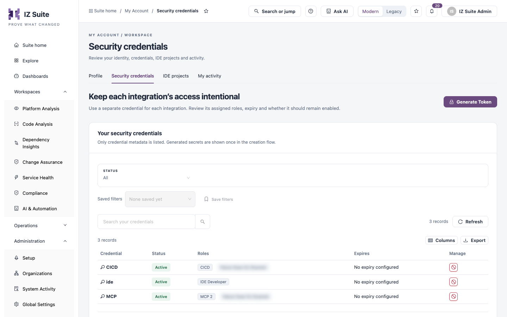

# Security Credentials

**Security credentials** lists the security tokens that belong to you. Integrations such as the Code Analysis CLI, the IDE extension and AI assistants (MCP clients) use a token to act on your behalf, with the roles assigned to that token. Use a separate token for each integration, and review its roles, expiry and whether it should stay enabled.

Open it from **Administration** → **My Account** → **Security credentials** in the sidebar, or from the **Security credentials** tab of My Account.

<figure><figcaption>
Your security credentials
</figcaption></figure>


Only credential metadata is listed. A token's secret value is shown once, when you generate it, and never again. Tokens for other users are managed in Access Tokens.


## Credentials List

| Control                              | What it does                                       |
| ------------------------------------ | -------------------------------------------------- |
| **Status**                           | **All**, **Enabled**, **Expired** or **Disabled**. |
| **Saved filters** / **Save filters** | Re-apply or save the current filters.              |
| **Search your credentials**          | Finds a credential by name.                        |
| **Refresh**                          | Reloads the list.                                  |
| **Columns**                          | Shows or hides columns.                            |
| **Export**                           | Downloads the list.                                |

| Column         | Description                                                                                                |
| -------------- | ---------------------------------------------------------------------------------------------------------- |
| **Credential** | The token's name.                                                                                          |
| **Status**     | **Active**, **Disabled**, or **Expired** once its expiry date has passed.                                  |
| **Roles**      | The roles assigned to the token. When there are more than two, hover over the extra count to see the rest. |
| **Expires**    | The expiry date, or **No expiry configured**.                                                              |
| **Manage**     | **Disable credential** or **Enable credential**.                                                           |

## Generate a Token

1. Click **Generate Token**.
2. In **Generate New Token**, enter the **Token Name**. **Required.**
3. Optionally, choose an **Expiry** date. Leave it empty if the token is not intended to expire.
4. On the **Roles** tab, under **Assign Roles**, select the roles the token gets. Use **Search Role** to find one.
5. Click **Save changes**.
6. On **Token Generated**, copy the token and store it safely.


Copy the token straight away: it is not shown again. Treat it like a password, and give it only the roles the integration needs.


## Disable or Enable a Credential

1. Click **Disable credential** (or **Enable credential**) in the **Manage** column.
2. Read the confirmation and confirm.

| Action                 | Effect                                                            |
| ---------------------- | ----------------------------------------------------------------- |
| **Disable credential** | Integrations using this credential lose access.                   |
| **Enable credential**  | The credential regains its assigned access until its expiry date. |

## Next steps

* [IDE Projects](ide-projects.md): see the projects you scanned in the IDE extension.
* [My Activity](my-activity.md): check what was done with your account.
* MCP Integration: connect an AI assistant with a token.
* [My Account](./): back to the overview.
