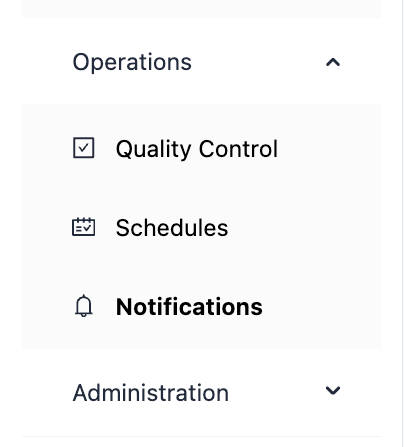

# Operations

The **Operations** group in the sidebar holds the screens that every workspace relies on: the quality standards that assessments are judged against, the scheduled work that collects and assesses applications, and the updates IZ Suite sends to you. Each screen shows only what your roles allow.

<figure><figcaption></figcaption></figure>

| Menu                                | What it is for                                                                                                                           |
| ----------------------------------- | ---------------------------------------------------------------------------------------------------------------------------------------- |
| [Quality Control](quality-control/) | Quality gates, AI review profiles, customer requirements, quality and metric profiles, quality and metric rules, and security standards. |
| [Schedules](schedules/)             | Recurring and one-time work, platform scan schedules, and the execution history of every run.                                            |
| [Notifications](notifications/)     | Your updates, the delivery log, your subscriptions and every subscription in the organization.                                           |

## Next Steps

* [Quality Control](quality-control/): set the standards an application must meet.
* [Schedules](schedules/): keep collection and assessment running on time.
* [Notifications](notifications/): choose which updates reach you.
