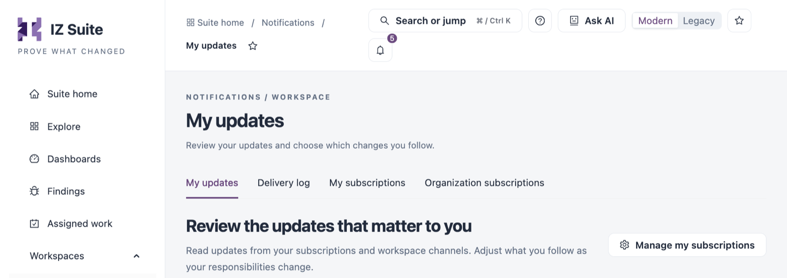

# Notifications

IZ Suite sends updates about the records you follow, such as a status page changing state or a maintenance window starting. Each update reaches you through a subscription, by email, Slack or in-app in the bell at the top of the screen. **Notifications** is where you read your updates, check what was delivered and manage subscriptions.

Open it from **Operations** → **Notifications** in the sidebar. The tabs at the top switch between the sections below. Each tab appears only when your role allows it.

<figure><figcaption></figcaption></figure>

| Tab                                                         | What it is for                                                               |
| ----------------------------------------------------------- | ---------------------------------------------------------------------------- |
| [My updates](my-updates.md)                                 | The updates from your subscriptions and shared workspace channels.           |
| [Delivery log](delivery-log.md)                             | Every update sent by email, Slack or in-app, with its delivery status.       |
| [My subscriptions](my-subscriptions.md)                     | The subscriptions that send updates to you.                                  |
| [Organization subscriptions](organization-subscriptions.md) | Every subscription in the organization, with its subscriber and destination. |


You subscribe from the record you want to follow, with its **Subscribe to updates** action, for example on an organization or a status page.


## Next Steps

* [My Updates](my-updates.md): read your latest updates.
* [My Subscriptions](my-subscriptions.md): stop updates you no longer need.
* [Operations](../): return to the Operations overview.
