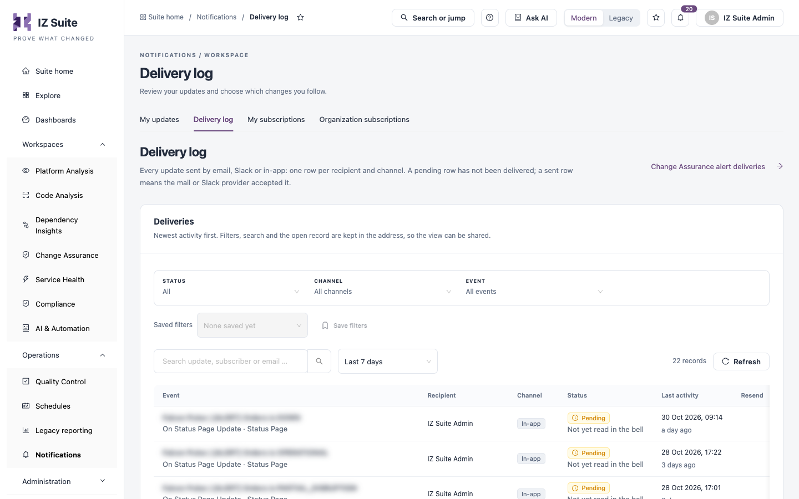

# Delivery Log

The delivery log lists every update IZ Suite sent by email, Slack or in-app, with one row per recipient and channel. A pending row has not been delivered yet; a sent row means the mail or Slack provider accepted it. Use it to confirm that an update went out and to resend one that failed.

Open it from **Operations** → **Notifications** → **Delivery log** in the sidebar.


You need a role that can view global settings. Resending needs a role that can edit global settings.


<figure><figcaption>
Delivery log
</figcaption></figure>

**Change Assurance alert deliveries** opens the deliveries of Change Assurance alerts, which are listed separately.

## Filter deliveries

| Filter      | Description                                              |
| ----------- | -------------------------------------------------------- |
| **Status**  | **All**, **Failed**, **Pending** or **Sent**.            |
| **Channel** | **Email**, **Slack** or **In-app**.                      |
| **Event**   | The kind of update, for example a status page update.    |
| Search      | Finds deliveries by update, subscriber or email address. |
| Time range  | The period to show, for example **Last 7 days**.         |

The filters, search and the open record are kept in the page address, so you can share the view. When failures exist, **Show failures** filters to them. **Refresh** reloads the list.

## Deliveries

| Column            | Description                                                                                                                                                      |
| ----------------- | ---------------------------------------------------------------------------------------------------------------------------------------------------------------- |
| **Event**         | The update title, its event and topic. Click it to open the delivery.                                                                                            |
| **Recipient**     | Who received the update.                                                                                                                                         |
| **Channel**       | **Email**, **Slack** or **In-app**.                                                                                                                              |
| **Status**        | **Sent**, **Pending** or **Failed**, with a note. An in-app delivery is **Read in the bell** or **Not yet read in the bell**; a paused subscription is not sent. |
| **Last activity** | When the delivery last changed.                                                                                                                                  |
| **Resend**        | **Resend to the original recipient**, for email and Slack deliveries that are not pending and whose subscription is active.                                      |

## Delivery details

Click a delivery's event to open it. The drawer shows the **Status**, **Event**, **Channel**, **Recipient**, **Subscriber**, **Failed attempts** and **Last activity**. For email and Slack, **Provider response** shows the error recorded for the last failed attempt.


A Slack webhook address is stored securely and is never shown.


## Resend an update

1. Click **Resend to the original recipient** on the row, or **Resend** in the delivery's details.
2. Confirm with **Resend**.

The update is queued for the original recipient. The delivery run sends it within about a minute; the row then shows **Sent** or **Failed**.

## Next steps

* [Organization Subscriptions](organization-subscriptions.md): fix or remove a misdirected subscription.
* [My Updates](my-updates.md): read the updates delivered to you in-app.
* [Notifications](./): return to the Notifications overview.
