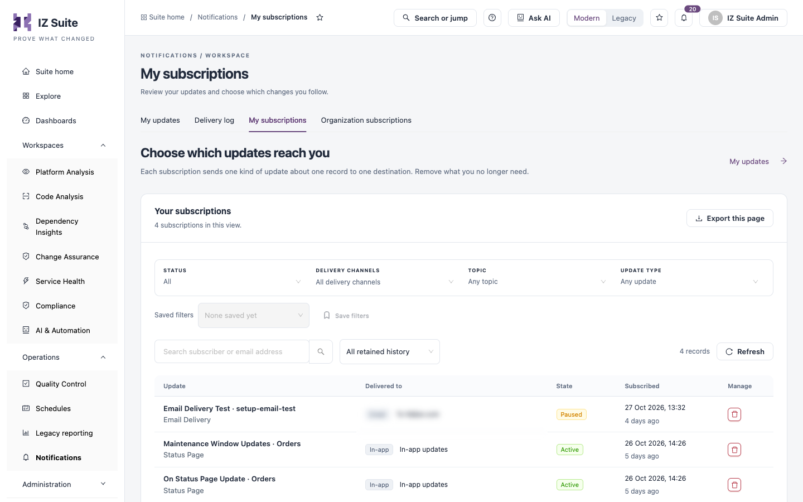

# My Subscriptions

Each subscription sends one kind of update about one record to one destination, for example status page updates for the Orders page, in-app. Use this tab to see what you follow and where it is delivered, and to remove what you no longer need.

Open it from **Operations** → **Notifications** → **My subscriptions** in the sidebar.

<figure><figcaption>
My subscriptions
</figcaption></figure>


To add a subscription, open the record you want to follow, for example an organization or a status page, and use its **Subscribe to updates** action.


## Filter subscriptions

| Filter                | Description                                                              |
| --------------------- | ------------------------------------------------------------------------ |
| **Status**            | **All**, **Active** or **Paused**.                                       |
| **Delivery channels** | **Email**, **Slack** or **In-app**.                                      |
| **Topic**             | The kind of record, for example a status page.                           |
| **Update type**       | The kind of update, for example maintenance window updates.              |
| Search                | Finds subscriptions by subscriber or email address.                      |
| Time range            | When the subscription was created, for example **All retained history**. |

**Saved filters** and **Save filters** keep a combination of filters for later. **Refresh** reloads the table and **Export this page** downloads the rows on the current page. **My updates** opens your updates.

## Your subscriptions

| Column           | Description                                                                                       |
| ---------------- | ------------------------------------------------------------------------------------------------- |
| **Update**       | The kind of update and the record it is about, with its topic. Click it to open the subscription. |
| **Delivered to** | The channel and destination, for example an email address or **In-app updates**.                  |
| **State**        | **Active**, or **Paused** when updates are not sent.                                              |
| **Subscribed**   | When the subscription was created.                                                                |
| **Manage**       | **Remove subscription**.                                                                          |

Click a subscription to see its **Subscriber**, **Topic**, **Update**, **Subject**, **Channel**, **Delivered to**, **State** and **Subscribed** date. A Slack webhook address is stored securely and is never shown.

## Remove a subscription

1. Click **Remove subscription** on the row, or in the subscription's details.
2. Confirm with **Remove subscription**.

No further updates are delivered to that destination. You can subscribe again from the record at any time.

## Next steps

* [My Updates](my-updates.md): read the updates your subscriptions send.
* [Delivery Log](delivery-log.md): check whether an update was delivered.
* [Notifications](./): return to the Notifications overview.
