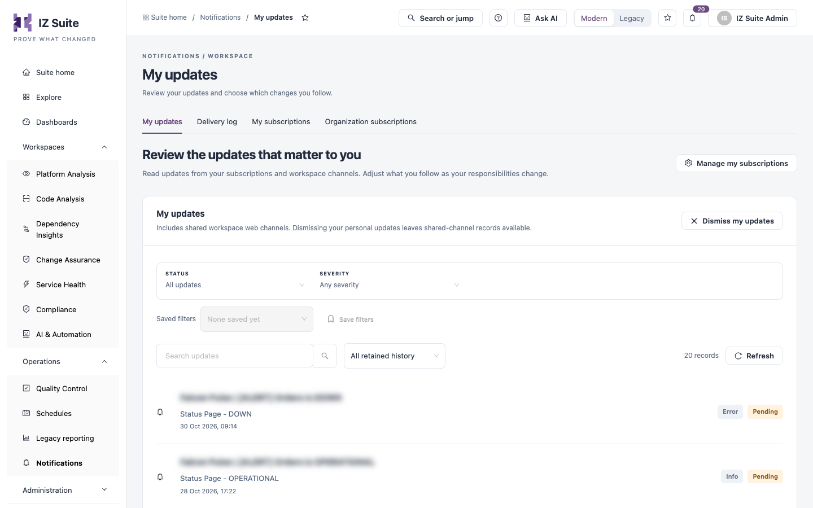

# My Updates

**My updates** lists the updates from your subscriptions and from shared workspace web channels, newest first. Use it to catch up on what changed and to dismiss updates you have handled.

Open it from **Operations** → **Notifications** → **My updates** in the sidebar.

<figure><figcaption>
My updates
</figcaption></figure>

## Filter updates

| Filter             | Description                                                        |
| ------------------ | ------------------------------------------------------------------ |
| **Status**         | **All updates**, **Pending** (not yet dismissed) or **Dismissed**. |
| **Severity**       | **Any severity**, **Info**, **Warning** or **Error**.              |
| **Search updates** | Finds updates by title.                                            |
| Time range         | The period to show, for example **All retained history**.          |

**Saved filters** and **Save filters** keep a combination of filters for later. **Refresh** reloads the list.

## Updates

Each update shows its title, description and date, with its severity (**Info**, **Warning** or **Error**) and status (**Pending** or **Dismissed**).

When the list is empty, **Review subscriptions** opens [My subscriptions](my-subscriptions.md) so you can follow the organizations, status pages and events relevant to your work.

## Dismiss your updates

1. Click **Dismiss my updates**.
2. Confirm with **Dismiss my updates**.

Dismissing applies to all of your own subscription updates, across all pages and filters. Updates from shared workspace channels stay available.

**Manage my subscriptions** opens [My subscriptions](my-subscriptions.md).

## Next steps

* [My Subscriptions](my-subscriptions.md): change which updates reach you.
* [Delivery Log](delivery-log.md): check whether an update was delivered.
* [Notifications](./): return to the Notifications overview.
