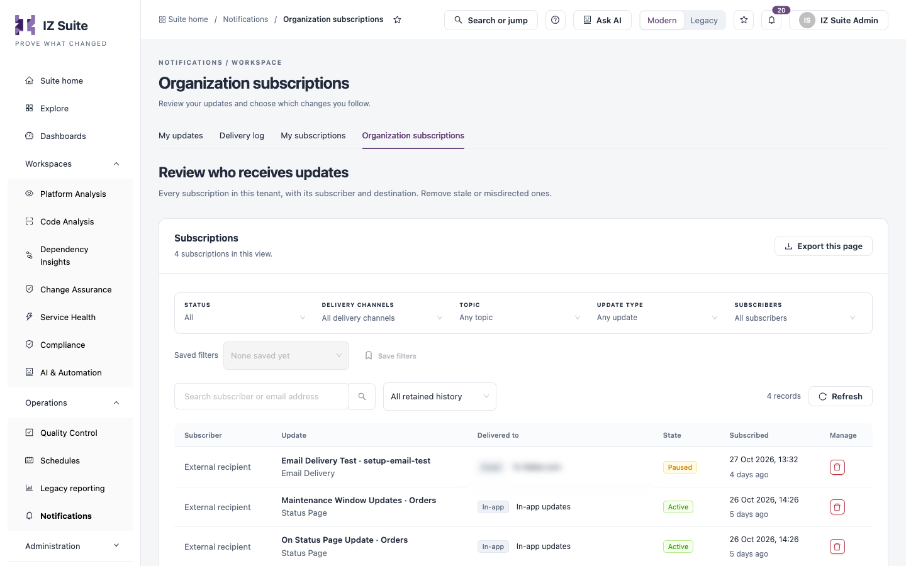

# Organization Subscriptions

This tab lists every subscription in your tenant, with its subscriber and destination. Administrators use it to see who receives which updates and to remove subscriptions that are stale or sent to the wrong place.

Open it from **Operations** → **Notifications** → **Organization subscriptions** in the sidebar.


You need a role that can manage all subscriptions.


<figure><figcaption>
Organization subscriptions
</figcaption></figure>

## Filter subscriptions

| Filter                | Description                                                              |
| --------------------- | ------------------------------------------------------------------------ |
| **Status**            | **All**, **Active** or **Paused**.                                       |
| **Delivery channels** | **Email**, **Slack** or **In-app**.                                      |
| **Topic**             | The kind of record, for example a status page.                           |
| **Update type**       | The kind of update, for example maintenance window updates.              |
| **Subscribers**       | The people whose subscriptions to show.                                  |
| Search                | Finds subscriptions by subscriber or email address.                      |
| Time range            | When the subscription was created, for example **All retained history**. |

**Saved filters** and **Save filters** keep a combination of filters for later. **Refresh** reloads the table and **Export this page** downloads the rows on the current page.

## Subscriptions

| Column           | Description                                                                                       |
| ---------------- | ------------------------------------------------------------------------------------------------- |
| **Subscriber**   | The user who subscribed, or **External recipient** for an address that is not a user.             |
| **Update**       | The kind of update and the record it is about, with its topic. Click it to open the subscription. |
| **Delivered to** | The channel and destination.                                                                      |
| **State**        | **Active** or **Paused**.                                                                         |
| **Subscribed**   | When the subscription was created.                                                                |
| **Manage**       | **Remove subscription**.                                                                          |

Click a subscription to see its details. **Open subscriber** opens the subscriber's user record, when your role can view users.

## Remove a subscription

1. Click **Remove subscription** on the row, or in the subscription's details.
2. Confirm with **Remove subscription**.

The recipient stops receiving those updates. They can subscribe again from the record.

## Next steps

* [Delivery Log](delivery-log.md): see which deliveries failed and resend them.
* [My Subscriptions](my-subscriptions.md): review your own subscriptions.
* [Notifications](./): return to the Notifications overview.
