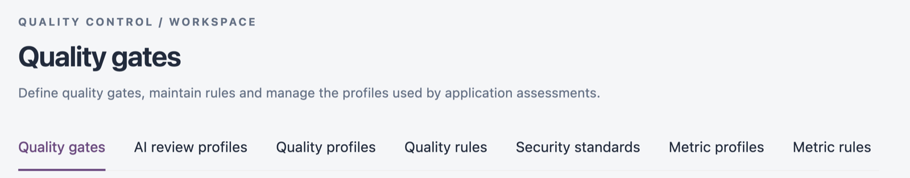

# Quality Control

**Quality Control** holds the shared standards that every assessment uses. Rules and metrics measure an application, profiles choose which rules and metrics run for a technology, and quality gates decide whether the measured result passes. [AI review profiles](ai-review-profiles.md) add AI review checks that are specific to your organization.

Open it from **Operations** → **Quality Control** in the sidebar. The tabs at the top of the screen switch between the sections below. Each tab appears only when your role can view it.

<figure><figcaption></figcaption></figure>

| Tab                                         | What it is for                                                                                          |
| ------------------------------------------- | ------------------------------------------------------------------------------------------------------- |
| [Quality gates](quality-gates.md)           | The pass or fail conditions an assessment is judged against, per technology.                            |
| [AI review profiles](ai-review-profiles.md) | Customer policies, design guidance and review questions for AI reviews of completed assessments.        |
| [Quality profiles](quality-profiles.md)     | The set of quality rules that runs for a technology, and which organizations use it by default.         |
| [Quality rules](quality-rules.md)           | The library of rules that raise findings, supplied and custom.                                          |
| [Security standards](security-standards.md) | CWE, OWASP and AWS Foundational Security Best Practices references, and the rules that detect each one. |
| [Metric profiles](metric-profiles.md)       | The set of metrics measured for a technology, and which organizations use it by default.                |
| [Metric rules](metric-rules.md)             | The library of metrics that produce measured values for quality gate conditions.                        |


Supplied gates, profiles and rules ship with IZ Suite. They are marked **Supplied**; the ones your team creates are marked **Custom**. Clone a supplied item to adapt it without losing the original.


## Next Steps

* [Quality Gates](quality-gates.md): review the conditions an assessment must meet.
* [Quality Profiles](quality-profiles.md): choose which rules run for a technology.
* [Quality Rules](quality-rules.md): find the rule behind a finding.
* [Writing Custom Rules](writing-custom-rules.md): clone, write and activate your own rules.
* [Operations](../): return to the Operations overview.
