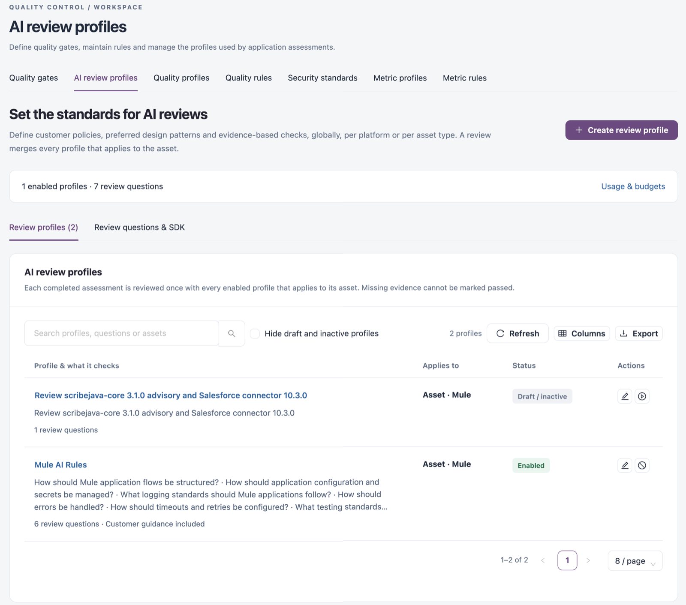
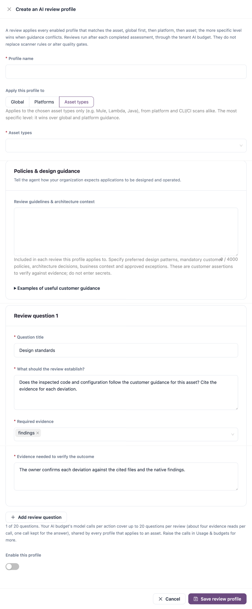

# AI Review Profiles

An AI review profile tells the AI review how your organization expects applications to be designed and operated. After each completed assessment, the asset is reviewed once with every enabled profile that applies to it. Use this tab to set customer policies, preferred design patterns and evidence-based review questions, globally, per platform or per asset type.

Open it from **Operations** → **Quality Control** → **AI review profiles** in the sidebar.


Reviews use the AI provider and the monthly budget configured in **AI & Automation** → **Usage & budgets**. They do not replace scanner rules and do not change quality gates.



You need a role that can view or run AI insights to see this tab. Creating and editing profiles needs a role that can manage them.


<figure><figcaption></figcaption></figure>

## How Profiles Combine

A review merges every enabled profile that matches the asset: the global profile first, then platform profiles, then asset-type profiles. When guidance conflicts, the more specific level wins. Missing evidence cannot be marked as passed.

The line under the page title shows how many profiles are enabled and how many review questions they hold. **Usage & budgets** opens the AI usage and budget settings.

## Review Profiles

The tab has two views: **Review profiles** (with the number of profiles) and **Review questions & SDK**.

| Control                                  | Description                                     |
| ---------------------------------------- | ----------------------------------------------- |
| **Search profiles, questions or assets** | Finds profiles by name, question or asset type. |
| **Hide draft and inactive profiles**     | Shows enabled profiles only.                    |
| **Refresh**                              | Reloads the list.                               |
| **Columns**                              | Shows or hides columns.                         |
| **Export**                               | Downloads the list.                             |

| Column                       | Description                                                                                                                                                                                                                                                    |
| ---------------------------- | -------------------------------------------------------------------------------------------------------------------------------------------------------------------------------------------------------------------------------------------------------------- |
| **Profile & what it checks** | The profile name, the titles of its review questions, the question count and whether customer guidance is included. Click the name to see the profile and the latest reviews that used it.                                                                     |
| **Applies to**               | **Global · every asset**, the chosen platforms, or the chosen asset types.                                                                                                                                                                                     |
| **Status**                   | **Enabled** or **Draft / inactive**. A warning such as **3 questions over the review limit** means that, together with the other enabled profiles for the same asset, a review would have more questions than the AI budget covers; the last ones are dropped. |
| **Actions**                  | **Edit profile**, and **Disable profile** or **Enable profile**.                                                                                                                                                                                               |

## Review Questions & SDK

**All AI review rules** lists every review question across all profiles. Search with **Find a review question**; **Refresh**, **Columns** and **Export** work as on the profile list.

| Column              | Description                                                                                                           |
| ------------------- | --------------------------------------------------------------------------------------------------------------------- |
| **Review rule**     | The question, with **Evidence & verification** (the evidence it needs and how the outcome is verified).               |
| **Applies to**      | Where the question applies.                                                                                           |
| **Edit in profile** | **Edit profile** opens the profile that holds the question; when several profiles share it, choose the profile first. |

Accepted AI suggestions appear here as disabled drafts until they are assigned and enabled. **AI suggestions & rule improvements** opens the suggestions in **AI & Automation**, and **Native quality rules** opens [Quality Rules](quality-rules.md).

## Create an AI Review Profile

1. Click **Create review profile**.
2. Enter the **Profile name**. Required.
3. Under **Apply this profile to**, choose **Global**, **Platforms** or **Asset types**. For **Platforms** or **Asset types**, choose at least one in the field that appears.
4. Under **Policies & design guidance**, enter the **Review guidelines & architecture context**.
5. Fill in **Review question 1**. Click **Add review question** for more questions.
6. Turn on **Enable this profile** when the profile should run.
7. Click **Save review profile**.

<figure><figcaption></figcaption></figure>

| Field                                        | Description                                                                                                                                                                                                                                                                     |
| -------------------------------------------- | ------------------------------------------------------------------------------------------------------------------------------------------------------------------------------------------------------------------------------------------------------------------------------- |
| **Profile name**                             | Required. Up to 160 characters.                                                                                                                                                                                                                                                 |
| **Apply this profile to**                    | **Global** applies to every asset; only one global profile can exist. **Platforms** applies to the chosen platforms. **Asset types** applies to the chosen asset types (for example Mule, Lambda or Java) from platform and CLI/CI scans alike, and is the most specific level. |
| **Platforms** / **Asset types**              | Required for that level: at least one platform or asset type.                                                                                                                                                                                                                   |
| **Review guidelines & architecture context** | Up to 4,000 characters, included in every review this profile applies to. Describe preferred design patterns, mandatory customer policies, architecture decisions, business context and approved exceptions. **Examples of useful customer guidance** shows samples.            |
| **Question title**                           | Required. Up to 160 characters.                                                                                                                                                                                                                                                 |
| **What should the review establish?**        | Required. The question the review must answer, up to 1,000 characters.                                                                                                                                                                                                          |
| **Required evidence**                        | Required. One or more evidence sections the review reads, for example findings, source, configuration or dependencies.                                                                                                                                                          |
| **Evidence needed to verify the outcome**    | Required. How the outcome is verified, up to 600 characters.                                                                                                                                                                                                                    |
| **Enable this profile**                      | When on, the profile runs on matching assets.                                                                                                                                                                                                                                   |

**Remove** deletes a review question from the profile when it has more than one.


Enabled profiles send the matching assets' evidence, and their source when it is stored or on the scan agent, to the configured AI provider. The guidance text is a customer assertion that the review verifies against evidence: never enter secrets in it.



The AI budget limits how many questions fit in one review, shared by every profile that applies to an asset. The form shows the limit under the questions (for example **1 of 20 questions**); at most 40 questions are merged into one review. Raise the model calls per action in **Usage & budgets** for more.


## Next Steps

* [AI Coverage & Findings](../../workspaces/ai-and-automation/ai-coverage-and-findings.md): see the reviews that used your profiles.
* [Quality Rules](quality-rules.md): review the native rules that AI reviews complement.
* [Usage & Budgets](../../workspaces/ai-and-automation/usage-and-budgets.md): set the provider and budget AI reviews use.
* [Quality Control](./): return to the Quality Control overview.
