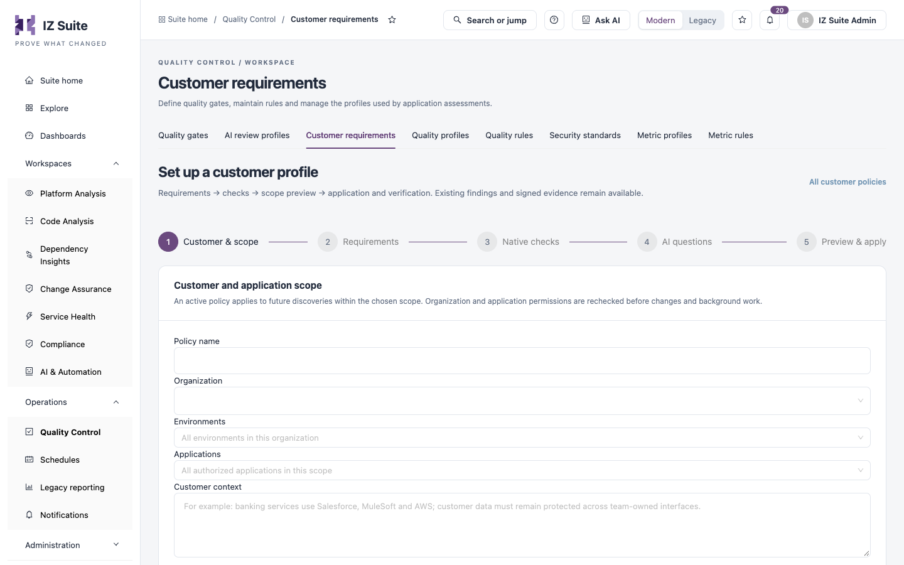

# Customer Requirements

Customer requirements turn what a customer needs into concrete checks. For an organization, environment or group of applications, you write the requirements, choose the native rules that cover them, optionally add AI review questions, preview the coverage and then apply the resulting profiles. Each change keeps its revision, so you can see what changed and restore an earlier configuration.

Open it from **Operations** → **Quality Control** → **Customer requirements** in the sidebar.


You need a role that can view quality profiles. Requesting AI suggestions needs a role that can run AI insights.


## Customer requirements & profiles

The list shows each saved set of customer requirements. Manual setup is available without AI. **Refresh** reloads the list.

| Column              | Description                                                        |
| ------------------- | ------------------------------------------------------------------ |
| **Customer policy** | The policy name. Click it to open the policy.                      |
| **Status**          | The policy's status, for example draft or active.                  |
| **Revision**        | The current revision number. Each saved change creates a revision. |
| **Changed**         | When the policy last changed.                                      |

Start a new policy with **Set up manually**, or with **Create with AI** to let AI propose checks and questions from your requirements.

## Set up customer requirements

The setup has five steps. Use **Next** and **Back** to move between them, and **Save draft** to keep your work. **Save draft** needs a **Policy name**, an **Organization** and a **Reason for this change**.

<figure><figcaption>
Setting up customer requirements
</figcaption></figure>



### Customer & scope

| Field                | Description                                                                                                        |
| -------------------- | ------------------------------------------------------------------------------------------------------------------ |
| **Policy name**      | The name of this set of requirements. Required to save.                                                            |
| **Organization**     | The organization the policy applies to. Required to save.                                                          |
| **Environments**     | Specific environments, or all environments in the organization when left empty.                                    |
| **Applications**     | Specific applications, or all authorized applications in the scope when left empty.                                |
| **Customer context** | Up to 4,000 characters describing the customer, for example the platforms they use and the data they must protect. |

An active policy applies to future discoveries within the chosen scope. Organization and application permissions are checked again before changes and background work.



### Requirements

Click **Add requirement** for each customer need. For each one, enter a key, a title ("What must be true for this customer?") and a rationale ("Why it matters and how to establish it"), and link the native checks, compliance controls and AI questions that cover it. Select **Mandatory coverage** when the requirement must stay covered before a profile change can be applied. **Remove requirement** deletes it.



### Native checks

**Choose native checks** for each language: pick the **Language**, optionally **Start from a profile**, then search and select the rules to include. Applying the configuration creates a customer-owned profile for each language; the supplied profiles are preserved.



### AI questions

**Optional AI questions** are not needed for manual setup. Select **Enable this policy's AI review profile** to include AI questions, then choose the **Review workspaces** (Platform Analysis, Code Analysis) and whether to **Review after completed assessments** and **Include approved source evidence**. **Add a question manually** adds a question; AI suggestions arrive as drafts that you choose to keep.

When AI reviews run after assessments, you can also select **Automatically add an evidence-backed review question within this policy** and set the **Maximum additions per day** (1 to 5).



### Preview & apply

**Preview profile changes** shows the native checks and the current application versions in scope, and flags any requirement without coverage, missing defaults or application assignment problems. Then:

* **Apply reviewed profile changes** applies the profiles to the applications in scope. Select **Queue one-time assessments to verify this policy** to assess them right away.
* **Create native profiles only** creates the profiles without assigning them, so you can review them first.

Applying is blocked while a mandatory requirement has no coverage or an assignment problem remains.



## Create requirements with AI

1. Click **Create with AI**.
2. Fill in the scope and requirements, and save the draft.
3. Select the consent to send the saved requirements and the selected rule catalogue metadata for metered assessment and gap planning.
4. Click **Request AI proposal**. Progress updates in the background; you can keep working or return later.
5. Review the proposal, keep what you need and continue with **Preview & apply**.


AI proposals use the AI budget configured in **AI & Automation**. A proposal is a draft: nothing changes until you apply it.


## Revisions and deletion

**Revision and outcomes** shows the activity history of the policy. **Restore a previous configuration** brings back an earlier revision. **Refresh outcomes** reloads the latest results.


**Delete requirements** stops the set from assigning profiles or starting policy work, and needs a reason. Revisions, AI usage and existing evidence are retained, and work already dispatched may finish.


## Next steps

* [Quality Profiles](quality-profiles.md): review the profiles the policy created.
* [AI Review Profiles](ai-review-profiles.md): manage AI review questions outside a policy.
* [Quality Rules](quality-rules.md): look up the native checks a requirement uses.
* [Quality Control](./): return to the Quality Control overview.
