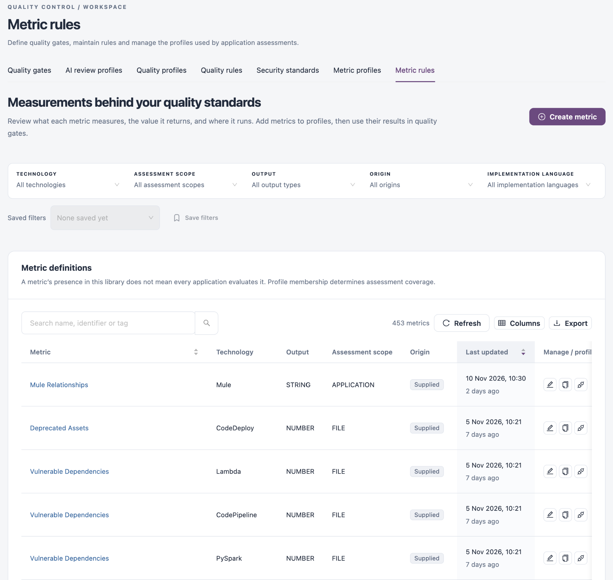
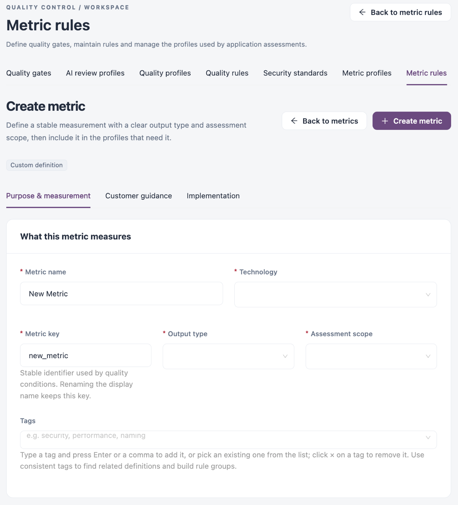

# Metric Rules

A metric produces a measured value during an assessment, such as the number of blocker issues or the number of batch jobs. Quality gate conditions compare these values with required results. A metric only runs for an application when it is included in that technology's metric profile. Use this tab to review what each metric measures, the value it returns and where it runs.

Open it from **Operations** → **Quality Control** → **Metric rules** in the sidebar.


You need a role that can view metric rules. Creating, editing, cloning, deleting and activating metrics in profiles need the matching metric permissions.


<figure><figcaption></figcaption></figure>

## Filters

| Filter                             | Description                                                            |
| ---------------------------------- | ---------------------------------------------------------------------- |
| **Technology**                     | The technology the metric applies to.                                  |
| **Assessment scope**               | Where the metric runs, for example `APPLICATION`, `PROJECT` or `FILE`. |
| **Output**                         | The type of value it returns, for example `NUMBER` or `STRING`.        |
| **Origin**                         | **Supplied** or **Custom**.                                            |
| **Implementation language**        | The language the metric's logic is written in.                         |
| **Search name, identifier or tag** | Finds metrics by name, identifier or tag.                              |

**Saved filters** and **Save filters** keep a combination of filters for later.

## Metric Definitions

The count shows how many metrics match. **Refresh** reloads the table, **Columns** shows or hides columns and **Export** downloads the table.

| Column                          | Description                                                                                                                                                                                                                                   |
| ------------------------------- | --------------------------------------------------------------------------------------------------------------------------------------------------------------------------------------------------------------------------------------------- |
| **Metric**                      | The metric name. Click it to open the metric.                                                                                                                                                                                                 |
| **Technology**                  | The technology the metric applies to.                                                                                                                                                                                                         |
| **Output**                      | The type of value it returns.                                                                                                                                                                                                                 |
| **Assessment scope**            | Where it runs.                                                                                                                                                                                                                                |
| **Origin**                      | **Supplied** or **Custom**.                                                                                                                                                                                                                   |
| **Last updated**                | When the metric last changed. The list shows the most recently changed metrics first; click **Last updated** or the name column to sort.                                                                                                      |
| **Manage / profile membership** | **Edit metric**, **Clone metric** (asks for confirmation, then creates a custom copy and opens it), **Activate in profile** (adds it to metric profiles) and, for custom metrics, **Delete metric**. The actions you see depend on your role. |


A metric's presence in this library does not mean every application evaluates it. Profile membership decides which metrics are measured.



Deleting a custom metric cannot be undone.


## Create a Metric

1. Click **Create metric**.
2. Fill in the fields on **Purpose & measurement**, **Customer guidance** and **Implementation**.
3. Click **Create metric**. **Back to metrics** or **Back to metric rules** leaves without saving.
4. Use **Activate in profile** to include the metric in the metric profiles that need it.

<figure><figcaption></figcaption></figure>

| Field                       | Description                                                                                                                                         |
| --------------------------- | --------------------------------------------------------------------------------------------------------------------------------------------------- |
| **Metric name**             | Required. A descriptive name, up to 100 characters.                                                                                                 |
| **Technology**              | Required. The technology the metric applies to.                                                                                                     |
| **Metric key**              | Required. The stable identifier that quality gate conditions use. Renaming the metric keeps this key.                                               |
| **Output type**             | Required. The type of value the metric returns.                                                                                                     |
| **Assessment scope**        | Required. Where the metric runs.                                                                                                                    |
| **Tags**                    | Type a tag and press Enter or a comma, or pick an existing tag.                                                                                     |
| **Guidance (Markdown)**     | On **Customer guidance**: what the value means, why it matters and what the application owner should do. **Guidance preview** shows how it renders. |
| **Implementation language** | On **Implementation**: required. The language of the metric's logic, together with the implementation itself.                                       |

## Open or Edit a Metric

Click a metric's name to open it. **Edit definition** lets you change it; click **Save definition** to keep the change, or **Cancel**. **Activate in profile** adds it to metric profiles. Supplied metrics have no **Implementation** tab; clone one to make a custom version you can change.

## Next Steps

* [Metric Profiles](metric-profiles.md): include metrics in the profile for a technology.
* [Quality Gates](quality-gates.md): use a metric's value in a gate condition.
* [Quality Rules](quality-rules.md): review the rules whose findings many metrics count.
* [Quality Control](./): return to the Quality Control overview.
