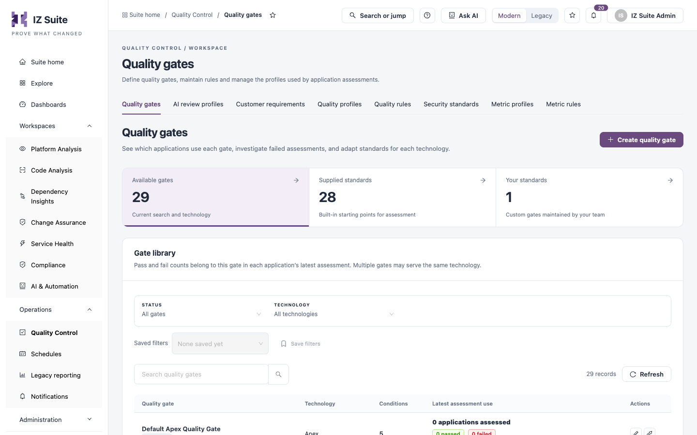
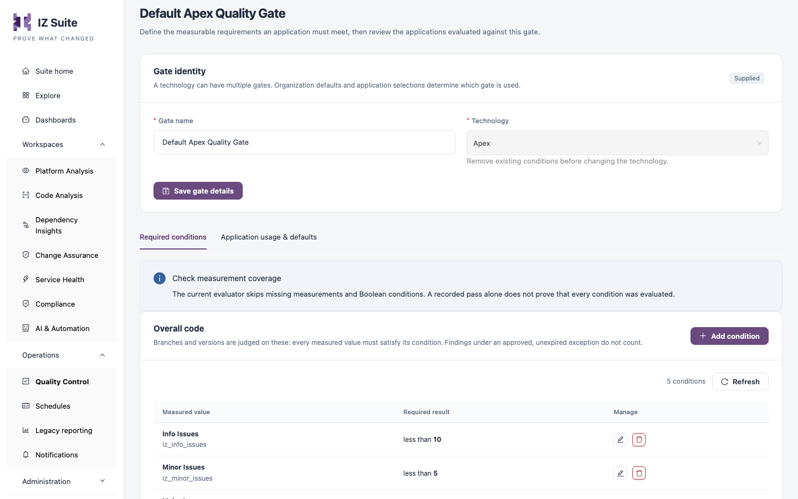

# Quality Gates

A quality gate is a set of conditions on measured values, such as "Critical issues equal to 0". After an assessment, IZ Suite compares the application's measured values with the gate for its technology and records a pass or a failure. Use this tab to see which applications each gate judged, investigate failures and adapt the conditions for each technology.

Open it from **Operations** → **Quality Control** → **Quality gates** in the sidebar.


You need a role that can view quality gates. Creating, editing and assigning gates, and removing conditions, need roles that can create, edit or delete quality gates.


<figure><figcaption>
Quality gates
</figcaption></figure>

## Summary tiles

Click a tile to filter the gate library.

| Tile                   | Shows                                                              |
| ---------------------- | ------------------------------------------------------------------ |
| **Available gates**    | All gates that match the current search and technology.            |
| **Supplied standards** | Built-in gates supplied with IZ Suite, one default per technology. |
| **Your standards**     | Custom gates your team maintains.                                  |

## Gate library

| Filter                   | Description                                                                                 |
| ------------------------ | ------------------------------------------------------------------------------------------- |
| **Status**               | **All gates**, **Custom**, **Supplied** or **Needs definition** (gates without conditions). |
| **Technology**           | The technology the gate measures, for example Apex, Mule or CloudFormation.                 |
| **Search quality gates** | Finds gates by name.                                                                        |

**Saved filters** and **Save filters** keep a combination of filters for later. **Refresh** reloads the list.

| Column                    | Description                                                                                                                                                                          |
| ------------------------- | ------------------------------------------------------------------------------------------------------------------------------------------------------------------------------------ |
| **Quality gate**          | The gate name and a **Supplied** or **Custom** tag. Click the name to open the gate's details.                                                                                       |
| **Technology**            | The technology the gate applies to.                                                                                                                                                  |
| **Conditions**            | The number of conditions, or **Needs definition** when there are none.                                                                                                               |
| **Latest assessment use** | How many applications were assessed with the gate in their latest assessment, how many passed and failed, and in how many organizations it is the default. Click it to review usage. |
| **Actions**               | **Edit gate** (**View gate** when you can only view) and **Assign to organizations**.                                                                                                |


Pass and fail counts come from each application's latest assessment only. Several gates can serve the same technology; organization defaults and application selections decide which one an assessment uses.


## Gate details

Click a gate's name, condition count or usage to open its details. The drawer shows the technology, whether the gate is supplied or custom, when it was last updated and its conditions. **Application usage & defaults** shows:

* **Applications assessed**, **Passed this gate** and **Failed this gate** for the latest recorded assessments.
* **Applications using this standard**: each application or version whose latest assessment used this gate, filtered by **All**, **Passed**, **Failed** or **Not evaluated**.
* **Organization defaults**: the organizations that use this gate by default.

**Edit / inspect definition** opens the gate editor. **Assign to organizations** opens the assignment described below.

## Create a quality gate

1. Click **Create quality gate**.
2. Enter the **Gate name**. Required.
3. Choose the **Technology**. Required. Conditions measure this technology's metrics, so choose it first.
4. Under **Overall code**, click **Add condition** and fill in the condition (see [Condition fields](quality-gates.md#condition-fields)). Repeat for each condition.
5. Optionally, under **New code**, add the conditions that judge pull requests.
6. Click **Create quality gate**. The gate and its conditions are saved together and the gate opens in the editor.

<figure><figcaption>
Editing a quality gate
</figcaption></figure>

### Condition scopes

| Scope            | How it is used                                                                                                                                                                                                                                                   |
| ---------------- | ---------------------------------------------------------------------------------------------------------------------------------------------------------------------------------------------------------------------------------------------------------------- |
| **Overall code** | Branches and versions are judged on these conditions: every measured value must satisfy its condition. Findings under an approved, unexpired exception do not count.                                                                                             |
| **New code**     | Pull requests are judged on these conditions alone, using issue counts for the findings that are not open on the target branch. Without new-code conditions, or when the target branch has not been scanned, a pull request is judged on the overall conditions. |

### Condition fields

| Field                   | Description                                                                                                                                                           |
| ----------------------- | --------------------------------------------------------------------------------------------------------------------------------------------------------------------- |
| **Measured value**      | The metric to check, shown with its output type. Required. Boolean metrics cannot be chosen. New-code conditions use issue counts per severity.                       |
| **Required comparison** | **Is Greater Than**, **Is Greater Than Equal To**, **Is Less Than**, **Is Less Than Equal To** or **Is Equal To**. Required. Text metrics allow **Is Equal To** only. |
| **Required value**      | The value to compare with. Required. A numeric metric needs a valid number.                                                                                           |

The dialog shows the resulting requirement in words, for example "Require Critical Issues to be equal to 0".

## Edit a quality gate

1. Click **Edit gate** on the gate's row.
2. Change the **Gate name** and click **Save gate details**.
3. On **Required conditions**, use **Add condition**, **Edit condition** or **Remove condition** in each scope. Each change is saved when you confirm it.

The **Technology** cannot be changed while the gate has conditions; remove them first. The **Application usage & defaults** tab shows the same usage as the details drawer and **Assign organization defaults**.


The evaluator skips missing measurements and Boolean conditions. A recorded pass alone does not prove that every condition was evaluated, so check that the profile for the technology measures each metric your gate uses.


## Assign a gate to organizations

1. Click **Assign to organizations** on the gate's row. The **Activate Profile In Org** dialog lists the organizations that already use the gate under **Profile active in Organizations**.
2. Choose one or more organizations in the **Add organization to profile** field.
3. Click **Add Organizations**.

Assignment controls which organizations use the gate for future assessments. It does not change past assessment results.

## Next steps

* [Metric Profiles](metric-profiles.md): make sure the metrics your conditions use are measured.
* [Metric Rules](metric-rules.md): review what each measured value means.
* [Quality Profiles](quality-profiles.md): choose which rules raise the findings that gates count.
* [Quality Control](./): return to the Quality Control overview.
