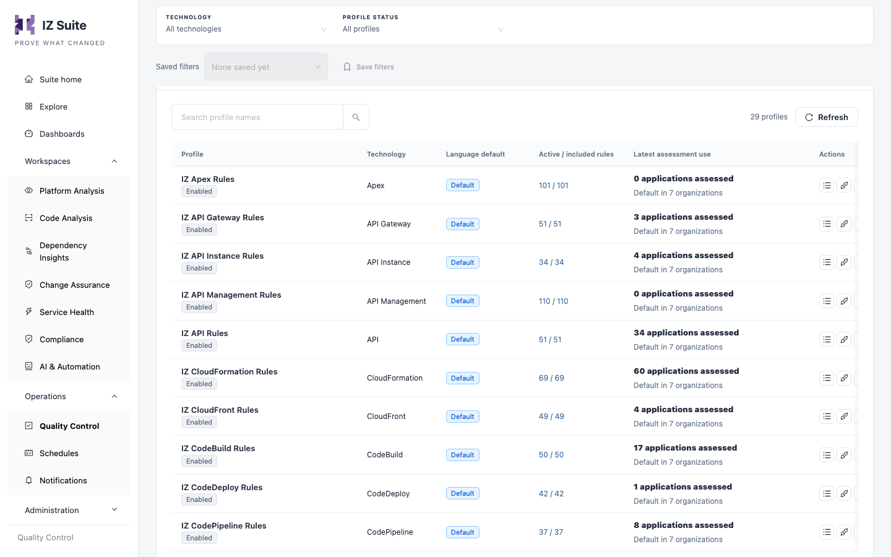
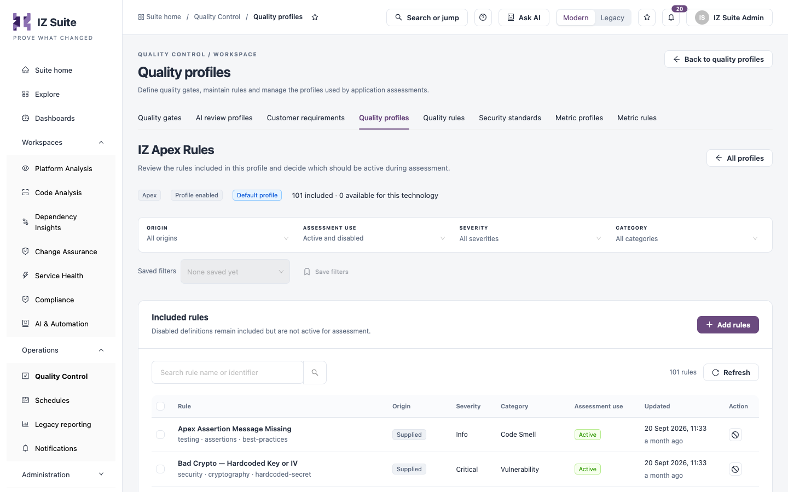

# Quality Profiles

A quality profile is the set of quality rules that runs when an application of a technology is assessed. Each technology has a supplied language default, and you can create alternatives for particular applications or policies. Use this tab to compare how profiles are used, review organization defaults and adapt the rules each application uses.

Open it from **Operations** → **Quality Control** → **Quality profiles** in the sidebar.


You need a role that can view quality profiles. Creating, editing, cloning and assigning profiles need roles that can manage or clone quality profiles.


<figure><figcaption>
Quality profiles
</figcaption></figure>

## Summary tiles

Click a tile to filter the table.

| Tile                      | Shows                                                                                             |
| ------------------------- | ------------------------------------------------------------------------------------------------- |
| **Profiles**              | All profiles in the selected technology scope.                                                    |
| **Language defaults**     | The starting default profile of each technology. Organization and application choices can differ. |
| **No active definitions** | Profiles without any active rule. Review their coverage before assigning them.                    |

## Profile adoption and configuration

| Filter                   | Description                                                                                                          |
| ------------------------ | -------------------------------------------------------------------------------------------------------------------- |
| **Technology**           | The technology the profile applies to.                                                                               |
| **Profile status**       | **All profiles**, **Language defaults**, **Other profiles**, **Enabled**, **Disabled** or **No active definitions**. |
| **Search profile names** | Finds profiles by name.                                                                                              |

**Saved filters** and **Save filters** keep a combination of filters for later. **Refresh** reloads the table.

| Column                      | Description                                                                                                                                   |
| --------------------------- | --------------------------------------------------------------------------------------------------------------------------------------------- |
| **Profile**                 | The profile name and whether it is **Enabled** or **Disabled**. Click the name to open its details.                                           |
| **Technology**              | The technology the profile applies to.                                                                                                        |
| **Language default**        | **Default** when this is the technology's default profile.                                                                                    |
| **Active / included rules** | Active rules out of all included rules. Click it to review the rules.                                                                         |
| **Latest assessment use**   | How many applications used the profile in their latest assessment, and in how many organizations it is the default. Click it to review usage. |
| **Actions**                 | **Review rules**, **Assign organization defaults** and **Clone profile**.                                                                     |


Application counts reflect the latest recorded assessment. Organization defaults describe configuration, not proof that a profile was used.


## Profile details

Click a profile's name or usage to open its details: technology, status, whether it is the language default and when it was updated, followed by the applications whose latest assessment used it and its organization defaults. From the details you can:

* **Edit profile details**: change the name and description.
* **Export profile**: download the profile as JSON, for example to import it elsewhere.
* **Make language default**: make this enabled profile the technology's default. Organization and application selections may still use another profile.
* **Disable profile** or **Enable profile**: organizations using a disabled profile revert to the language default. Recorded assessment results stay unchanged.

## Create a profile

1. Click **Create Profile**.
2. Enter the **Profile name**. Required.
3. Choose the **Starting point**: **Start empty**, or **Import JSON** to upload an **Exported profile** file.
4. Choose the **Technology**. Required.
5. Optionally, explain in **Purpose** which applications or policy the profile is for.
6. Click **Create profile**.

A new profile does not change existing organization defaults. Add rules and review its coverage before you assign it.

## Clone a profile

1. Click **Clone profile** on the profile's row.
2. Enter the **New Profile Name**. Required.
3. Confirm the clone.

## Review the rules in a profile

Click **Review rules** to open the profile's rules. The header shows the technology, whether the profile is enabled and the default, and how many rules are included and still available for the technology.

<figure><figcaption>
Rules in a profile
</figcaption></figure>

| Filter             | Description                        |
| ------------------ | ---------------------------------- |
| **Origin**         | **Supplied** or **Custom** rules.  |
| **Assessment use** | **Active**, **Disabled**, or both. |
| **Severity**       | The rule severity.                 |
| **Category**       | The rule category.                 |

The table lists each **Rule** with its tags, **Origin**, **Severity**, **Category**, **Assessment use** and when it was **Updated**. The **Action** column disables an active rule in this profile or activates a disabled one. Disabled rules stay in the profile but are not used in assessments.

Select rules with the checkboxes and click **Investigate selected rules** to see the applications and open issues they affect. **Clear selection** clears the checkboxes.

### Add rules to a profile

1. Click **Add rules**.
2. Search and select the rules to add from the available rules for the technology. Selections are kept while you search and page.
3. Review the selection; **Remove from selection** drops a rule.
4. Confirm in **Review profile additions**.

## Assign organization defaults

1. Click **Assign organization defaults** on the profile's row.
2. Choose one or more organizations in **Add organization to profile**, and click **Add Organizations**.

**Profile active in Organizations** lists the organizations that already use this profile by default. Defaults apply to future assessments and do not rewrite earlier results.

## Next steps

* [Quality Rules](quality-rules.md): review and create the rules a profile uses.
* [Quality Gates](quality-gates.md): set the limits the profile's findings are judged against.
* [Metric Profiles](metric-profiles.md): choose the metrics measured for a technology.
* [Quality Control](./): return to the Quality Control overview.
