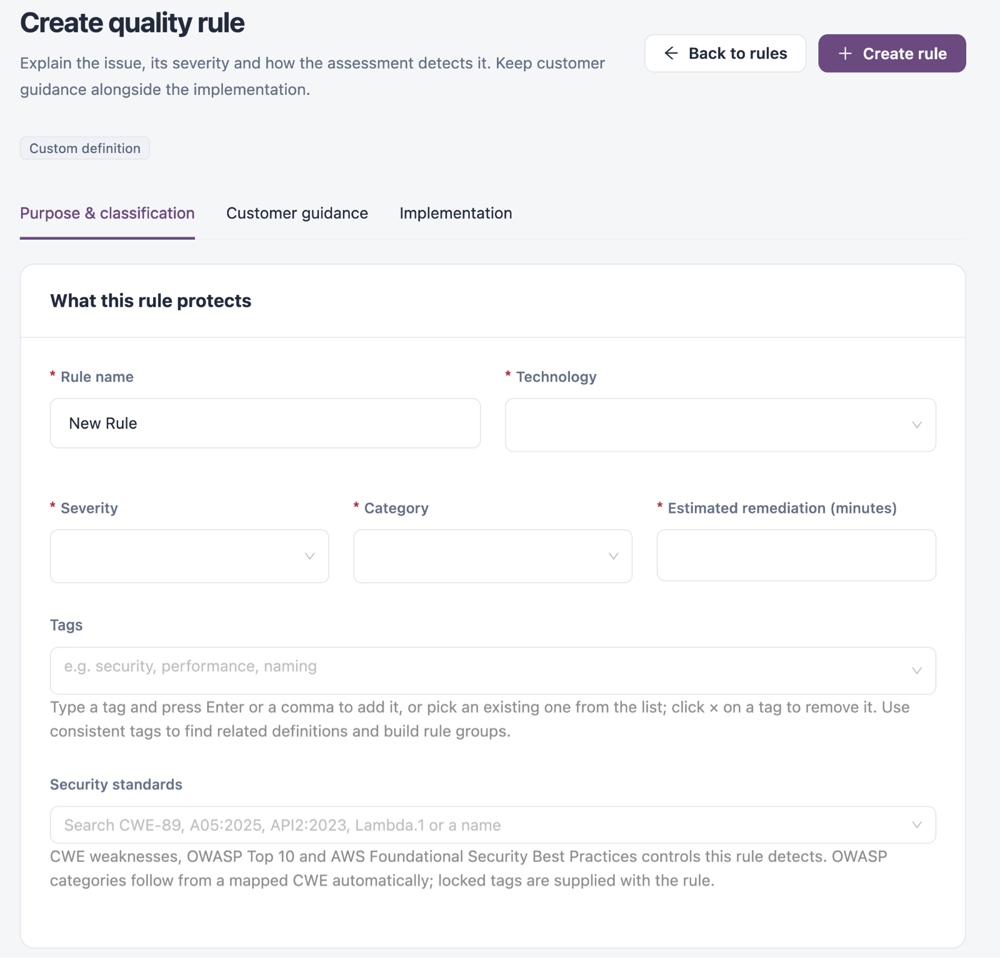

# Quality Rules

A quality rule detects one kind of issue, such as a hard-coded secret or a missing error handler, and raises a finding with a severity and category. Rules are supplied with IZ Suite for each technology, and your team can add custom rules. Use this tab to find a rule, see which applications and open issues it affects, and maintain your custom rules.

Open it from **Operations** → **Quality Control** → **Quality rules** in the sidebar.


You need a role that can view quality rules. Creating, editing, cloning, deleting and activating rules in profiles need the matching quality rule permissions.


<figure><figcaption></figcaption></figure>

## Filters

| Filter                             | Description                                                                      |
| ---------------------------------- | -------------------------------------------------------------------------------- |
| **Technology**                     | The technology the rule applies to.                                              |
| **Severity**                       | The rule severity, for example **Critical**, **Major**, **Minor** or **Info**.   |
| **Category**                       | The rule category, for example **Bugs**, **Vulnerabilities** or **Code smells**. |
| **Origin**                         | **Supplied** or **Custom**.                                                      |
| **Implementation language**        | The language the rule's detection logic is written in.                           |
| **Search name, identifier or tag** | Finds rules by name, identifier or tag.                                          |

**Saved filters** and **Save filters** keep a combination of filters for later.

## Rule Table

**Refresh** reloads the table, **Columns** shows or hides columns (**Rule id** and **Tags** start hidden) and **Export** downloads the table.

| Column           | Description                                                                                                                          |
| ---------------- | ------------------------------------------------------------------------------------------------------------------------------------ |
| **Rule**         | The rule name and its tags. Click it to open the rule.                                                                               |
| **Technology**   | The technology the rule applies to.                                                                                                  |
| **Severity**     | The severity of the findings it raises.                                                                                              |
| **Category**     | The category of the findings it raises.                                                                                              |
| **Origin**       | **Supplied** or **Custom**.                                                                                                          |
| **Last updated** | When the rule last changed. The list shows the most recently changed rules first; click **Last updated** or the name column to sort. |
| **Manage**       | The row actions below. Actions that do not fit open from **More actions**.                                                           |

| Action                  | What it does                                                         |
| ----------------------- | -------------------------------------------------------------------- |
| **Edit rule**           | Opens the rule in the definition editor.                             |
| **Clone rule**          | Creates a custom copy and opens it in the definition editor.         |
| **Find violations**     | Opens **Rule impact investigation** for the rule.                    |
| **Activate in profile** | Adds the rule to one or more quality profiles.                       |
| **Delete rule**         | Permanently deletes a custom rule. Supplied rules cannot be deleted. |


Deleting a custom rule cannot be undone.


## Investigate a Rule's Impact

1. Click **Find violations** on the rule's row.
2. In **Rule impact investigation**, review the applications affected by the rule and their open issues.
3. To investigate several rules together, add or remove rules with the tags at the top of the drawer.

## Create a Quality Rule

1. Click **Create rule**.
2. Fill in the fields on **Purpose & classification**, **Customer guidance** and **Implementation**.
3. Click **Create rule**. **Back to rules** leaves without saving.

<figure><figcaption></figcaption></figure>

### Purpose & Classification

| Field                               | Description                                                                                                                                                                  |
| ----------------------------------- | ---------------------------------------------------------------------------------------------------------------------------------------------------------------------------- |
| **Rule name**                       | Required. A descriptive name, up to 100 characters.                                                                                                                          |
| **Technology**                      | Required. The technology the rule applies to.                                                                                                                                |
| **Severity**                        | Required. The severity of the findings it raises.                                                                                                                            |
| **Category**                        | Required. The category of the findings it raises.                                                                                                                            |
| **Estimated remediation (minutes)** | Required. How long a fix usually takes.                                                                                                                                      |
| **Tags**                            | Type a tag and press Enter or a comma, or pick an existing tag. Consistent tags help you find related rules.                                                                 |
| **Security standards**              | The CWE weaknesses, OWASP Top 10 categories and AWS Foundational Security Best Practices controls the rule detects. OWASP categories follow from a mapped CWE automatically. |

### Customer Guidance

**Guidance (Markdown)** explains what the finding means, why it matters and what the application owner should do. **Guidance preview** shows how it renders.

### Implementation

**Implementation language** (required) and the rule implementation (required) define how the assessment detects the issue. Saving updates the definition; adding it to profiles is a separate step.

## Open or Edit a Rule

Click a rule's name to open it. The header shows whether it is a **Supplied definition** or a **Custom definition**, and offers:

* **Edit definition**: change the fields, then click **Save definition**, or **Cancel**.
* **Find applications and issues**: open the rule impact investigation.
* **Activate in profile**: add the rule to quality profiles.

Supplied rules have no **Implementation** tab. When your role cannot edit a rule, the page shows it as a **Read-only definition**; clone it to make a custom version you can change.

## Next Steps

* [Quality Profiles](quality-profiles.md): choose which rules run for a technology.
* [Security Standards](security-standards.md): see which rules detect each CWE or OWASP category.
* [Metric Rules](metric-rules.md): review the metrics that count findings for quality gates.
* [Quality Control](./): return to the Quality Control overview.
