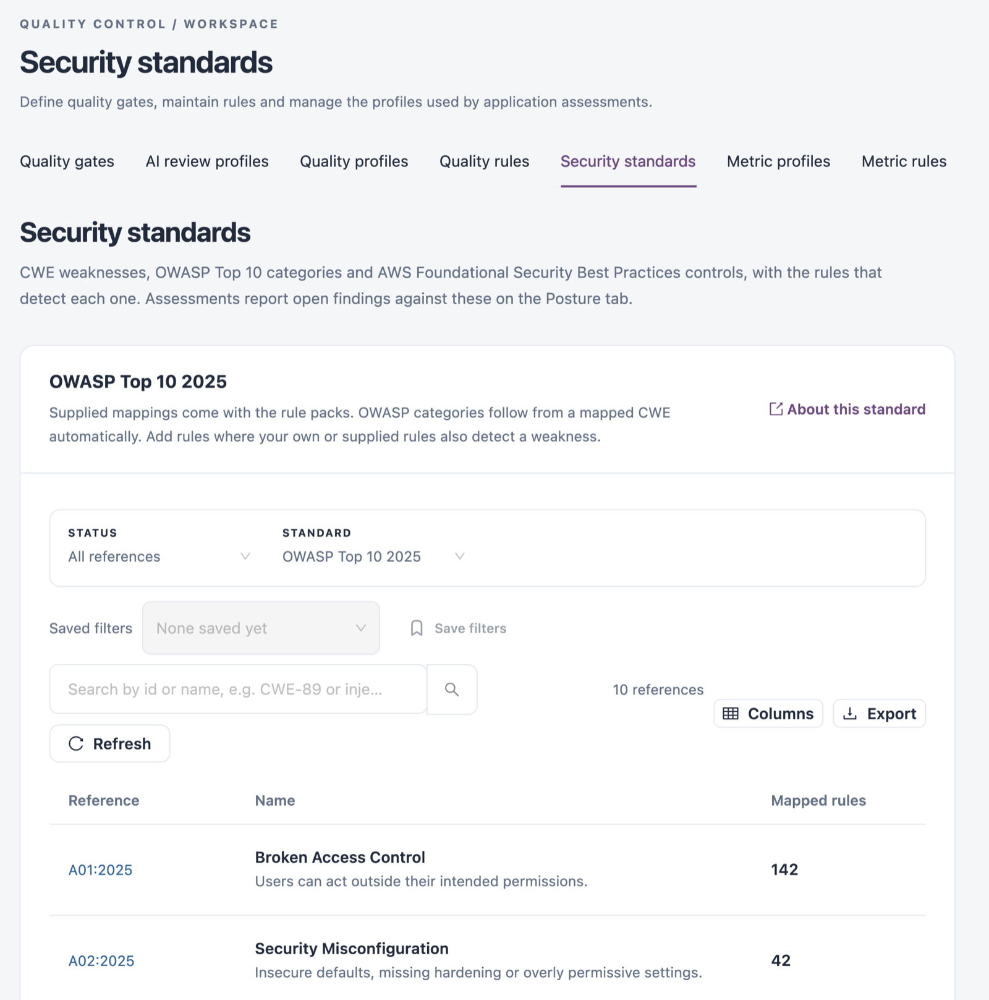

# Security Standards

Security standards link quality rules to well-known security references: CWE weaknesses, OWASP Top 10 categories and AWS Foundational Security Best Practices controls. Assessments report open findings against these references on an application's **Posture** tab. Use this tab to see which rules detect each reference, and to map your own or supplied rules to a weakness they also detect.

Open it from **Operations** → **Quality Control** → **Security standards** in the sidebar.


You need a role that can view quality rules. Adding and removing mappings needs a role that can edit quality rules.


<figure><figcaption></figcaption></figure>

## Choose a Standard

| Filter                   | Description                                                                                                                                          |
| ------------------------ | ---------------------------------------------------------------------------------------------------------------------------------------------------- |
| **Status**               | **All references**, **Mapped to rules** or **Not mapped**.                                                                                           |
| **Standard**             | **CWE**, **OWASP Top 10 2025**, **OWASP Top 10 2021 (earlier)**, **OWASP API Security Top 10 2023** or **AWS Foundational Security Best Practices**. |
| **Search by id or name** | Finds a reference by its id or name, for example `CWE-89` or `injection`.                                                                            |

**About this standard** opens the standard's own website. **Saved filters** and **Save filters** keep a combination of filters for later. **Refresh** reloads the list, **Columns** chooses the visible columns and **Export** downloads the list.

Supplied mappings come with the rule packs. OWASP categories follow automatically from a mapped CWE.

## References

| Column           | Description                                                                                    |
| ---------------- | ---------------------------------------------------------------------------------------------- |
| **Reference**    | The reference id, for example `A01:2025`. It links to the reference on the standard's website. |
| **Name**         | The reference name and a short description. Click it to open the rules that detect it.         |
| **Mapped rules** | How many rules detect the reference. Click it to open the rules.                               |

## Rules That Detect a Reference

Click a reference's name or mapped rule count to open it. The drawer shows the standard, the reference and its mapped rule count, then **Rules that detect this**:

| Column         | Description                                                                                                                           |
| -------------- | ------------------------------------------------------------------------------------------------------------------------------------- |
| **Rule**       | The rule name. Click it to open the rule.                                                                                             |
| **Technology** | The technology the rule applies to.                                                                                                   |
| **Mapping**    | **Supplied** (comes with the rule pack), **Derived** (follows from a CWE mapped to the rule) or **Added** (added in Quality Control). |

Supplied and derived mappings are locked. **Remove mapping** removes a mapping that was added in Quality Control.

## Map Rules to a Reference

1. Click the reference's name.
2. Under **Add rules**, search for rules by name or id and select one or more.
3. Click **Add rules**.

A CWE added this way also maps the rule to the OWASP categories that follow from it. You can also map a rule to references from the rule itself, in its **Security standards** field.

## Next Steps

* [Quality Rules](quality-rules.md): open a rule and edit its security standards.
* [Quality Profiles](quality-profiles.md): make sure the rules that detect a weakness are active.
* [Quality Control](./): return to the Quality Control overview.
