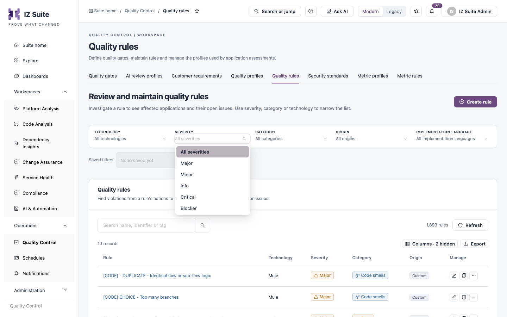

# Severities & Categories

Every finding comes from one rule, and every rule carries two labels that the finding inherits: a **severity** (how urgent the issue is) and a **category** (what kind of problem it is). Because the labels belong to the rule, the same issue is rated the same way in every application and every assessment. Quality gates count findings by these labels.

You see each rule's severity and category in **Operations** → **Quality Control** → **Quality rules**, where both are also filters.

<figure><figcaption>
Filtering rules by severity
</figcaption></figure>

## Severities

| Severity     | Meaning                                                                                                                                                         |
| ------------ | --------------------------------------------------------------------------------------------------------------------------------------------------------------- |
| **Blocker**  | A definite, high-impact flaw that should stop a release, typically an exploitable security issue such as an injection or credentials embedded in configuration. |
| **Critical** | A serious security or reliability risk to fix urgently, although it may need a specific condition to cause harm.                                                |
| **Major**    | A real defect or risk with significant impact on reliability, security or maintainability.                                                                      |
| **Minor**    | A low-impact issue or a gap against good practice.                                                                                                              |
| **Info**     | Guidance on naming, documentation or inventory. It is not a defect.                                                                                             |

Workspaces group **Blocker** and **Critical** together as **Critical + Blocker**, for example in the findings severity filter and in the **Time to fix** effort to fix first (see [Platform Analysis Findings](https://knowledgebase.autorabit.com/product-guides/integral-zone/iz-suite/workspaces/platform-analysis/findings#time-to-fix)).

## Categories

| Category             | Meaning                                                                                                         |
| -------------------- | --------------------------------------------------------------------------------------------------------------- |
| **Vulnerability**    | A definite, exploitable security flaw.                                                                          |
| **Security Hotspot** | Security-sensitive code or configuration that a person needs to review before deciding whether it is a problem. |
| **Bug**              | Code or configuration that will not behave as intended.                                                         |
| **Code Smell**       | A maintainability or style issue.                                                                               |

Filters and rule forms use the singular names; finding tables and tiles show the plurals (**Vulnerabilities**, **Bugs**, **Security hotspots**, **Code smells**).

## How severities drive quality gates

Each technology's assessment counts the findings by severity and category into measured values that quality gate conditions can check:

| Measured value                                                                                | Counts                     |
| --------------------------------------------------------------------------------------------- | -------------------------- |
| **Blocker Issues**, **Critical Issues**, **Major Issues**, **Minor Issues**, **Info Issues**  | Findings of that severity. |
| **Total Issues**                                                                              | All findings.              |
| **Total Vulnerabilities**, **Total Bugs**, **Total Code Smells**, **Total Security Hotspots** | Findings of that category. |

When IZ Suite judges a gate:

* The severity counts are taken from the application's open findings. Findings under an approved, unexpired exception do not count.
* Branches and versions are judged on the **Overall code** conditions, counting every open finding. A finding counts until it is fixed, so a gate does not turn green from a rescan alone.
* Pull requests are judged on the **New code** conditions, which use the severity counts of the findings the change introduced.
* The other counts, such as the category totals, are measured values: they can only be checked when the technology's [metric profile](https://knowledgebase.autorabit.com/product-guides/integral-zone/iz-suite/operations/quality-control/metric-profiles) includes them.

The supplied gates require no **Blocker**, **Critical** or **Major** issues and allow a limited number of **Minor** and **Info** issues. The limits differ by technology; open the gate in [Quality Gates](https://knowledgebase.autorabit.com/product-guides/integral-zone/iz-suite/operations/quality-control/quality-gates) to see them.

A common setup fails the gate on any Blocker or Critical issue, or on any vulnerability, and tracks the rest as a trend. In a pipeline, the Maven plugin stops the build when the gate fails if you pass `-DabortOnQualityGateFailure=true`.

## If you rate a rule differently

The supplied severities and categories are defaults; your risk policy can differ.

* **Change the severity or category**: clone the supplied rule, change the copy's **Severity** or **Category**, activate the copy in your quality profiles and disable the original there. See [Writing Custom Rules](writing-custom-rules.md#clone-a-supplied-rule).
* **Stop reporting a rule**: disable it in your quality profile. See [Quality Profiles](https://knowledgebase.autorabit.com/product-guides/integral-zone/iz-suite/operations/quality-control/quality-profiles#review-the-rules-in-a-profile).
* **Accept a single finding**: mark it as a false positive or accepted risk, so once approved it no longer counts against the gate. See [Platform Analysis Findings](https://knowledgebase.autorabit.com/product-guides/integral-zone/iz-suite/workspaces/platform-analysis/findings#mark-a-finding-as-a-false-positive-or-accepted-risk).

A change to a rule applies to the findings raised by later assessments.

## Next steps

* [Quality Gates](https://knowledgebase.autorabit.com/product-guides/integral-zone/iz-suite/operations/quality-control/quality-gates): set the severity limits each technology must meet.
* [Quality Rules](https://knowledgebase.autorabit.com/product-guides/integral-zone/iz-suite/operations/quality-control/quality-rules): filter rules by severity and category.
* [Writing Custom Rules](writing-custom-rules.md): create a rule with your own severity and category.
* [Quality Control](https://knowledgebase.autorabit.com/product-guides/integral-zone/iz-suite/operations/quality-control): return to the Quality Control overview.
