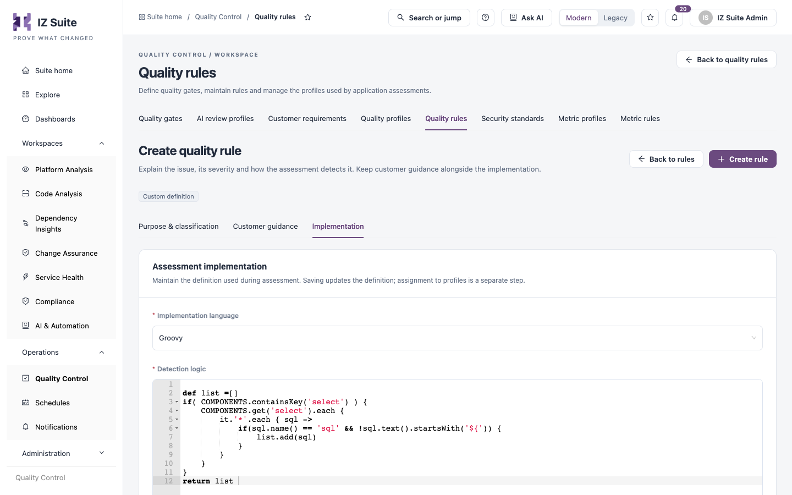
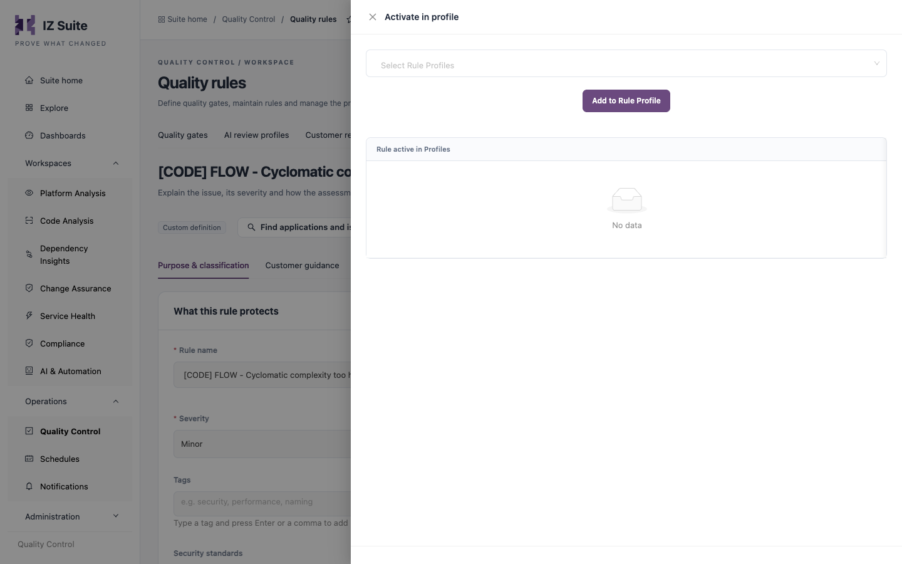

# Writing Custom Rules

When the supplied rules do not cover one of your standards, you write a custom rule. A custom quality rule raises findings; a custom metric measures a value that a quality gate can check. This page explains how to choose between them, how a rule definition is written, which keywords it can use and how to bring it into assessments.

You work in **Operations** → **Quality Control**, on the **Quality rules** and **Metric rules** tabs.


You need a role that can create quality rules (or metric rules). Cloning a supplied rule needs a role that can clone built-in rules, and adding a rule to a profile needs a role that can activate rules in profiles.


## Choose how to start

| Start from                | Use it when                                                                                                                             | Where                                                                                                                                                                         |
| ------------------------- | --------------------------------------------------------------------------------------------------------------------------------------- | ----------------------------------------------------------------------------------------------------------------------------------------------------------------------------- |
| **Clone a supplied rule** | A supplied rule is close to what you need, but you want a different severity, category or detection logic.                              | **Clone rule** on the rule's row in [Quality Rules](https://knowledgebase.autorabit.com/product-guides/integral-zone/iz-suite/operations/quality-control/quality-rules).      |
| **Create a quality rule** | You want findings for an issue no supplied rule detects.                                                                                | **Create rule** in [Quality Rules](https://knowledgebase.autorabit.com/product-guides/integral-zone/iz-suite/operations/quality-control/quality-rules#create-a-quality-rule). |
| **Create a metric**       | You want a measured value (a count, a yes/no or a text value) to report or to check in a quality gate, rather than individual findings. | **Create metric** in [Metric Rules](https://knowledgebase.autorabit.com/product-guides/integral-zone/iz-suite/operations/quality-control/metric-rules#create-a-metric).       |

Supplied rules are read-only. To change one, clone it: the copy is yours to edit, and you swap it for the original in your quality profiles.

## Clone a supplied rule

1. Open **Quality rules** and find the rule.
2. Click **Clone rule** on its row, then confirm. The custom copy, named after the original with `- Copy` added, opens in the definition editor.
3. Click **Edit definition**, change the **Rule name**, **Severity**, **Category**, **Tags**, guidance or the detection logic on **Implementation**, and click **Save definition**.
4. Activate the copy in your quality profiles, and disable the original there so the same issue is not reported twice (see [Put the rule to work](writing-custom-rules.md#put-the-rule-to-work)).

The copy keeps the original's technology, detection logic, automatic fix, estimated remediation, tags and security standards. Metrics are cloned the same way with **Clone metric** on the **Metric rules** tab.


The **Clone rule** action appears only for technologies your workspace is licensed for.


## Create a quality rule

1. On **Quality rules**, click **Create rule**.
2. On **Purpose & classification**, enter the **Rule name**, choose the **Technology**, **Severity** and **Category**, and set **Estimated remediation (minutes)**. Add **Tags** and **Security standards** if they apply.
3. On **Customer guidance**, write in **Guidance (Markdown)** what the finding means and how to fix it. A compliant and a non-compliant example help application owners most.
4. On **Implementation**, choose the **Implementation language** and write the **Detection logic** (see [How a rule definition works](writing-custom-rules.md#how-a-rule-definition-works)). The editor starts with an example Mule rule that you replace.
5. Optionally, add an **Automatic fix (optional)**: a script that corrects the finding when someone applies the fix.
6. Click **Create rule**. The rule opens with the message that profile membership is managed separately.

See [Severities & Categories](/broken/pages/a8c79e936effedf2683e2076e9dec344d344d695) to choose the severity and category, and [Quality Rules](https://knowledgebase.autorabit.com/product-guides/integral-zone/iz-suite/operations/quality-control/quality-rules#create-a-quality-rule) for every field.

<figure><figcaption><p>Writing the detection logic</p></figcaption></figure>

## How a rule definition works

During an assessment, IZ Suite parses the application's files for the rule's technology and then runs each active rule's definition against the parsed result. The definition reads the parsed content through **keywords** (predefined variables), and what it **returns** becomes the findings. Every finding gets the rule's severity and category.

### Implementation languages

| Language       | Used for                                                                                                                   |
| -------------- | -------------------------------------------------------------------------------------------------------------------------- |
| **Groovy**     | Most technologies: Mule, APIs (RAML and OAS), Salesforce Apex, Java, C#, Python, PySpark, Kubernetes and the AWS services. |
| **JavaScript** | Azure Logic Apps, Azure API Management and Azure Function Apps.                                                            |

The easiest way to learn a technology's keywords and return format is to clone one of its supplied rules: every supplied rule carries its full definition.

### Sandbox

Definitions run in a sandbox. A rule can read the files of the project being assessed but nothing outside it. Running processes, network access, reflection, reading environment variables or system properties, and creating threads or class loaders are rejected. JavaScript definitions have no file, network or process access at all.

### What a Groovy definition returns

| Return value                                                              | Findings raised                                                                                                                                                                                                      |
| ------------------------------------------------------------------------- | -------------------------------------------------------------------------------------------------------------------------------------------------------------------------------------------------------------------- |
| Nothing, `null` or an empty list or map                                   | None. The code is compliant.                                                                                                                                                                                         |
| A list of parsed XML elements (for example from `COMPONENTS`)             | One finding per element, at the element's file and line.                                                                                                                                                             |
| The text `'PROJECT_HANDLE'`                                               | One finding for the whole project, for example when a required file is missing.                                                                                                                                      |
| Any other text                                                            | One finding on that file, given as a path relative to the project root.                                                                                                                                              |
| `['PROPERTY': [<file path>: [<property keys>]]]`                          | One finding per property key, at the key's line in the property or YAML file.                                                                                                                                        |
| `['API': [<file path>: [<API elements>]]]`                                | One finding per API element (RAML or OAS), at the element's position.                                                                                                                                                |
| `['AST': [[path: …, line: …, desc: …]]]`                                  | One finding per entry in a source file, with `desc` as the finding's message. Used by source-code technologies such as Apex, Java, C# and Python.                                                                    |
| A list of `[id: …, line: …, desc: …]` or `[id: …, path: …, desc: …]` maps | One finding per entry on the resource with that `id`. `path` is the location inside the resource's document (for example `Resources.Fn.Properties.Runtime`) and is turned into a line. Used by the AWS technologies. |

A JavaScript definition returns an array of objects `{ id, path, desc }` or `{ id, line, desc }`, read in the same way as the last row.

## Rules registry keywords

Every technology's parser provides its own keywords. These are available to every rule:

| Keyword            | Contains                                                                |
| ------------------ | ----------------------------------------------------------------------- |
| `PROJECT_ROOT_DIR` | The root directory of the project being assessed (a `File`).            |
| `ANALYSIS`         | The assessment context. `ANALYSIS.projectDir` is the project directory. |

### Mule

Mule configuration files are parsed with the Groovy XML parser (`GPathResult` and `NodeChild` objects).

| Keyword              | Contains                                                                                                                                                                                                                 | Structure                      |
| -------------------- | ------------------------------------------------------------------------------------------------------------------------------------------------------------------------------------------------------------------------ | ------------------------------ |
| `DOCUMENTS`          | Every parsed Mule XML configuration file, by absolute file path.                                                                                                                                                         | `Map<String, GPathResult>`     |
| `COMPONENTS`         | Every element across all configuration files, grouped by element name without the namespace prefix (for example `flow`, `sub-flow`, `flow-ref`, `select`, `logger`). `all-flows` holds the flows and sub-flows together. | `Map<String, List<NodeChild>>` |
| `MUNIT_DOCUMENTS`    | Every parsed MUnit test file, by absolute file path.                                                                                                                                                                     | `Map<String, GPathResult>`     |
| `MUNIT_COMPONENTS`   | Every element across all MUnit files, grouped by element name.                                                                                                                                                           | `Map<String, List<NodeChild>>` |
| `CONFIGURATIONS`     | The application's property and YAML files. `get(key)` returns the key's values from all files, `getAll()` the files by path, `getProps(filePath)` one file's keys and values.                                            | Property registry              |
| `API_CONFIGURATIONS` | The parsed API specifications of the application. `getResolved()` returns them by main file path.                                                                                                                        | `Map<String, WebApi>`          |

### Other technologies

| Technology           | Main keywords                             |
| -------------------- | ----------------------------------------- |
| APIs (RAML, OAS)     | `API_CONFIGURATIONS`                      |
| Salesforce Apex      | `APEX_CLASSES`, `APEX_TRIGGERS`           |
| Java                 | `JAVA_FILES`, `JAVA_RESOURCES`            |
| C#                   | `CSHARP_FILES`                            |
| Python and PySpark   | `PYTHON_FILES`                            |
| Azure Logic Apps     | `WORKFLOWS`                               |
| Azure API Management | `APIS`, `POLICIES`                        |
| Azure Function Apps  | `FUNCTION_APP`, `FUNCTIONS`, `WEB_CONFIG` |

Source-code keywords such as `PYTHON_FILES` are lists with one entry per file. A Python entry has `filePath`, `fileName`, `sourceCode`, `sourceLines` and `parseTree`. The AWS technologies each provide keywords for their own resources; clone a supplied rule of the service to see them.

### Examples

A Mule rule that reports sub-flows no `flow-ref` calls (the supplied rule **Unused sub-flows SHOULD be removed**):


```groovy
def response = []

def references = COMPONENTS.get('flow-ref')?.collect { it.@name.text() }

COMPONENTS.get('sub-flow')?.each {
    if (!references || !references.contains(it.@name.text())) {
        response.add(it)
    }
}
return response
```


A Mule rule that reports password and secure properties stored without encryption:


```groovy
def response = [:]
def propFiles = [:]
CONFIGURATIONS.getAll().keySet().each { filePath ->
    def list = []
    def props = CONFIGURATIONS.getProps(filePath)
    props.keySet().each { key ->
        if ((key.toLowerCase().contains('pass') || key.toLowerCase().contains('secure')) && !props.get(key).startsWith('![')) {
            list.add(key)
        }
    }
    if (!list.isEmpty()) {
        propFiles[filePath] = list
    }
}
response['PROPERTY'] = propFiles
return response
```


A Python rule that reports `print(` calls, adapted from a supplied rule:


```groovy
def response = []
PYTHON_FILES.each { file ->
    file.sourceLines.eachWithIndex { String line, int idx ->
        if (line.contains('print(')) {
            response << [path: file.filePath, line: idx + 1, desc: 'Use logging instead of print.']
        }
    }
}
return ['AST': response]
```


## Write a metric

A metric definition returns a single value of the metric's **Output type**: a number, `true`/`false` or text. The **Assessment scope** decides how often it runs:

| Assessment scope | How it runs                                                                                                                                                    |
| ---------------- | -------------------------------------------------------------------------------------------------------------------------------------------------------------- |
| `FILE`           | Once per file. The keyword `METRIC_FILE` holds the file's absolute path. Numbers are added up across files; a yes/no value is true when any file returns true. |
| `PROJECT`        | Once for the whole project.                                                                                                                                    |

The **Metric key** is what quality gate conditions refer to, so choose it carefully. Number and text metrics can be used in gate conditions; yes/no metrics cannot. The editor starts with this example, which checks whether a Mule file defines a global error handler:


```groovy
def defined = false
if (DOCUMENTS.containsKey(METRIC_FILE)) {
    def node = DOCUMENTS.get(METRIC_FILE)
    node.'**'.findAll {
        if (it.name() == 'configuration' && (it.'@defaultExceptionStrategy-ref'.text() || it.'@defaultErrorHandler-ref'.text())) {
            defined = true
        }
    }
}
return defined
```


## Test the rule

Test a rule on a real project before you activate it. The Rules Playground in the IDE extension evaluates a definition against the project open in your editor, reports syntax errors and shows the findings it would raise.

You can also activate the rule in a profile that only a test application uses, assess that application and review the findings in **Find violations**.

## Put the rule to work

A new or cloned rule runs only after you add it to a quality profile. Profiles are per technology, so only profiles of the rule's technology are offered.

1. Open the rule and click **Activate in profile** (or use the row action on **Quality rules**).
2. Choose the profiles in **Select Rule Profiles**.
3. Click **Add to Rule Profile**. **Rule active in Profiles** lists where the rule is active.

<figure><figcaption><p>Activating a rule in profiles</p></figcaption></figure>

The rule raises findings from the next assessment of every application that uses one of those profiles.

For a metric, use **Activate in profile** on the metric to add it to a [metric profile](https://knowledgebase.autorabit.com/product-guides/integral-zone/iz-suite/operations/quality-control/metric-profiles); then add a gate condition on it in [Quality Gates](https://knowledgebase.autorabit.com/product-guides/integral-zone/iz-suite/operations/quality-control/quality-gates).

## Next steps

* [Severities & Categories](/broken/pages/a8c79e936effedf2683e2076e9dec344d344d695): choose the right severity and category for the rule.
* [Quality Profiles](https://knowledgebase.autorabit.com/product-guides/integral-zone/iz-suite/operations/quality-control/quality-profiles): add the rule to the profiles your applications use.
* [Quality Gates](https://knowledgebase.autorabit.com/product-guides/integral-zone/iz-suite/operations/quality-control/quality-gates): fail assessments on your rule's findings or your metric's value.
* [Quality Control](https://knowledgebase.autorabit.com/product-guides/integral-zone/iz-suite/operations/quality-control): return to the Quality Control overview.
