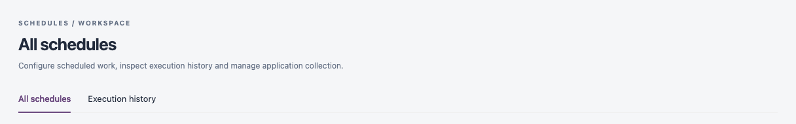

# Schedules

**Schedules** shows the work IZ Suite runs on a schedule or once: collecting assets from connected platforms, scanning repositories, syncing connections, checking endpoint health and producing reports. Agents pick up each run, and every run is recorded with its status and log.

Open it from **Operations** → **Schedules** in the sidebar. The tabs at the top switch between the sections below. Each tab appears only when your role can view it.

<figure><figcaption>
Schedules tabs
</figcaption></figure>

| Tab                                       | What it is for                                                                                     |
| ----------------------------------------- | -------------------------------------------------------------------------------------------------- |
| [All schedules](all-schedules.md)         | Recurring and one-time work, platform scan schedules, and pausing, resuming or editing a schedule. |
| [Execution history](execution-history.md) | Every run, its status, assigned worker, timing and recorded log.                                   |


A schedule controls when work is queued. The actual start time depends on the agents and capacity available.


## Next steps

* [All Schedules](all-schedules.md): schedule a platform scan or change a schedule's timing.
* [Execution History](execution-history.md): find the run that needs attention.
* Operations: return to the Operations overview.
