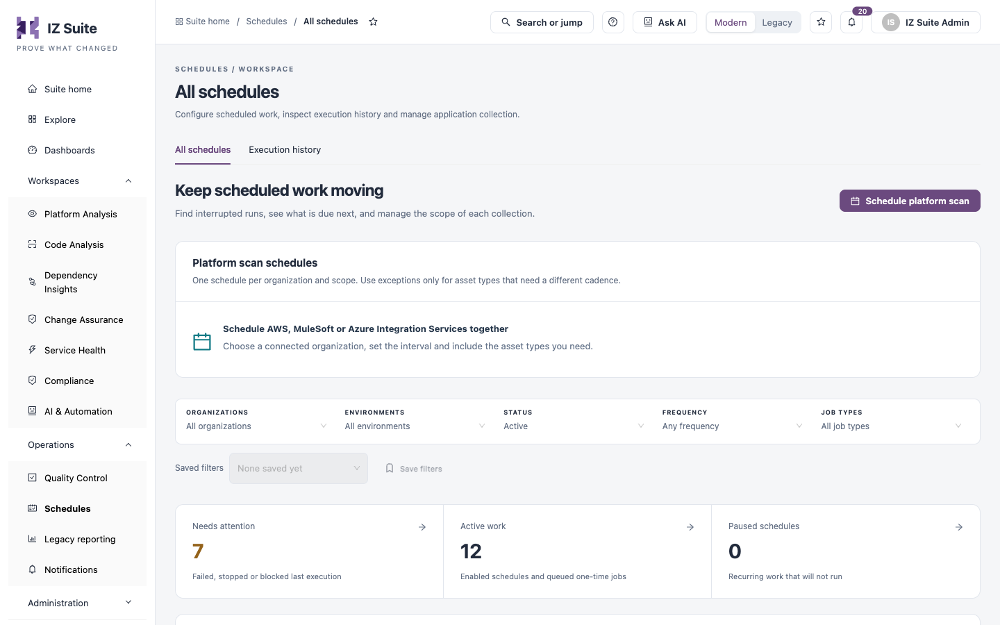
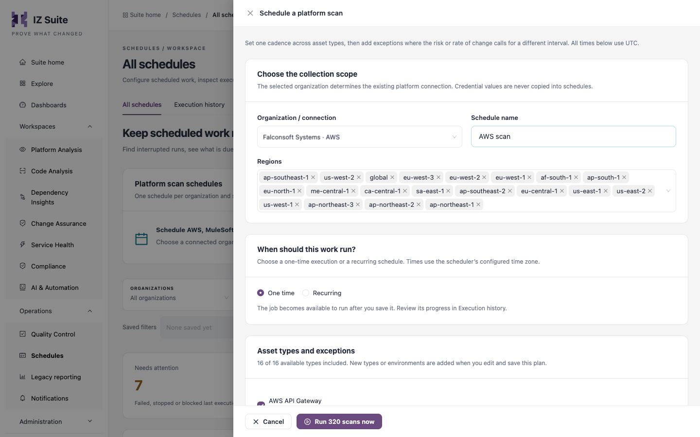
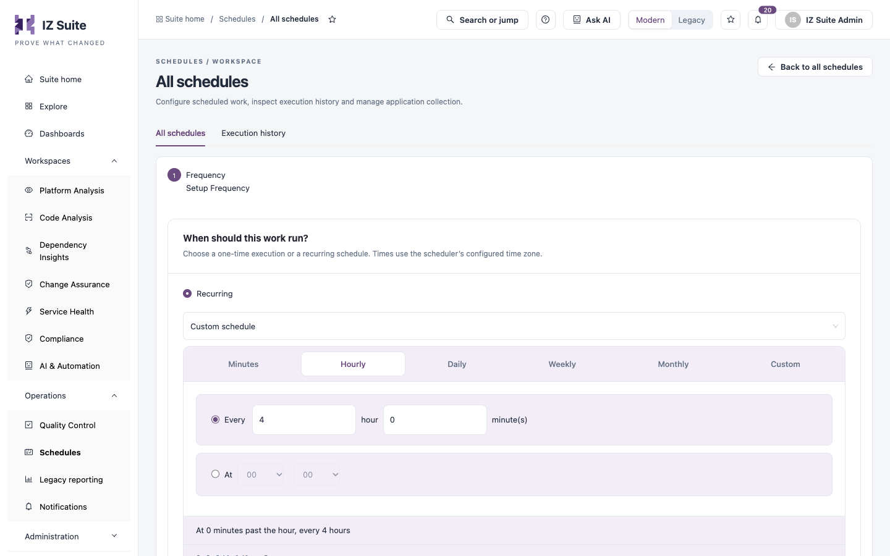

# All Schedules

This tab lists every piece of scheduled work: recurring schedules and queued one-time jobs. Use it to find work whose last run failed, see what is due next, schedule scans of a connected platform, and pause, resume or change a schedule.

Open it from **Operations** → **Schedules** → **All schedules** in the sidebar.


You need a role that can view jobs. Scheduling, editing, pausing, resuming and archiving need a role that can configure jobs. Opening execution history needs a role that can view job executions.


<figure><figcaption><p>All schedules</p></figcaption></figure>

## Platform scan schedules

**Platform scan schedules** shows one schedule per organization and collection scope for AWS, MuleSoft or Azure Integration Services. Each plan shows its organization, how many asset types and regions or environments it covers, and its timing. Click a plan's name to change it. See [Schedule a platform scan](all-schedules.md#schedule-a-platform-scan).

## Filters and summary tiles

| Filter                                       | Description                                                                                           |
| -------------------------------------------- | ----------------------------------------------------------------------------------------------------- |
| **Organizations**                            | The organizations the work belongs to.                                                                |
| **Environments**                             | The environments the work runs in.                                                                    |
| **Status**                                   | **Active**, **Disabled**, **Needs attention**, **Paused**, **Completed one-time** or **Archived**.    |
| **Frequency**                                | **Recurring** or **One-time**.                                                                        |
| **Job types**                                | The kind of work, for example a platform analysis, a repository scan or an AI evidence investigation. |
| **Search work, organization or environment** | Finds work by name, organization or environment.                                                      |

**Saved filters** and **Save filters** keep a combination of filters for later.

| Tile                 | Shows                                                     |
| -------------------- | --------------------------------------------------------- |
| **Needs attention**  | Work whose last execution failed, stopped or was blocked. |
| **Active work**      | Enabled schedules and queued one-time jobs.               |
| **Paused schedules** | Recurring work that will not run until resumed.           |

Click a tile to filter the table.

## Schedule table

The table lists the newest enabled work first, 10 per page, and follows the search and filters above. Switch between **Active** and **Disabled** work above the table. **Search schedules** finds a schedule, **Refresh** reloads the table, **Columns** shows or hides columns and **Export this page** downloads the rows on the current page.

| Column        | Description                                                                                                                                                              |
| ------------- | ------------------------------------------------------------------------------------------------------------------------------------------------------------------------ |
| **Schedule**  | The schedule name and its organization and environment. Click the name to open its details.                                                                              |
| **Frequency** | The timing in words, the cron expression of a recurring schedule, and the asset type when there is one.                                                                  |
| **Last run**  | The status of the last run, for example **Completed** or **Failed**, and how long ago it ran.                                                                            |
| **Next run**  | When active work runs next (**Awaiting scheduler** until it is planned), or **Paused**, **Archived**, **Finished / disabled** or **On-demand & change-triggered scans**. |
| **Actions**   | The row actions below. Actions that do not fit open from **More actions**.                                                                                               |

| Action                | What it does                                                             |
| --------------------- | ------------------------------------------------------------------------ |
| **Inspect run**       | Opens the schedule's details and the output of its last execution.       |
| **Execution history** | Opens the execution history of this schedule only.                       |
| **Edit schedule**     | Changes the timing of a recurring schedule.                              |
| **Pause schedule**    | Stops future runs until you resume. A running execution is not affected. |
| **Resume schedule**   | Lets the scheduler pick up paused recurring work again.                  |
| **Run again**         | Queues a completed one-time job to run again.                            |

## Schedule details

Click a schedule's name or **Inspect run** to open its details:

| Field                        | Description                                        |
| ---------------------------- | -------------------------------------------------- |
| **Scope**                    | The organization and environments the work covers. |
| **Schedule**                 | The timing in words, with its time zone.           |
| **Cron (UTC)**               | The cron expression.                               |
| **Status**                   | The schedule status, for example **Active**.       |
| **Last execution**           | The status of the last run.                        |
| **Last completed / updated** | When the last run finished or last changed.        |
| **Next scheduled run**       | When the work runs next.                           |

**Last execution evidence** shows the recorded scheduler output for this job; **Refresh** reloads it. For report schedules, the drawer also lets you change who receives the report.

**Archive schedule** stops future runs and moves the schedule to **Archived**. The record is kept.

## Schedule a platform scan

Use a platform scan schedule to collect and assess all the asset types of a connected AWS, MuleSoft or Azure Integration Services organization with one cadence.

1. Click **Schedule platform scan**.
2. Under **Choose the collection scope**, choose the **Organization / connection** and enter a **Schedule name**.
3. Choose the regions or environments to cover, for example **Regions** for AWS.
4. Under **When should this work run?**, choose **One time** or **Recurring**. For **Recurring**, choose the interval and whether to enable the schedule after saving.
5. Under **Asset types and exceptions**, clear the asset types you do not want to collect. For a recurring schedule, click the edit link next to an asset type's timing to give it its own cadence (an exception); **Use default** removes the exception.
6. For **One time**, click **Run&#x20;**_**N**_**&#x20;scans now** to queue the scans immediately.
7. For **Recurring**, click **Review schedule changes**, check **Review what will change**, then click **Save&#x20;**_**N**_**&#x20;schedules**. **Back to settings** returns to the form.

<figure><figcaption><p>Scheduling a platform scan</p></figcaption></figure>

| Field                          | Description                                                                                                                                                                                                               |
| ------------------------------ | ------------------------------------------------------------------------------------------------------------------------------------------------------------------------------------------------------------------------- |
| **Organization / connection**  | The connected organization and its platform. It decides which platform connection is used; credentials are never copied into schedules. It cannot be changed when you edit an existing plan.                              |
| **Schedule name**              | The plan name, up to 80 characters.                                                                                                                                                                                       |
| **Regions** / environments     | The AWS regions, or the environments of other platforms, to collect from. For MuleSoft, Exchange assets are collected once for the business group, while Runtime Manager and API instances use each selected environment. |
| **One time** / **Recurring**   | Run the scans once, or on a recurring interval. All times use UTC.                                                                                                                                                        |
| **Enable platform schedule**   | For a recurring plan: **Enable after saving**, or **Save paused**.                                                                                                                                                        |
| **Asset types and exceptions** | The asset types included. New asset types or environments are added when you edit and save the plan.                                                                                                                      |


A platform scan schedule changes only timing and collection scope. Eligibility, quality profiles, source retention, AI review profiles and budgets keep their settings. Existing individual schedules in the same scope are shown in the preview before they are included.



**No connected platform is available** means no organization is connected yet, or you cannot edit its licensed asset types. Connect an organization first.


## Edit a schedule's timing

1. Click **Edit schedule** on a recurring schedule's row (under **More actions** when needed).
2. Under **When should this work run?**, choose a preset interval, or **Custom schedule** to build your own with the **Minutes**, **Hourly**, **Daily**, **Weekly**, **Monthly** or **Custom** tabs. The builder shows the schedule in words and as a cron expression.
3. Click **Submit**. **Previous** returns to the previous step.

<figure><figcaption><p>Changing a schedule's interval</p></figcaption></figure>

The preset intervals are **Every 15 minutes**, **Every hour**, **Every 6 hours**, **Every 12 hours**, **Daily at midnight**, **Daily at 02:00**, **Weekdays at 09:00** and **Weekly on Monday at 02:00**.

### Cron expressions

Schedules use Quartz cron expressions with seven fields: seconds, minutes, hours, day of month, month, day of week and year. Use `?` in either the day-of-month or the day-of-week field. For example, **Daily at 02:00** is:


```
0 0 2 1/1 * ? *
```


and **Weekdays at 09:00** is `0 0 9 ? * MON-FRI *`.

## Next steps

* [Execution History](execution-history.md): inspect the runs a schedule produced.
* Quality Profiles: set the rules that scheduled assessments use.
* [Schedules](./): return to the Schedules overview.
