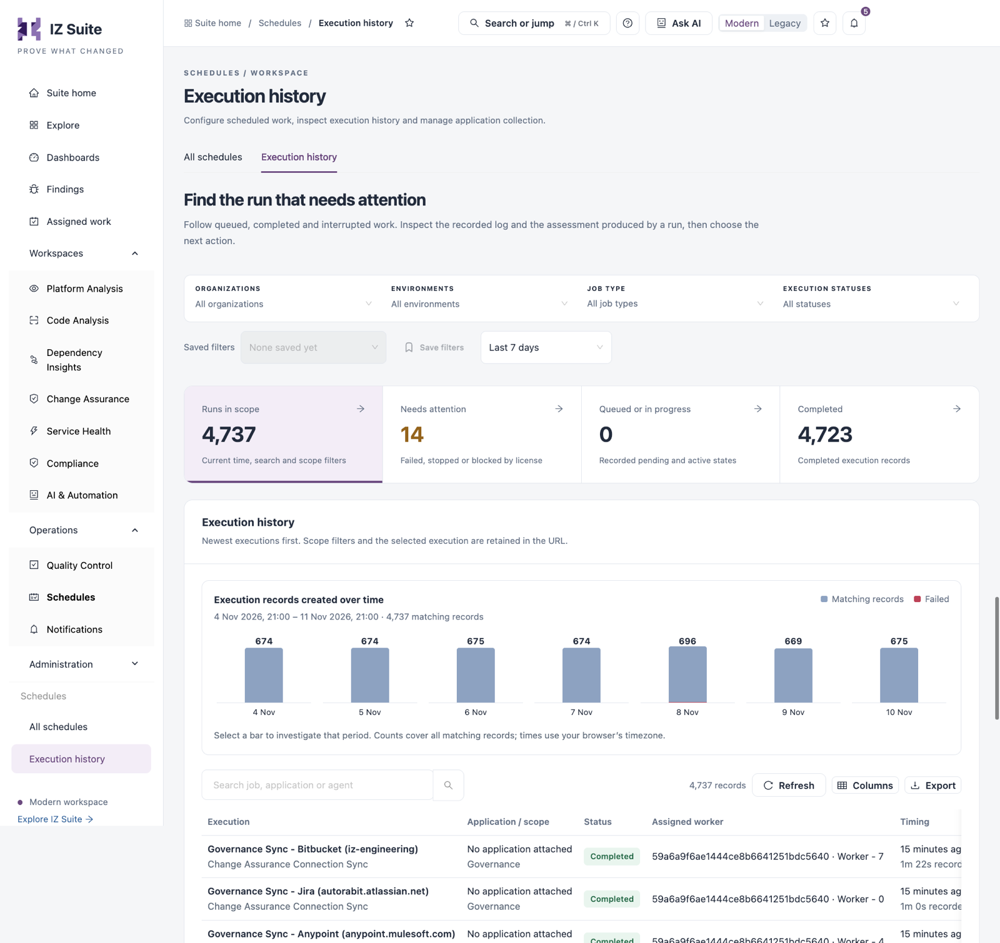
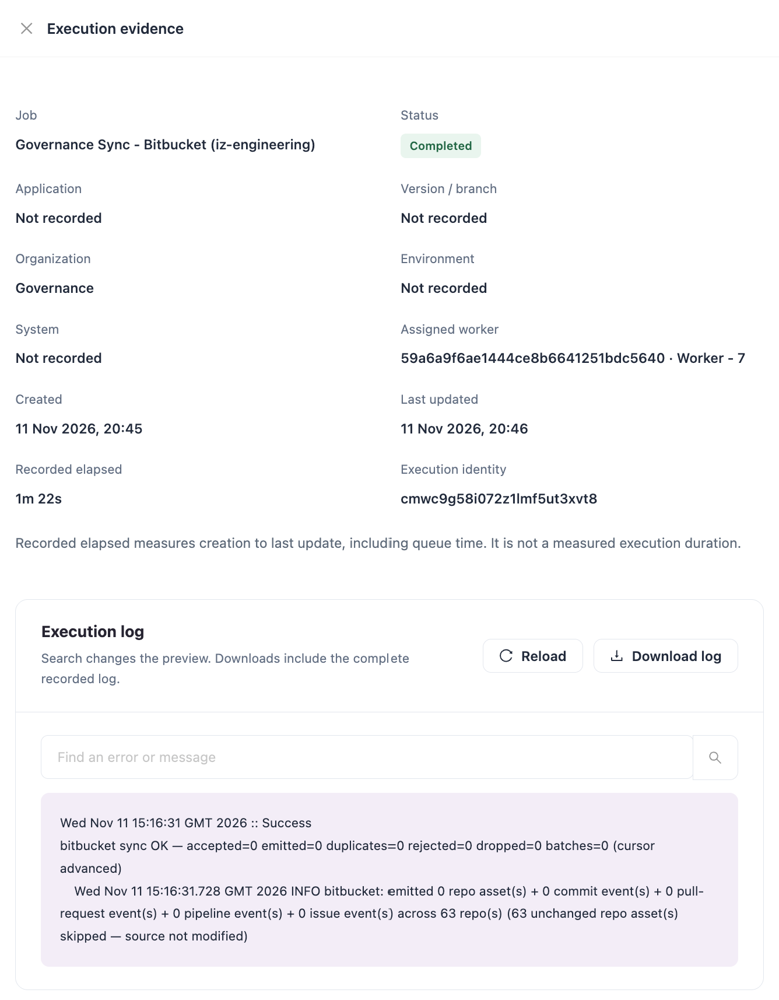

# Execution History

Every time scheduled or one-time work runs, IZ Suite records an execution with its status, the worker that ran it, its timing and its log. Use this tab to find the run that needs attention, read what it recorded, open the assessment it produced and decide what to do next.

Open it from **Operations** → **Schedules** → **Execution history** in the sidebar. **Execution history** on a schedule's row in [All schedules](all-schedules.md) opens the same view for that schedule only, with **Review schedule** to return to the schedule.


You need a role that can view job executions. Stopping and restarting runs needs a role that can configure jobs.


<figure><figcaption></figcaption></figure>

## Filters

| Filter                               | Description                                                           |
| ------------------------------------ | --------------------------------------------------------------------- |
| **Organizations**                    | The organizations the runs belong to.                                 |
| **Environments**                     | The environments the runs used.                                       |
| **Job type**                         | The kind of work. Not shown when you view one schedule's history.     |
| **Execution statuses**               | Run statuses such as queued, executing, completed, failed or stopped. |
| **Search job, application or agent** | Finds runs by job, application or agent.                              |
| Time range                           | The period to show, for example **Last 7 days**.                      |

**Saved filters** and **Save filters** keep a combination of filters for later, and **Reset execution filters** clears them. The filters and the selected execution are kept in the page address, so you can share the view. **Export executions on this page** downloads the runs on the current page.

## Summary Tiles and Timeline

| Tile                      | Shows                                                           |
| ------------------------- | --------------------------------------------------------------- |
| **Runs in scope**         | All runs that match the time range, search and filters.         |
| **Needs attention**       | Runs that failed, were stopped, or were blocked by the licence. |
| **Queued or in progress** | Runs that are scheduled, pending or active.                     |
| **Completed**             | Runs that completed.                                            |

Click a tile to filter the table. **Execution records created over time** charts the matching runs per period with their failures. Select a bar to filter to that period. Times use your browser's time zone.

## Executions

The newest runs come first. **Refresh** reloads the table, **Columns** shows or hides columns and **Export** downloads the runs on the current page.

| Column                  | Description                                                                                              |
| ----------------------- | -------------------------------------------------------------------------------------------------------- |
| **Execution**           | The job name and its job type.                                                                           |
| **Application / scope** | The application the run assessed, or **No application attached**, with its organization and environment. |
| **Status**              | The run status, for example **Completed** or **Failed**.                                                 |
| **Assigned worker**     | The agent and worker that ran it.                                                                        |
| **Timing**              | When the run was created and its recorded elapsed time.                                                  |
| **Review**              | **Inspect execution** opens the run's evidence.                                                          |

## Inspect an Execution

**Inspect execution** opens **Execution evidence**:

<figure><figcaption></figcaption></figure>

| Field                                           | Description                                                                                                  |
| ----------------------------------------------- | ------------------------------------------------------------------------------------------------------------ |
| **Job**                                         | The job that ran.                                                                                            |
| **Status**                                      | The run status.                                                                                              |
| **Application** / **Version / branch**          | What the run assessed, when recorded.                                                                        |
| **Organization** / **Environment** / **System** | Where the run collected from.                                                                                |
| **Assigned worker**                             | The agent and worker that ran it.                                                                            |
| **Created** / **Last updated**                  | When the run was created and last changed.                                                                   |
| **Recorded elapsed**                            | Time from creation to the last update, including time in the queue. It is not a measured execution duration. |
| **Execution identity**                          | The run's identifier, for support.                                                                           |

**Execution log** shows the recorded log. Search it with **Find an error or message**, **Reload** it, or **Download log** to save the complete log. When the run produced an assessment, the drawer links to **Assessment from this run** and the **Latest application evidence**. **Review schedule** opens the schedule.

## Stop or Restart an Execution

* **Stop execution** stops a run that is still queued or in progress.
* **Restart execution** queues a failed or stopped run again. Confirm with **Queue execution again**.
* **Download report** downloads the report a completed report run produced.


Restarting a run can clear its worker assignment, so the worker shown is not a complete history of everything that worker ran.


## Next Steps

* [All Schedules](all-schedules.md): pause, resume or change the schedule behind a run.
* [Quality Gates](../quality-control/quality-gates.md): understand why an assessment failed its gate.
* [Schedules](./): return to the Schedules overview.
