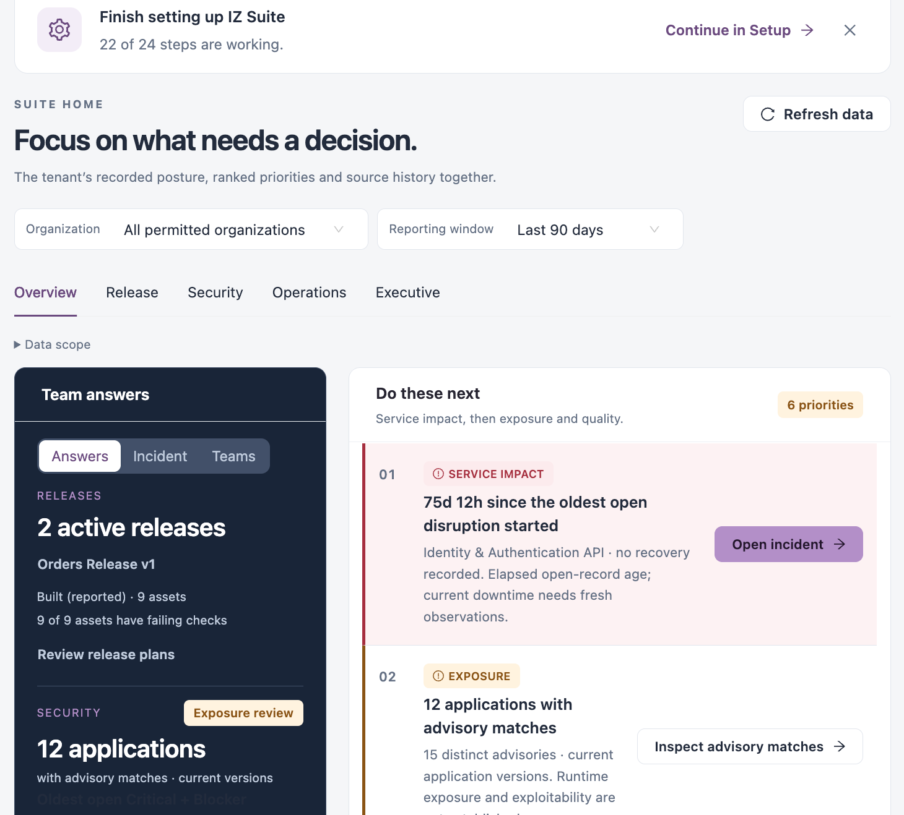
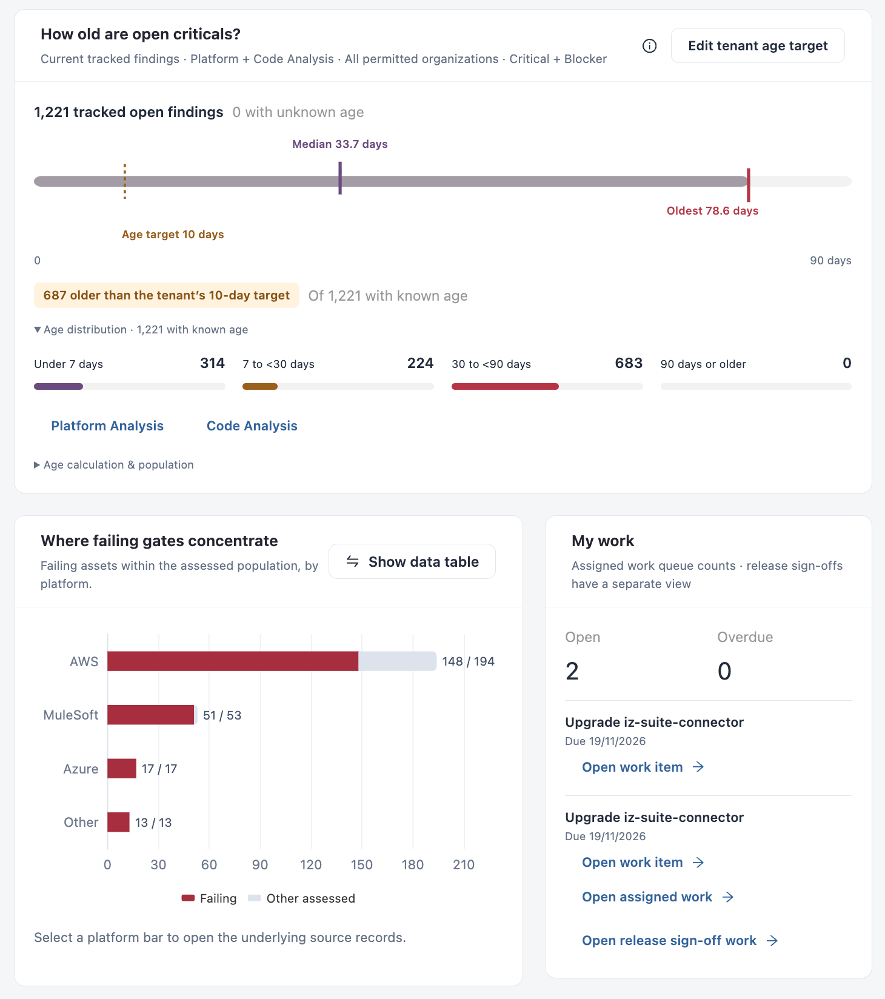
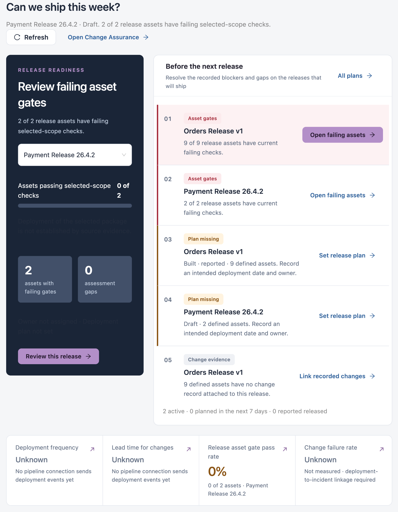

# Suite Home

Suite home is the page IZ Suite opens after you sign in. It brings your recorded posture, ranked priorities and history together, so you can see what needs a decision first. It has five views: **Overview**, **Release**, **Security**, **Operations** and **Executive**. Every count and chart opens the records behind it.

Open it from **Suite home** at the top of the sidebar, or click the **IZ Suite** logo.

<figure><figcaption></figcaption></figure>


Suite home only shows what your organization licensed and your role can see. A panel for a workspace you cannot use says **Not available**. A value that could not be established shows **Unknown**, never a zero.


## Setup Reminder

While setup is incomplete, **Finish setting up IZ Suite** at the top shows how many setup steps are working (for example **22 of 24 steps are working**).

* Click **Continue in Setup** to open [Setup](administration/setup.md).
* Click **X** to hide the reminder.

## Scope and Views

| Control                                                                | What it does                                                                                                                                    |
| ---------------------------------------------------------------------- | ----------------------------------------------------------------------------------------------------------------------------------------------- |
| **Organization**                                                       | **All permitted organizations**, or one organization.                                                                                           |
| **Reporting window**                                                   | **Last 7 days**, **Last 30 days**, **Last 90 days** (the default) or **All retained history**. Sets the period for history charts and activity. |
| **Refresh data**                                                       | Reads the latest recorded data again.                                                                                                           |
| **Overview**, **Release**, **Security**, **Operations**, **Executive** | Switches the view.                                                                                                                              |
| **Data scope**                                                         | Explains which panels follow the organization you chose.                                                                                        |

The organization, window and view are kept in the page address, so you can bookmark or share them.


Assessment and dependency figures follow the organization you choose. Monitoring, compliance and your own work always cover everything you can see. Current posture (gates, findings, exposure) is not limited by the reporting window.


## Overview

The Overview answers "what needs a decision now?".

### Team Answers

A dark card with three tabs:

| Tab          | What it shows                                                                                                                                                                                                                                                                                                                                                      |
| ------------ | ------------------------------------------------------------------------------------------------------------------------------------------------------------------------------------------------------------------------------------------------------------------------------------------------------------------------------------------------------------------ |
| **Answers**  | **RELEASES**: active releases and how many of their assets have failing checks (**Review release plans**). **SECURITY**: applications with advisory matches and the age of the oldest open Critical + Blocker finding (**Inspect oldest finding**, **Inspect advisory matches**). **OPERATIONS**: the longest open disruption and its monitor (**Open incident**). |
| **Incident** | The monitors that are down, degraded or partially disrupted now (**Review service observations**).                                                                                                                                                                                                                                                                 |
| **Teams**    | One card per assessment workspace with its failing gates and Critical + Blocker findings (**Review gates**, **Review findings**).                                                                                                                                                                                                                                  |

### Do These Next

**Do these next** ranks what to act on: service impact first, then exposure and quality. Each item has a label, the count, a short explanation and a button that opens the records. Possible labels:

| Label                 | Example                                                           |
| --------------------- | ----------------------------------------------------------------- |
| **SERVICE IMPACT**    | A monitor with an open disruption and no recovery recorded.       |
| **EXPOSURE**          | Applications whose dependencies match a known advisory.           |
| **QUALITY GATES**     | Assets failing a quality gate, per workspace.                     |
| **COVERAGE**          | Assets never assessed: their posture is unknown, not clean.       |
| **CRITICAL FINDINGS** | Open Critical + Blocker findings to review.                       |
| **LIFECYCLE**         | Applications using components with lifecycle (end-of-life) risks. |

### Health Tiles

| Tile                  | What it shows                                                                                                                 |
| --------------------- | ----------------------------------------------------------------------------------------------------------------------------- |
| **Coverage**          | The share of assets with a recorded assessment (for example **277 of 280 assets assessed**).                                  |
| **Quality gates**     | Assets whose latest assessment failed its gate, with the share failing. **Review N passing assets** lists the ones that pass. |
| **Critical findings** | Open Critical + Blocker findings.                                                                                             |
| **Service health**    | Monitors that are down, degraded or partially disrupted.                                                                      |
| **Compliance**        | The average score of your evaluated standards.                                                                                |

Each tile has a small history chart of recorded counts and a **Review …** link. **What the mini charts measure**, below the tiles, explains each chart.

### Panels Below the Tiles

<figure><figcaption></figcaption></figure>

* **How old are open criticals?**: the median and oldest age of open Critical + Blocker findings, how many are older than your age target, and an age distribution. Select an age band to open those findings. **Edit tenant age target** sets the target in days for everyone in your tenant; it needs permission to edit global settings. The target is a review threshold: it does not fail a gate.
* **Where failing gates concentrate**: failing assets against all assessed assets, by platform. Select a bar to open its records.
* **My work**: your **Open** and **Overdue** assigned items and the next ones due. **Open assigned work** opens [Assigned Work](assigned-work.md); **Open release sign-off work** opens your release sign-offs.
* **Critical findings by source**: open Critical + Blocker findings per workspace. Select a segment or **Review source** to open them.
* **Recorded assessment history**: **Assessment counts** (assessed and failing assets) or **Critical findings** per recorded day in the reporting window. Select a day for its counts.
* **Compliance**: the current score of each evaluated standard, lowest first. **Inspect standards & evidence** opens the details.
* **Workspace posture**: one row per workspace with its inventory and status. **Review setup and connections** opens [Setup](administration/setup.md); **Review collection jobs** opens the job list.

## Release

The Release view answers "Can we ship this week?" for the releases you defined in [Change Assurance](workspaces/change-assurance/).

<figure><figcaption></figcaption></figure>

* **Release readiness**: choose a release in the list to see how many of its assets pass their checks, its failing gates and assessment gaps. **Review this release** opens it; **Open Change Assurance** opens the workspace.
* **Before the next release**: the recorded blockers and gaps of your active releases, ranked: **Asset gates** (**Open failing assets**), **Plan missing** (**Set release plan**: record the intended deployment date and owner) and **Change evidence** (**Link recorded changes**).
* **Deployment frequency**, **Lead time for changes**, **Release asset gate pass rate** and **Change failure rate**.
* **Which gates need attention in this release?**: failing assets of the release by asset type.
* **Shipping in the next 7 days**: releases with a planned date in the next 7 days. **Define release** creates a release.


**Deployment frequency** and **Lead time for changes** show **Unknown** until a pipeline connection sends deployment events. **Change failure rate** also needs incidents linked to deployments.


## Security

The Security view answers "Where should we reduce exposure?".

* **Security posture**: **Review priority findings** and **Review dependency exposure**.
* Tiles: **Critical + Blocker findings**, **Applications with advisory matches**, **Applications with lifecycle matches** and **Assessment coverage**, each with a review link.
* **Do these next**: exposure, lifecycle, high-severity findings and change-assurance gaps (for example pending approval requests).
* **Critical findings by source**, **How old are open criticals?** and **Compliance**, as on the Overview.
* **Security standards coverage**: how many open findings map to CWE, OWASP and AWS Foundational Security Best Practices.
* **High-severity finding history**: Critical + Blocker counts over the reporting window.
* **Known-exploited & malicious advisory context**: applications matching advisories on the CISA Known Exploited Vulnerabilities list or malicious packages, and the advisory that affects the most applications.
* **Accepted risk & exception expiry**: exceptions **In force**, **Expiring in the stated horizon** (next 30 days), **Lapsed** and **Awaiting a decision**, with links to each workspace's exceptions.
* **Change Assurance attention**: recorded changes, blocked changes and pending approval requests.


An advisory match means a dependency version is listed in an advisory. It does not prove the issue can be exploited in your application.


## Operations

The Operations view answers "What needs restoring?".

* **Ongoing outage record**: the longest open disruption, with **Diagnose outage**, **Inspect incident records** and **Open availability targets**.
* **Ongoing incident**: the open disruption, its monitor and how long it has been open.
* **Do these next**: **RESTORE SERVICE**, **CAPTURE THE RECOVERY** (follow up a recent recovery) and **CHANGE CONTEXT** (compare changes with incidents).
* Tiles: **Services down**, **Incidents in selected window**, **Time to Restore** (mean, median and P90) and **Change source connections**.
* **Outage starts and recoveries**: a timeline of dated starts and recoveries.
* **Recorded downtime & recovery**, **Incident trend** (starts per week) and **Availability target history**.
* **Availability targets**: each [service objective](workspaces/service-health/service-objectives.md) with its **Target**, **Attained** availability, **State** and **Measurement limit** (for example when probes run less often than the objective allows).

## Executive

The Executive view answers "Is delivery becoming faster and safer?". Click **Export current overview** to print the view or save it as PDF.

* **Executive summary** and **Delivery measurement**: **Production deployments / week**, **Median lead time**, **Change failure rate** and **Failed-deployment recovery**. Each says **Not measured** until the evidence it needs is connected.
* **Release oversight**, **Security exposure** and **Service impact**.
* **Risk position**: compliance readiness, Critical + Blocker findings, advisory and lifecycle matches, and assessment coverage.
* **Matters for leadership attention**: up to three topics backed by evidence, each with **Inspect supporting evidence**.
* **Security standards coverage**, **Compliance summary** and **Lowest scored standard**.

## Charts and Drill-Down

* Select a point, bar or segment to list the records behind it. A drawer opens with links to the workspace that holds them.
* Click **Show data table** to read a chart's exact values as a table.
* **Source coverage and interpretation**, at the bottom of a view, explains what each source returned.

## Next Steps

* [Explore](explore.md): see what each workspace can do for your role.
* [Findings](findings.md): every open finding across Platform Analysis and Code Analysis.
* [Dashboards](dashboards/): build your own views and schedule PDF reports.
* [Navigating IZ Suite](getting-started/navigating-iz-suite.md): favourites, search and the top bar.
