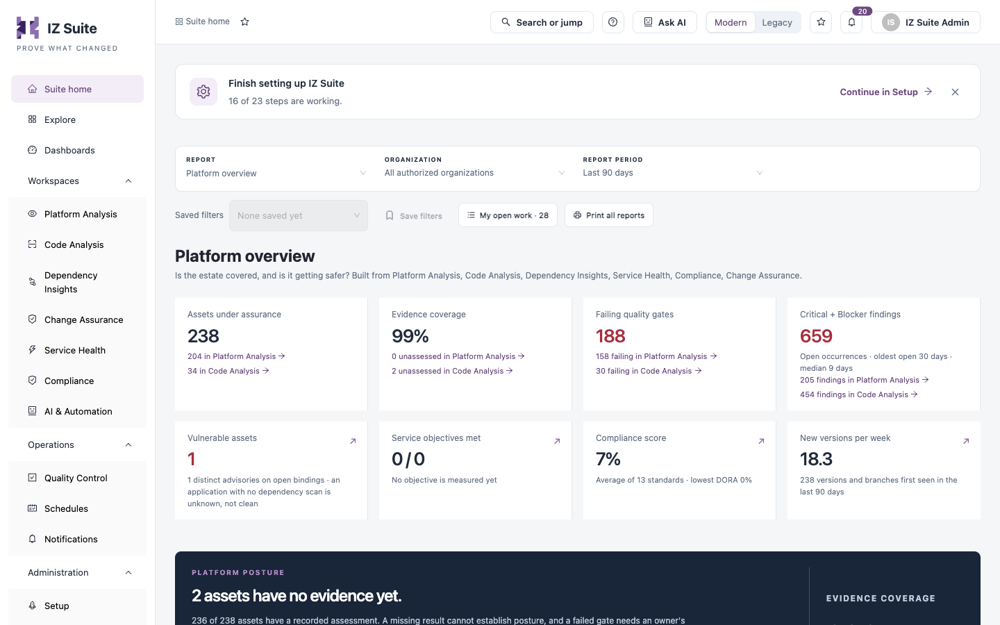
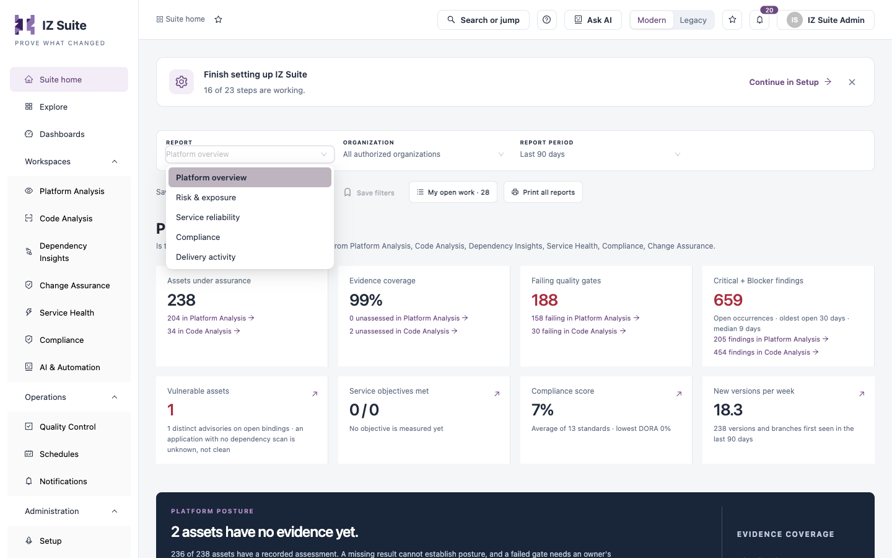
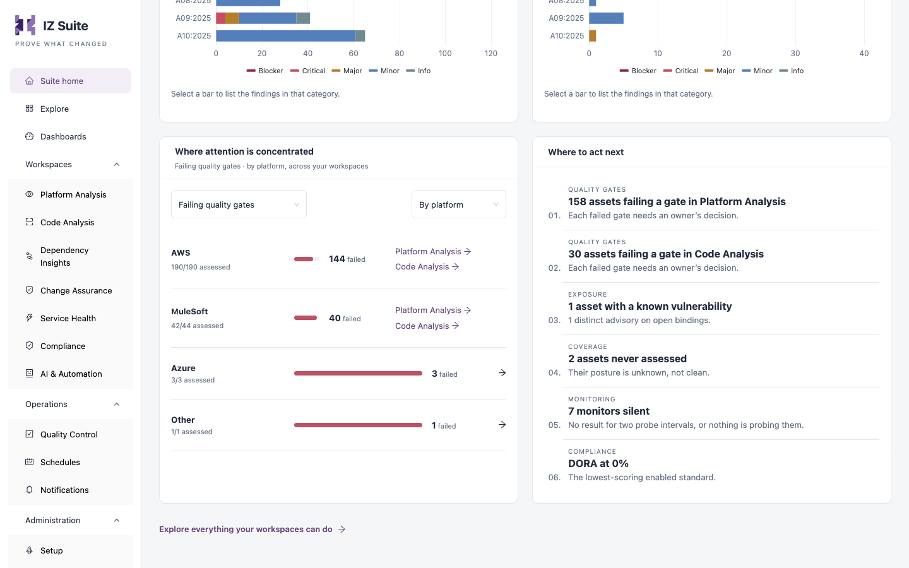

# Suite Home

Suite home is the page IZ Suite opens after you sign in. It answers platform questions, such as "Is the estate covered, and is it getting safer?", with reports built only from the workspaces your organization licensed and the evidence you are allowed to see. Every number links to the records behind it.

Open it from **Suite home** at the top of the sidebar, or click the **IZ Suite** logo.

<figure><figcaption>
Suite home with the Platform overview report
</figcaption></figure>


Suite home reports on Platform Analysis and Code Analysis evidence. If you can use neither, it shows **No assessment workspace available**; ask your administrator for a licence or viewing permission.


## Setup Reminder

While setup is incomplete, **Finish setting up IZ Suite** at the top shows how many setup steps are working (for example **16 of 23 steps are working**).

* Click **Continue in Setup** to open Setup.
* Click **X** (**Dismiss setup reminder**) to hide the reminder for you.

## Filters and Actions

| Control               | What it does                                                                                                                                                                   |
| --------------------- | ------------------------------------------------------------------------------------------------------------------------------------------------------------------------------ |
| **Report**            | Chooses the report. See [Reports](suite-home.md#reports).                                                                                                                      |
| **Organization**      | **All authorized organizations**, or one organization. Shown when you can see more than one organization.                                                                      |
| **Report period**     | **Last 30 days**, **Last 90 days** (the default), **Last 180 days**, **Last 365 days**, **Custom range** or **All retained history**. Sets the period for trends and activity. |
| **Saved filters**     | Re-applies filters you saved. Choose a saved set to apply it; edit or delete it from the same list.                                                                            |
| **Save filters**      | Saves the current filters under a name. Available once you choose an organization.                                                                                             |
| **Copy link**         | Copies a link to this page with the current filters. Shown when a filter is set.                                                                                               |
| **Reset filters**     | Clears the organization filter. Shown when a filter is set.                                                                                                                    |
| **My open work**      | Opens the work assigned to you. See [My Open Work](suite-home.md#my-open-work).                                                                                                |
| **Print all reports** | Prints every report available to you in one document, with a cover page that lists the reports and their scope.                                                                |

The report and organization are kept in the page address, so you can bookmark or share a filtered view.

## Reports

<figure><figcaption>
Choosing a report
</figcaption></figure>

| Report                  | Question it answers                                 | Available when                                             |
| ----------------------- | --------------------------------------------------- | ---------------------------------------------------------- |
| **Platform overview**   | Is the estate covered, and is it getting safer?     | Always.                                                    |
| **Risk & exposure**     | What kind of risk do we carry, and where?           | Always.                                                    |
| **Service reliability** | Are services meeting their availability objectives? | You have the Service Health licence and can view monitors. |
| **Compliance**          | How well do we meet the standards we follow?        | You can open the Compliance workspace.                     |
| **Delivery activity**   | How often is change delivered and assessed?         | Always.                                                    |

Under its title, each report names the workspaces it is built from. Tiles and charts for a workspace you cannot use are left out. A count that could not be established shows a dash, not a zero.

### Platform Overview

| Tile                            | What it shows                                                                                                                                            |
| ------------------------------- | -------------------------------------------------------------------------------------------------------------------------------------------------------- |
| **Assets under assurance**      | Assets (application versions and branches) in Platform Analysis and Code Analysis.                                                                       |
| **Evidence coverage**           | The share of assets with a recorded assessment, and how many are unassessed in each workspace.                                                           |
| **Failing quality gates**       | Assets whose latest assessment failed its quality gate, per workspace.                                                                                   |
| **Critical + Blocker findings** | Open Critical and Blocker finding occurrences, with the age of the oldest and the median open finding.                                                   |
| **Vulnerable assets**           | Assets with a known vulnerability on an open dependency. Needs Dependency Insights. An application with no dependency scan counts as unknown, not clean. |
| **Service objectives met**      | Service objectives meeting their target. Needs Service Health. Opens the **Service reliability** report.                                                 |
| **Compliance score**            | The average score of your enabled standards, and the lowest one. Needs Compliance. Opens the **Compliance** report.                                      |
| **New versions per week**       | New versions and branches first seen in the report period. Opens the **Delivery activity** report.                                                       |

Below the tiles:

* **Platform posture** sums up coverage. **Close baseline gaps** opens the assets that have never been assessed; **Review failed gates** opens the assets with a failed gate.
* **Is quality improving?** charts findings over the report period. Choose what to chart: **Gate pass rate**, **Total & high severity**, **Severity breakdown**, **Defect types** or **Gates & assessment coverage**.
* **Platform Analysis: security standards** and **Code Analysis: security standards** show how many open findings map to CWE, OWASP and AWS Foundational Security Best Practices, by category and severity.
* **Where attention is concentrated** ranks platforms or asset types. Choose the measure (**Failing quality gates**, **Never assessed**, **Evidence to refresh** or **Critical + Blocker findings**) and **By platform** or **By asset type**.
* **Where to act next**. See [Where to Act Next](suite-home.md#where-to-act-next).

### Risk & Exposure

Tiles: **Critical + Blocker findings**, **Failing quality gates**, **Vulnerable assets**, **On CISA KEV** (assets using an advisory on the CISA Known Exploited Vulnerabilities list), **Malicious packages**, **Assets on end-of-life components** and **Exceptions in force** (with how many expire in 30 days, have lapsed or await a decision).

The findings chart breaks open findings down **By severity**, **By issue type**, **By asset type (Critical + Blocker)** or **By platform (Critical + Blocker)**. **How is the finding mix changing?** shows the trend over the report period. The page ends with **Where attention is concentrated** and **Where to act next**.


**On CISA KEV** and **Malicious packages** are counted across every organization, even when you filter by one.


### Service Reliability

Tiles: **Service objectives met** and **Monitors reporting a problem** (down, degraded or partial).

The **Service objectives** table lists each objective, lowest availability first:

| Column               | Description                                                                     |
| -------------------- | ------------------------------------------------------------------------------- |
| **Objective**        | The objective, its monitor and owner. Links to Service Objectives and Monitors. |
| **Target**           | The target availability over its window, for example 99.9% over 30 days.        |
| **Observed**         | Measured availability, or **Not measured yet** with the reason.                 |
| **Status**           | **Met**, **At risk** or **Missed**.                                             |
| **Downtime allowed** | Minutes of downtime the target allows.                                          |

Availability is measured from probe results, so its precision is one probe interval.

### Compliance

The **Compliance score** tile, and **Score by standard**: the current score of each enabled standard, lowest first. Select a standard to open its controls in Standards & Frameworks. Scores appear once a standard has been evaluated.

### Delivery Activity

Tiles: **New versions per week**, **Assessments per week**, **Evidence to refresh** (assessments older than the freshness limit) and **Evidence coverage**.

**Is assessment keeping up with delivery?** charts each week (weeks start Monday, UTC). Choose **New versions and assessments**, **New versions and branches** or **Completed assessments**. Select a week to narrow the table below to that week; click **Show all weeks** to clear it.

**Activity by asset type** lists the most active asset types first, with **New versions / branches**, **Assessments** and **Assessments per week**. Click a type to open its assets.

## Charts

* Select a point or bar to list the records behind it, with links to the workspace that holds them.
* Click **Show data table** to read a chart's exact values as a table.

## Where to Act Next

<figure><figcaption>
Where attention is concentrated and Where to act next
</figcaption></figure>

**Where to act next** lists the most pressing kinds of action in the report's scope. Click an item to open the records it is about. Possible items include:

| Label             | Example                                                                         |
| ----------------- | ------------------------------------------------------------------------------- |
| **QUALITY GATES** | Assets failing a gate, per workspace.                                           |
| **EXPOSURE**      | Assets with a known vulnerability.                                              |
| **COVERAGE**      | Assets never assessed: their posture is unknown, not clean.                     |
| **RELIABILITY**   | Service objectives that missed their target.                                    |
| **MONITORING**    | Silent monitors: no result for two probe intervals, or nothing is probing them. |
| **COMPLIANCE**    | The lowest-scoring enabled standard.                                            |
| **LIFECYCLE**     | Assets on end-of-life components.                                               |
| **FRESHNESS**     | Assessments to refresh.                                                         |
| **COLLECTION**    | Schedules whose last run failed.                                                |
| **AUTOMATION**    | Automation runs waiting for approval.                                           |

When nothing needs action, the card says **Nothing needs attention**.

## My Open Work

**My open work** shows the number of open items assigned to you, and how many are overdue. It covers Change Assurance tasks and upgrade and maintenance work that you can open. The button is shown when you can see at least one of them.

Click it to open the **My open work** drawer: up to 20 of your items, soonest due first, with **Kind**, **Work**, **Due** (tagged **Overdue** when late) and **Status**. Click an item to open it in Change Assurance.

Click **Explore everything your workspaces can do** at the bottom of the page to open [Explore](explore.md).

## Next steps

* [Explore](explore.md): see what each workspace can do for your role.
* Dashboards: build your own views and schedule PDF reports.
* Navigating IZ Suite: favourites, search and the top bar.
