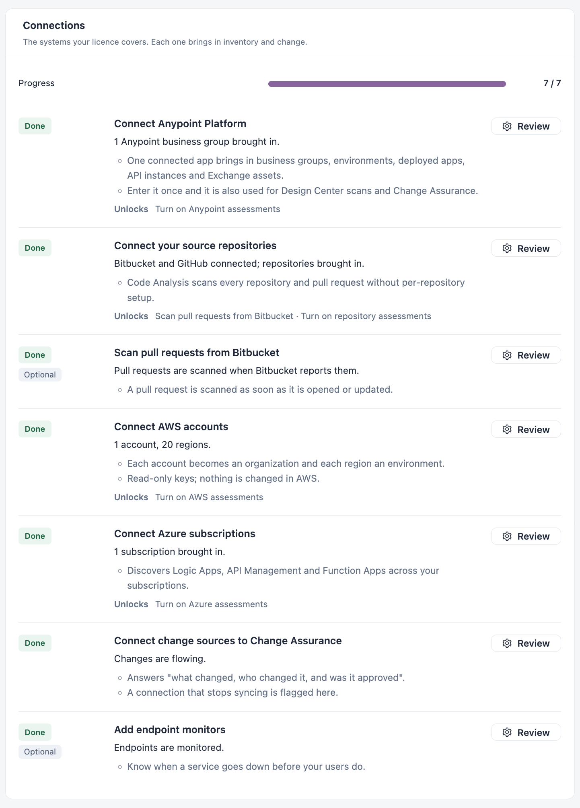

# Supported Platforms

IZ Suite connects to the platforms your integrations and code live on, brings in what is deployed there, and assesses it against rules. This page lists every supported platform and source, what IZ Suite does with each one, and how the work flows from connecting a platform to reviewing results.

## Platforms and Sources

| Platform or source                                          | What IZ Suite brings in                                                                                                                                                                            | What it does with it                                                                                                                                                                                                                                                                                                                                                  | Where you set it up                                          |
| ----------------------------------------------------------- | -------------------------------------------------------------------------------------------------------------------------------------------------------------------------------------------------- | --------------------------------------------------------------------------------------------------------------------------------------------------------------------------------------------------------------------------------------------------------------------------------------------------------------------------------------------------------------------- | ------------------------------------------------------------ |
| [MuleSoft Anypoint Platform](mulesoft-anypoint-platform.md) | Business groups (as organizations), environments, Mule applications in Runtime Manager, API instances in API Manager, APIs published in Exchange, and optionally Anypoint teams and their members. | **Platform Analysis** assesses deployed Mule applications, API instances and Exchange APIs. **Code Analysis** scans Design Center projects. **Service Health** can monitor Runtime Manager applications and API instances. **Dependency Insights** shows the dependencies and component versions recorded for them. **Change Assurance** can record Anypoint changes. | **Setup** → **Connect Anypoint Platform**                    |
| [Amazon Web Services](amazon-web-services.md)               | Each AWS account (as an organization) and its regions (as environments), plus the resources of 16 AWS services.                                                                                    | **Platform Analysis** assesses each resource's configuration; Lambda functions on Python runtimes also have their code scanned. **Service Health** can monitor AWS resources. **Dependency Insights** links functions, queues, topics, event buses, state machines, secrets and databases. **Change Assurance** can record AWS changes.                               | **Setup** → **Connect AWS accounts**                         |
| [Azure Integration Services](azure-integration-services.md) | Subscriptions (as organizations) and resource groups (as environments), with their Logic Apps, API Management services and Function Apps.                                                          | **Platform Analysis** assesses Logic Apps, API Management policies and Function Apps. **Service Health** can monitor Azure resources. **Change Assurance** can record Azure changes.                                                                                                                                                                                  | **Setup** → **Connect Azure subscriptions**                  |
| [Bitbucket and GitHub](source-repositories.md)              | Repositories, their branches and, for Bitbucket, pull requests.                                                                                                                                    | **Code Analysis** scans each enabled repository and branch in every [supported language](supported-languages.md), and scans Bitbucket pull requests as they are opened or updated.                                                                                                                                                                                    | **Setup** → **Connect your source repositories**             |
| [CI/CD pipelines](../ci-cd-integration/)                    | Whatever your pipeline checks out.                                                                                                                                                                 | **Code Analysis** scans the code with the IZ Suite CLI or Maven plugin and can fail the build on a failed quality gate.                                                                                                                                                                                                                                               | **Setup** → **Scan in your CI/CD pipeline**                  |
| [IDEs](../ide-extensions/)                                  | The project open in the developer's IDE.                                                                                                                                                           | **Code Analysis** rules run while the developer works, before code is committed.                                                                                                                                                                                                                                                                                      | **Setup** → **Connect your IDE**                             |
| HTTP endpoints                                              | The endpoints you add as monitors.                                                                                                                                                                 | **Service Health** checks each endpoint on a schedule and compares the answer with what you expect.                                                                                                                                                                                                                                                                   | [Monitors](../workspaces/service-health/monitors.md)         |
| Change sources                                              | Commits, deployments, pipeline runs, issues and platform activity from the connected tools.                                                                                                        | **Change Assurance** links each change to evidence and decisions.                                                                                                                                                                                                                                                                                                     | [Connections](../workspaces/change-assurance/connections.md) |


You see a platform's steps, menus and assessment types only when your licence covers them. **Platform Analysis**, **Code Analysis**, **Dependency Insights**, **Service Health** and **Change Assurance** are licensed separately; each AWS service is also licensed on its own.


<figure><figcaption></figcaption></figure>

## From Connecting to Reviewing

Every platform follows the same four stages. Each one runs as a job on an agent (see [How Assessments Run](how-assessments-run.md)).

| Stage          | What happens                                                                                                                                                                                                                                                                                               | Where you see it                                                                                                     |
| -------------- | ---------------------------------------------------------------------------------------------------------------------------------------------------------------------------------------------------------------------------------------------------------------------------------------------------------- | -------------------------------------------------------------------------------------------------------------------- |
| **1. Connect** | You give IZ Suite read-only access: a connected app, an access key, a service principal or an OAuth app. Secrets are stored encrypted and never shown again. Saving contacts no external service.                                                                                                          | [Setup](../administration/setup.md)                                                                                  |
| **2. Sync**    | A sync job signs in to the platform and brings in its structure: organizations, environments and the applications or repositories in them. The Anypoint, AWS and Azure syncs run every 12 hours once **Inventory sync** is on; saving the connection with it on also starts a one-time sync straight away. | [Organizations](../administration/organizations/), [Execution History](../operations/schedules/execution-history.md) |
| **3. Assess**  | Assessment jobs collect each application's definition (code, configuration or policies), run the rules of its quality profile against it, record the findings and metrics, and evaluate the quality gate. They run once or on a recurring schedule.                                                        | [Setup](../administration/setup.md), [All Schedules](../operations/schedules/all-schedules.md)                       |
| **4. Review**  | You review findings, gate results and trends, set findings aside as exceptions, and follow up with AI reviews, subscriptions and reports.                                                                                                                                                                  | The workspaces below                                                                                                 |

### Where Results Appear

| Workspace                                                 | Shows                                                                                                                      |
| --------------------------------------------------------- | -------------------------------------------------------------------------------------------------------------------------- |
| [Platform Analysis](../workspaces/platform-analysis/)     | Deployed applications on Anypoint, AWS and Azure: quality gates, open findings and the evidence behind each verdict.       |
| [Code Analysis](../workspaces/code-analysis/)             | Repositories, branches, pull requests and Design Center projects, whether scanned by a schedule, a pipeline or an IDE.     |
| [Dependency Insights](../workspaces/dependency-insights/) | How assessed applications depend on each other and on runtimes and libraries, and the risk that travels along those links. |
| [Service Health](../workspaces/service-health/)           | Monitors on endpoints and platform resources, service objectives and status pages.                                         |
| [Change Assurance](../workspaces/change-assurance/)       | Changes recorded from your connected tools, with their evidence and decisions.                                             |
| [Compliance](../workspaces/compliance/)                   | How findings map to the standards and frameworks your organization follows.                                                |

Each assessed application also has its own dossier with its assessments, findings, inventory and dependencies (see [Applications](../workspaces/platform-analysis/applications.md)).

## Next Steps

* [How Assessments Run](how-assessments-run.md): agents, job types and schedules behind every stage.
* [MuleSoft Anypoint Platform](mulesoft-anypoint-platform.md): connect Anypoint and choose what to assess.
* [Supported Languages](supported-languages.md): the languages Code Analysis scans.
* [Setup](../administration/setup.md): the checklist that walks you through each connection.
