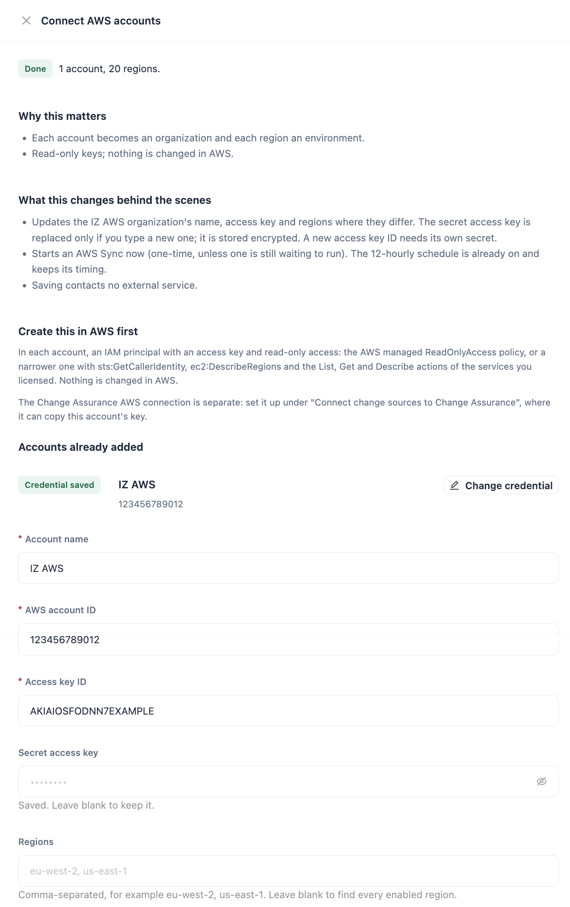

# Amazon Web Services

IZ Suite connects to each AWS account with a read-only access key. Each account becomes an organization and each region an environment. Assessment jobs then discover the resources of each AWS service and check their configuration against that service's rules. IZ Suite never creates, changes or deletes AWS resources, and never reads secret values.


Requires the **Platform Analysis** licence. Each AWS service is licensed separately: its assessment type, menus and applications appear only when the service is on your licence.


## Create a Read-Only Access Key in AWS

Create one IAM user with an access key in each AWS account you connect. You can attach the AWS managed **ReadOnlyAccess** policy, or the narrower policy below, which lists only the calls IZ Suite makes.

### Create the IAM Policy

1. In the AWS console, open **IAM** → **Policies** and click **Create policy**.
2. Choose the **JSON** editor and paste the policy below.
3. Name the policy, for example `IZSuiteReadOnly`, and create it.


```json
{
  "Version": "2012-10-17",
  "Statement": [
    {
      "Sid": "IZSuiteDiscovery",
      "Effect": "Allow",
      "Action": [
        "ec2:DescribeRegions",
        "lambda:ListFunctions",
        "lambda:GetFunction",
        "lambda:GetPolicy",
        "lambda:ListFunctionUrlConfigs",
        "lambda:ListEventSourceMappings",
        "cloudformation:ListStacks",
        "cloudformation:DescribeStacks",
        "cloudformation:GetTemplate",
        "states:ListStateMachines",
        "states:DescribeStateMachine",
        "apigateway:GET",
        "ecs:ListClusters",
        "ecs:ListServices",
        "ecs:DescribeServices",
        "ecs:DescribeTaskDefinition",
        "rds:DescribeDBInstances",
        "rds:DescribeDBClusters",
        "rds:DescribeDBEngineVersions",
        "elasticloadbalancing:DescribeLoadBalancers",
        "elasticloadbalancing:DescribeLoadBalancerAttributes",
        "elasticloadbalancing:DescribeListeners",
        "elasticloadbalancing:DescribeTargetGroups",
        "elasticloadbalancing:DescribeTargetGroupAttributes",
        "secretsmanager:ListSecrets",
        "secretsmanager:DescribeSecret",
        "secretsmanager:GetResourcePolicy",
        "cloudfront:ListDistributions",
        "cloudfront:GetDistribution",
        "dynamodb:ListTables",
        "dynamodb:DescribeTable",
        "dynamodb:DescribeContinuousBackups",
        "dynamodb:DescribeTimeToLive",
        "sqs:ListQueues",
        "sqs:GetQueueUrl",
        "sqs:GetQueueAttributes",
        "sns:ListTopics",
        "sns:GetTopicAttributes",
        "sns:ListSubscriptionsByTopic",
        "events:ListEventBuses",
        "events:DescribeEventBus",
        "events:ListRules",
        "events:DescribeRule",
        "events:ListTargetsByRule",
        "codepipeline:ListPipelines",
        "codepipeline:GetPipeline",
        "codebuild:ListProjects",
        "codebuild:BatchGetProjects",
        "codedeploy:ListApplications",
        "codedeploy:ListDeploymentGroups",
        "codedeploy:BatchGetDeploymentGroups",
        "codedeploy:GetDeploymentGroup"
      ],
      "Resource": "*"
    },
    {
      "Sid": "IZSuiteExecutionRoles",
      "Effect": "Allow",
      "Action": [
        "iam:GetRole",
        "iam:ListRolePolicies",
        "iam:GetRolePolicy",
        "iam:ListAttachedRolePolicies",
        "iam:GetPolicy",
        "iam:GetPolicyVersion"
      ],
      "Resource": "*"
    }
  ]
}
```


| Statement               | Why it is needed                                                                                                                                                                                                                                           |
| ----------------------- | ---------------------------------------------------------------------------------------------------------------------------------------------------------------------------------------------------------------------------------------------------------- |
| `IZSuiteDiscovery`      | Lists the resources of each service and reads the definitions that are assessed. `ec2:DescribeRegions` is used only when you leave **Regions** blank and IZ Suite finds the regions itself.                                                                |
| `IZSuiteExecutionRoles` | Optional. Reads the IAM roles that Lambda functions, Step Functions state machines and ECS task definitions run with, so the IAM rules (for example over-permissive policies) can be evaluated. Without it the assessment still runs, without those rules. |

You can leave out the actions of services you do not license or do not want assessed: a denied call only affects that service.


The policy deliberately leaves out `secretsmanager:GetSecretValue`. IZ Suite assesses a secret's rotation, encryption and resource policy from its metadata only.


### Create the IAM User and Access Key

1. Open **IAM** → **Users** and click **Create user**. Do not give the user console access.
2. On **Set permissions**, choose **Attach policies directly** and attach the policy you created.
3. Open the new user, choose the **Security credentials** tab and click **Create access key**.
4. Choose **Third-party service** (or **Other**) as the use case and create the key.
5. Copy the **Access key** and the **Secret access key**. The secret is shown only once.
6. Note the 12-digit account ID shown in the account menu at the top right of the console.

## Connect the Account in IZ Suite

<figure><figcaption></figcaption></figure>

1. Open **Administration** → **Setup** and click **Set up** (or **Review**) on **Connect AWS accounts**.
2.  Fill in the account:

    | Field                 | Description                                                                                                   |
    | --------------------- | ------------------------------------------------------------------------------------------------------------- |
    | **Account name**      | The organization's name in IZ Suite, for example `Payments Production`. Required.                             |
    | **AWS account ID**    | The 12-digit account ID. Required.                                                                            |
    | **Access key ID**     | The IAM user's access key. Required.                                                                          |
    | **Secret access key** | The access key's secret. Stored encrypted; once saved it shows **Saved. Leave blank to keep it.**             |
    | **Regions**           | Comma-separated regions to assess, for example `eu-west-2, us-east-1`. Leave blank to let IZ Suite find them. |
    | **Inventory sync**    | **On** runs **AWS Sync** every 12 hours.                                                                      |
3. Click **Save**.

Saving adds the account as an organization with the source **AWS**, creates its standard roles and, with **Inventory sync** on (the default), starts a one-time **AWS Sync**. Repeat for each account; **Accounts already added** lists them. You can also onboard an account from **Administration** → **Organizations** → **Onboard organization** with the source **AWS** (see [Organizations](../administration/organizations/)).


You need a role that can onboard organizations to connect AWS accounts.


### Rotate the Access Key

1. In AWS, create a second access key for the same IAM user.
2. In **Connect AWS accounts**, click **Change credential** on the account, enter the new **Access key ID** and **Secret access key**, and click **Save**.
3. Check that the next **AWS Sync** succeeds under [Execution History](../operations/schedules/execution-history.md).
4. In AWS, deactivate and delete the old key.

## What the Sync Does

On each run, **AWS Sync** goes through every AWS organization:

1. Skips an account that has no secret access key yet, and says so in the run log.
2. Checks that the access key belongs to the entered **AWS account ID**. If it does not, the account is not synced and the log says why.
3. Creates one environment per region. With **Regions** filled in, exactly those regions are used. With **Regions** blank, IZ Suite checks every region enabled on the account and keeps the regions that hold resources of any of the assessed services. If the key may not list regions (`ec2:DescribeRegions`), a fixed list of common regions is checked instead; if no region has resources, the account is skipped and the run log says so.
4. Creates a `global` environment for resources that belong to no region, such as CloudFront distributions.
5. Gives the organization's roles access to the AWS applications, so they are visible straight away.

Regions you add later become new environments on the next run. See the environments under **Administration** → **Organizations** → **Manage environments**.

## What Is Assessed

Each AWS service has its own assessment type. A run discovers the service's resources in the scheduled regions and checks each one against the service's rules.

| Assessment type                  | Discovers and assesses                                                                                            |
| -------------------------------- | ----------------------------------------------------------------------------------------------------------------- |
| **AWS Lambda Analysis**          | Lambda functions. Functions on a Python runtime also have their deployment package scanned with the Python rules. |
| **AWS CloudFormation Analysis**  | CloudFormation stacks, including failed stacks.                                                                   |
| **AWS Step Functions Analysis**  | Step Functions state machines.                                                                                    |
| **AWS API Gateway Analysis**     | API Gateway REST, HTTP and WebSocket APIs.                                                                        |
| **AWS ECS Analysis**             | The task definitions used by ECS services.                                                                        |
| **AWS RDS Analysis**             | RDS instances and Aurora clusters.                                                                                |
| **AWS Load Balancer Analysis**   | Elastic Load Balancing (v2) load balancers.                                                                       |
| **AWS Secrets Manager Analysis** | Secrets Manager secrets (metadata only).                                                                          |
| **AWS CloudFront Analysis**      | CloudFront distributions, in the `global` environment.                                                            |
| **AWS DynamoDB Analysis**        | DynamoDB tables.                                                                                                  |
| **AWS SQS Analysis**             | SQS queues.                                                                                                       |
| **AWS SNS Analysis**             | SNS topics.                                                                                                       |
| **AWS EventBridge Analysis**     | EventBridge event buses and their rules.                                                                          |
| **AWS CodePipeline Analysis**    | CodePipeline pipelines.                                                                                           |
| **AWS CodeBuild Analysis**       | CodeBuild projects.                                                                                               |
| **AWS CodeDeploy Analysis**      | CodeDeploy deployment groups.                                                                                     |

CloudFormation and SAM templates, and Lambda function definitions, can also be scanned from source before deployment with Code Analysis (see [Supported Languages](supported-languages.md)).

### Schedule the Assessments

1. Open **Administration** → **Setup** and click **Set up** on **Turn on AWS assessments**.
2. Under **What to assess**, keep the services you want.
3. Under **When should this work run?**, choose **One time** or **Recurring** and the interval.
4. Click **Turn on assessments**.

To set one cadence per account, with its own regions and exceptions per service, use **Schedule platform scan** under [All Schedules](../operations/schedules/all-schedules.md).

### Leave Resources Out

Every discovered resource is assessed by default. Each service has a pattern matcher under **Administration** → **Global Settings** → **Settings**, named **AWS** _Service_ **Pattern Matcher** (for example **AWS Lambda Pattern Matcher**), that includes or excludes resources by name:


```json
{
  "config": {
    "name": {
      "includePattern": [".*"],
      "excludePattern": ["^test-.*", ".*-sandbox$"]
    }
  }
}
```


The Lambda pattern matcher can also match `runtime` (for example `python3.12`) and `packageType` (`Zip` or `Image`). The pattern applies from the next run.

## Where the Results Appear

| What                                                                                                   | Where                                                             |
| ------------------------------------------------------------------------------------------------------ | ----------------------------------------------------------------- |
| Accounts and regions                                                                                   | [Organizations](../administration/organizations/)                 |
| Assessed resources, quality gates and findings                                                         | [Platform Analysis](../workspaces/platform-analysis/)             |
| How functions, queues, topics, event buses, state machines, secrets and databases depend on each other | [Dependency Insights](../workspaces/dependency-insights/)         |
| Monitors on AWS resources                                                                              | [Service Health](../workspaces/service-health/monitors.md)        |
| Sync and assessment runs                                                                               | [Execution History](../operations/schedules/execution-history.md) |

The Change Assurance AWS connection is separate: set it up under **Connect change sources to Change Assurance** in Setup, where it can copy this account's key.

## Next Steps

* [How Assessments Run](how-assessments-run.md): agents, job types and schedules.
* [Azure Integration Services](azure-integration-services.md): connect your Azure subscriptions.
* [All Schedules](../operations/schedules/all-schedules.md): review the AWS schedules.
* [Supported Platforms](./): back to the platform overview.
