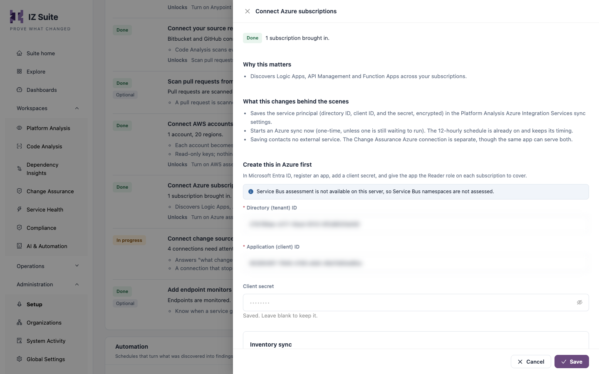

# Azure Integration Services

IZ Suite connects to Azure with a service principal: an app registered in Microsoft Entra ID with the Reader role on your subscriptions. The sync brings in each subscription as an organization and each resource group as an environment. Assessment jobs then check the Logic Apps, API Management policies and Function Apps in those resource groups.


Requires the **Platform Analysis** licence.


## Register an app in Microsoft Entra ID

### Create the app and its secret

1. In the Azure portal, open **Microsoft Entra ID** → **App registrations** and click **New registration**.
2. Enter a **Name** for the app.
3. Under **Supported account types**, choose the single-tenant option.
4. Click **Register**.
5. On the app's page, click **Add a certificate or secret** under **Client credentials**.
6. On the **Client secrets** tab, click **New client secret**, enter a description and choose an expiry that follows your organization's standards.
7. Click **Add** and copy the secret's **Value**. It is shown only once.

### Give the app read access

Repeat for each subscription you want IZ Suite to cover:

1. Open **Subscriptions**, select the subscription and open **Access control (IAM)**.
2. Click **Add** → **Add role assignment**.
3. Choose the **Reader** role.
4. Under **Assign access to**, choose **User, group, or service principal**.
5. Click **Select members**, search for the app you registered and select it.
6. Click **Review + assign**.

### Copy the app's IDs

On the app's **Overview** page, copy:

* **Directory (tenant) ID**
* **Application (client) ID**


The client secret expires on the date you chose. Before it does, create a new secret in Entra ID and enter it in IZ Suite, or the sync and assessments stop signing in.


## Connect Azure in IZ Suite

<figure><figcaption>
Connect Azure subscriptions
</figcaption></figure>

1. Open **Administration** → **Setup** and click **Set up** (or **Review**) on **Connect Azure subscriptions**.
2. Enter the **Directory (tenant) ID**, **Application (client) ID** and **Client secret**.
3. Leave **Inventory sync** on.
4. Click **Save**.

Saving stores the client secret encrypted and starts a one-time **Azure Integration Services Sync**; with **Inventory sync** on, the sync also runs every 12 hours. There is no test button: the first sync's run log under [Execution History](https://knowledgebase.autorabit.com/product-guides/integral-zone/iz-suite/operations/schedules/execution-history) says what it found, and the step turns done when subscriptions arrive.


You need a role that can change global settings to connect Azure.


The Change Assurance Azure connection is separate, though the same app can serve both. Signing in to IZ Suite with an Azure account uses a different app registration too (see [Single Sign-On](single-sign-on.md)).

## What the sync brings in

Each **Azure Integration Services Sync** run signs in with the service principal and:

* Brings in every subscription the app can read as an IZ Suite organization (source **Azure**).
* Brings in each subscription's resource groups as that organization's environments.

A recurring sync picks up new subscriptions and resource groups. See them under **Administration** → **Organizations**: **Manage environments** lists a subscription's resource groups.

## What is assessed

| Assessment type                   | Assesses                                                                                    |
| --------------------------------- | ------------------------------------------------------------------------------------------- |
| **Azure Logic App Analysis**      | The Logic Apps in the selected resource groups: their workflow definitions and connections. |
| **Azure API Management Analysis** | The policies of the API Management services in the selected resource groups.                |
| **Azure Function App Analysis**   | The Function Apps in the selected resource groups: their configuration and functions.       |

### Schedule the assessments

1. Open **Administration** → **Setup** and click **Set up** on **Turn on Azure assessments**. The step unlocks once **Connect Azure subscriptions** has brought subscriptions in.
2. Under **What to assess**, keep the assessment types you want.
3. Under **When should this work run?**, choose **One time** or **Recurring** and the interval.
4. Click **Turn on assessments**.

To set one cadence per subscription, with its own resource groups and exceptions per asset type, use **Schedule platform scan** under [All Schedules](https://knowledgebase.autorabit.com/product-guides/integral-zone/iz-suite/operations/schedules/all-schedules#schedule-a-platform-scan).

Logic Apps, API Management policies and Function Apps can also be scanned from source with Code Analysis (see [Supported Languages](supported-languages.md)).

## Where the results appear

| What                                                                                                  | Where                                                                                                                                 |
| ----------------------------------------------------------------------------------------------------- | ------------------------------------------------------------------------------------------------------------------------------------- |
| Subscriptions and resource groups                                                                     | [Organizations](https://knowledgebase.autorabit.com/product-guides/integral-zone/iz-suite/administration/organizations)               |
| Assessed Logic Apps, API Management services and Function Apps, with their quality gates and findings | [Platform Analysis](https://knowledgebase.autorabit.com/product-guides/integral-zone/iz-suite/workspaces/platform-analysis)           |
| Monitors on Azure resources                                                                           | [Service Health](https://knowledgebase.autorabit.com/product-guides/integral-zone/iz-suite/workspaces/service-health/monitors)        |
| Sync and assessment runs                                                                              | [Execution History](https://knowledgebase.autorabit.com/product-guides/integral-zone/iz-suite/operations/schedules/execution-history) |

## Next steps

* [How Assessments Run](how-assessments-run.md): agents, job types and schedules.
* [Single Sign-On](single-sign-on.md): let people sign in with their Azure account.
* [Amazon Web Services](amazon-web-services.md): connect your AWS accounts.
* [Supported Platforms](./): back to the platform overview.
