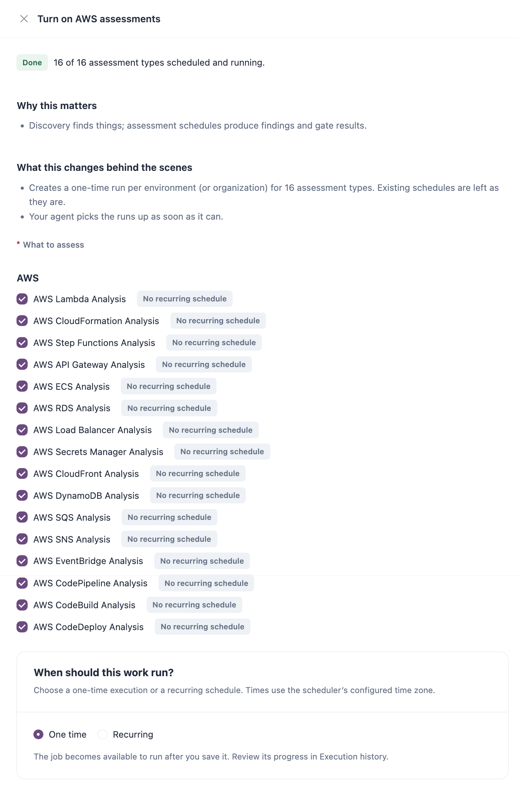

# How Assessments Run

Everything IZ Suite collects, scans or checks runs as a job on an agent. This page explains who runs the work, what each kind of job does, how schedules decide when it runs, and what an assessment leaves behind.

## Agents

An agent is the process that signs in to your platforms, downloads what it needs and runs the rules. Each agent has workers, and each worker runs one job at a time. Nothing is synced, scanned or checked without a running agent.

| Hosting model    | How it works                                                                                                                                      | Choose it when                                                                                                                                                                                 |
| ---------------- | ------------------------------------------------------------------------------------------------------------------------------------------------- | ---------------------------------------------------------------------------------------------------------------------------------------------------------------------------------------------- |
| **Cloud hosted** | Runs in the IZ Suite cloud. When your workspace uses the platform agents, there is nothing to install: Setup's **Connect an agent** step says so. | You do not want to install the prerequisites (such as Java) or run the agent on your own servers.                                                                                              |
| **Self hosted**  | Runs on your own machine or container, registered under **Global Settings** → **Agents** and started with the commands IZ Suite gives you.        | You do not want your platform credentials (for example the Anypoint connected app's client ID and secret) shared with the cloud, or applications downloaded and analysed outside your network. |

An agent only runs the job types it is eligible for. When you register an agent, you choose its **Eligible job types**, how many **Enabled workers** it has, and optionally the **Assigned systems** it works for. See [Agents](../administration/global-settings/agents.md) and [Connected Systems](../administration/global-settings/connected-systems.md).


When no running agent can run a job type, its schedules wait until one can. If work does not start, check **Global Settings** → **Agents** for an agent that is heard from and eligible for that job type.


## Job Types

A job type is one kind of work. Each platform has a sync job that brings in its structure, and one assessment job per asset type.

| Kind             | Job types                                                                                                   | What each one does                                                                                                                                                                                                |
| ---------------- | ----------------------------------------------------------------------------------------------------------- | ----------------------------------------------------------------------------------------------------------------------------------------------------------------------------------------------------------------- |
| Sync             | **Anypoint Sync**                                                                                           | Brings in Anypoint business groups as organizations, their environments, and the Mule applications, API instances and Exchange APIs in them. With teams sync on, also brings in Anypoint teams and their members. |
| Sync             | **AWS Sync**                                                                                                | Checks each AWS account's access key, then creates one environment per region and a `global` environment.                                                                                                         |
| Sync             | **Azure Integration Services Sync**                                                                         | Brings in subscriptions as organizations and resource groups as environments.                                                                                                                                     |
| Sync             | Repository sync                                                                                             | Discovers Bitbucket and GitHub repositories, branches and pull requests, and Design Center projects.                                                                                                              |
| Assessment       | **Anypoint Mule Runtime Analysis**, **Anypoint API Instance Analysis**, **Anypoint Exchange APIs Analysis** | Assess Mule applications deployed in Runtime Manager, API instances in API Manager, and API specifications published in Exchange. See [MuleSoft Anypoint Platform](mulesoft-anypoint-platform.md).                |
| Assessment       | **AWS Lambda Analysis**, **AWS CloudFormation Analysis** and 14 more, one per AWS service                   | Discover the resources of one AWS service in the scheduled regions and assess each one. See [Amazon Web Services](amazon-web-services.md).                                                                        |
| Assessment       | **Azure Logic App Analysis**, **Azure API Management Analysis**, **Azure Function App Analysis**            | Assess the Logic Apps, API Management policies and Function Apps of the scheduled resource groups. See [Azure Integration Services](azure-integration-services.md).                                               |
| Assessment       | Repository scan                                                                                             | Scans the enabled repositories and branches, and Design Center projects, in every [supported language](supported-languages.md).                                                                                   |
| Monitoring       | **API Health Check**                                                                                        | Checks every enabled Service Health monitor. See [Monitors](../workspaces/service-health/monitors.md).                                                                                                            |
| AI               | **AI evidence investigation**                                                                               | Runs the AI review of a scan that came from a pipeline, the CLI or an IDE. Scheduled platform assessments run their AI review in the same job.                                                                    |
| AI               | **AI Agent**                                                                                                | Runs AI & Automation tasks, such as generating code or documentation and applying suggested fixes.                                                                                                                |
| Reports          | **Reporting**                                                                                               | Generates scheduled reports. See [Scheduled Reports](../dashboards/scheduled-reports.md).                                                                                                                         |
| Change Assurance | **Change Assurance Connection Sync**, **Change Assurance Pipeline**                                         | Bring in changes from your [Change Assurance connections](../workspaces/change-assurance/connections.md) and process them.                                                                                        |

You only see the job types your licence covers. For AWS, each service's job type appears only when that service is licensed.

## Schedules and One-Time Runs

A schedule tells IZ Suite when to run a job type, and for which organizations and environments.

| Type          | Behaviour                                                                                             |
| ------------- | ----------------------------------------------------------------------------------------------------- |
| **One time**  | Runs once, as soon as an agent is free. It is then finished; **Run again** queues it once more.       |
| **Recurring** | Runs on a cron interval, for example every 12 hours or daily at 02:00, until you pause or archive it. |

When a schedule is due, it is queued. An agent that can run that job type picks it up and creates one execution per organization or environment in scope, and free workers run the executions. Each execution keeps a log that you can read under [Execution History](../operations/schedules/execution-history.md).

<figure><figcaption></figcaption></figure>

You can create assessment schedules from several places. They all create the same schedules:

| Where                                                                                                                                                                  | Use it to                                                                                                        |
| ---------------------------------------------------------------------------------------------------------------------------------------------------------------------- | ---------------------------------------------------------------------------------------------------------------- |
| [Setup](../administration/setup.md) → **Turn on Anypoint assessments**, **Turn on AWS assessments**, **Turn on Azure assessments**, **Turn on repository assessments** | Start every assessment type of a source at once, one time or recurring. Existing schedules are left as they are. |
| [All Schedules](../operations/schedules/all-schedules.md) → **Schedule platform scan**                                                                                 | Give all the asset types of one AWS, Anypoint or Azure organization one cadence, with exceptions per asset type. |
| [Organizations](../administration/organizations/) → **Schedule platform scan**                                                                                         | Open the same scheduling for one organization.                                                                   |
| [Manage Scanning](../workspaces/code-analysis/manage-scanning.md) → **Scan schedules**                                                                                 | Schedule repository and Design Center scans.                                                                     |
| [Applications](../workspaces/platform-analysis/applications.md) → **Force scan applications**, or **Request fresh evidence** in an application's dossier               | Ask for a new assessment of applications that already exist.                                                     |


With **Inventory sync** on, saving a platform connection in Setup starts a one-time sync and a recurring sync every 12 hours. You only schedule the assessments yourself.


## What an Assessment Produces

Each assessment of an application version records:

| Result                       | Description                                                                                                                                                                                                             |
| ---------------------------- | ----------------------------------------------------------------------------------------------------------------------------------------------------------------------------------------------------------------------- |
| Findings                     | One per rule violation, with its severity, category, file and line or configuration path. The rules come from the application's [quality profile](../operations/quality-control/quality-profiles.md).                   |
| Metrics and inventory        | Values that metric rules recorded, such as runtime versions, components and configuration. They feed the application's inventory and [Dependency Insights](../workspaces/dependency-insights/).                         |
| Quality gate                 | **Passed** or **Failed**, from the [quality gate](../operations/quality-control/quality-gates.md) assigned to the application. Findings that an approved, unexpired exception sets aside do not count.                  |
| Comparison with the baseline | What is new since the previous assessment, so you can tell new problems from old ones.                                                                                                                                  |
| AI review                    | When AI is turned on for the workspace, your access allows it and an [AI review profile](../operations/quality-control/ai-review-profiles.md) that applies is enabled, the assessment is reviewed against that profile. |

The results appear in [Platform Analysis](../workspaces/platform-analysis/) for deployed applications and in [Code Analysis](../workspaces/code-analysis/) for repositories, pipelines and IDEs. People subscribed to an application, organization or environment are notified of new assessments and quality gate failures (see [Notifications](../operations/notifications/)).

## Next Steps

* [All Schedules](../operations/schedules/all-schedules.md): review, pause and change the schedules that run assessments.
* [Execution History](../operations/schedules/execution-history.md): read the log of each run.
* [Agents](../administration/global-settings/agents.md): register an agent and choose its job types.
* [Supported Platforms](./): back to the platform overview.
