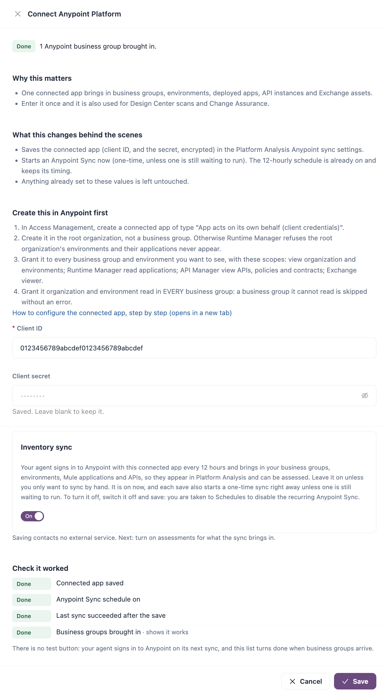

# MuleSoft Anypoint Platform

IZ Suite signs in to Anypoint Platform with a connected app, brings in your business groups, environments and applications, and assesses the Mule applications, API instances and Exchange APIs it finds. Optionally, it also scans Design Center projects and keeps IZ Suite roles in step with your Anypoint teams.


Requires the **Platform Analysis** licence. Design Center scans need the **Code Analysis** licence.


## Create the Connected App in Anypoint

The inventory sync and the assessments sign in with one connected app that acts on its own behalf.

1. Sign in to Anypoint Platform with a user who can manage connected apps.
2. Open **Access Management** → **Connected Apps** and click **Create app**.
3. Enter a **Name**, for example `IZ Suite Agent`.
4. Choose the type **App acts on its own behalf (client credentials)**.
5. Click **Add scopes** and add the view scopes in the table below. The app only reads from Anypoint, so it needs no manage scopes.
6. Grant the scopes to every business group and environment you want IZ Suite to see.
7. Save the app and copy its **Client ID** and **Client Secret**.


Create the app in the root organization, not in a business group. Otherwise Runtime Manager refuses the root organization's environments and their applications never appear. Also grant organization and environment read in every business group: a business group the app cannot read is skipped without an error.


| Used by                             | Scope                                                                      | What it allows                                                                                                                |
| ----------------------------------- | -------------------------------------------------------------------------- | ----------------------------------------------------------------------------------------------------------------------------- |
| **Anypoint Sync**                   | **View Organization**                                                      | List the organizations (business groups) the app can access.                                                                  |
| **Anypoint Sync**                   | **View Environment**                                                       | List the environments the app can access.                                                                                     |
| **Anypoint Sync**                   | **View Environments in a particular organization**                         | List the environments of each business group.                                                                                 |
| **Anypoint Mule Runtime Analysis**  | **Read Applications**                                                      | Read the applications deployed on CloudHub.                                                                                   |
| **Anypoint Mule Runtime Analysis**  | **Read Runtime Fabrics**                                                   | Read the applications deployed on CloudHub 2.0.                                                                               |
| **Anypoint API Instance Analysis**  | **View APIs Configuration**                                                | Read the API instances and their configuration.                                                                               |
| **Anypoint API Instance Analysis**  | **View Policies**                                                          | Read the policies applied to each API instance.                                                                               |
| **Anypoint API Instance Analysis**  | **View Contracts**                                                         | Read the contracts defined for each API instance.                                                                             |
| **Anypoint API Instance Analysis**  | **View API Alerts**                                                        | Read the alerts defined for each API instance.                                                                                |
| **Anypoint Exchange APIs Analysis** | **Exchange Viewer**                                                        | Read the assets published to Exchange.                                                                                        |
| Teams sync (optional)               | **View Users in a particular organization** and **Access Controls Viewer** | Read your teams, their members and their roles. Needed only when teams sync is on (see **Synchronize Anypoint Teams** below). |

Leave out the scopes of assessments you do not use: a missing scope only affects the job that needs it.

## Connect Anypoint in IZ Suite

<figure><figcaption></figcaption></figure>

1. Open **Administration** → **Setup** and click **Set up** (or **Review**) on **Connect Anypoint Platform**.
2. Enter the connected app's **Client ID** and **Client secret**.
3. Turn **Inventory sync** on. The switch is available once the client ID and secret are entered.
4. Click **Save**.

Design Center scans and the Change Assurance MuleSoft connection are set up separately: see **Design Center Projects** below and [Connections](../workspaces/change-assurance/connections.md).

Saving stores the client secret encrypted. With **Inventory sync** on, it also starts a one-time **Anypoint Sync** and creates a recurring **Anypoint Sync** every 12 hours; with it off, nothing is brought in until a schedule is on. There is no test button: the step turns done when the first business groups arrive.


With a [self-hosted agent](how-assessments-run.md), you can keep the client ID and secret on your own machine instead: start the agent with `--anypointClientId` and `--anypointClientSecret` (see [Agents](../administration/global-settings/agents.md)).


To turn the sync off, switch **Inventory sync** off and save: IZ Suite takes you to **Schedules**, where you disable the recurring **Anypoint Sync**.

## What the Sync Brings In

Each **Anypoint Sync** run:

1. Brings in every business group the app can read as an IZ Suite organization (source **Anypoint**).
2. Brings in each business group's environments.
3. Records the Mule applications deployed in Runtime Manager and the API instances in API Manager of every environment, except the **Design** environment.
4. Records the APIs published in Exchange, once per business group.
5. With teams sync on, brings in your Anypoint teams and their members (see **Synchronize Anypoint Teams** below).

The organizations and environments appear under [Organizations](../administration/organizations/). Each run's log under [Execution History](../operations/schedules/execution-history.md) lists what it synced.

### Leave Applications Out

Each kind of application has a pattern matcher under **Administration** → **Global Settings** → **Settings** that includes or excludes applications by name: **Anypoint Mule Applications Pattern Matcher**, **Anypoint API Instance Pattern Matcher** and **Anypoint Exchange APIs Pattern Matcher**. For example, to skip test and sandbox applications:


```json
{
  "config": {
    "name": {
      "includePattern": [".*"],
      "excludePattern": ["^test-.*", ".*-sandbox$"]
    }
  }
}
```


The patterns are regular expressions and apply from the next run.

## What Is Assessed

| Assessment type                     | Assesses                                                                                                                                                 | Scope                     |
| ----------------------------------- | -------------------------------------------------------------------------------------------------------------------------------------------------------- | ------------------------- |
| **Anypoint Mule Runtime Analysis**  | Mule applications deployed in Runtime Manager: the deployed application is downloaded and its code and configuration are checked against the Mule rules. | Each selected environment |
| **Anypoint API Instance Analysis**  | API instances in API Manager: their policies, contracts, alerts and SLA tiers.                                                                           | Each selected environment |
| **Anypoint Exchange APIs Analysis** | RAML and OAS API specifications published in Exchange.                                                                                                   | The business group        |

### Choose Which Applications Are Assessed

By default, only applications someone marked eligible are assessed. To assess every application the sync discovers, tick **Assess every discovered Anypoint application** when you turn on Anypoint assessments in Setup.

### Schedule the Assessments

1. Open **Administration** → **Setup** and click **Set up** on **Turn on Anypoint assessments**.
2. Under **What to assess**, keep the assessment types you want.
3. Under **When should this work run?**, choose **One time** or **Recurring** and the interval.
4. Optionally tick **Assess every discovered Anypoint application**.
5. Click **Turn on assessments**.

To give one business group its own cadence, use **Schedule platform scan** under [All Schedules](../operations/schedules/all-schedules.md). See [How Assessments Run](how-assessments-run.md).

## Design Center Projects

Code Analysis can scan the API specifications and Mule projects you design in Design Center. Design Center uses its own connected app settings, so you can reuse the inventory app or use a separate one.

1. In Anypoint, give the connected app Design Center access (**Design Center Developer**) for the business group whose projects you want scanned.
2. In IZ Suite, open **Workspaces** → **Code Analysis** → **Manage Scanning** and choose the **Design Center** tab.
3. Click **Configure Design Center connection**. The button appears once the **Anypoint Sync** has brought in your business groups; afterwards the connection is under **More** → **Design Center connection**.
4. Enter the **Client ID**, **Client secret** and **Owner ID**, the Anypoint user ID that owns the Design Center projects (not the organization ID), and click **Save**.
5. Schedule the repository sync and scans from **Scan schedules**.

Projects are filed under the Anypoint business group they belong to, so run the **Anypoint Sync** first. The results appear in [Code Analysis](../workspaces/code-analysis/).

## Synchronize Anypoint Teams

Teams sync keeps IZ Suite roles in step with your Anypoint teams. On each **Anypoint Sync**:

* Each Anypoint team becomes an IZ Suite role with the team's name. In [Roles](../administration/organizations/roles.md), its type is **Synced from** Anypoint.
* The role's permissions come from the Anypoint permissions the team holds, translated by the role mapping below, and are scoped to the business groups and environments where the team holds them.
* The team's members are added to IZ Suite as people and given the role. Members who left the team lose it.

### Turn On Teams Sync

1. Add the teams sync scopes to the connected app (see the scopes table above).
2. Open **Administration** → **Global Settings** → **Settings**.
3. Search for **Anypoint Team Sync**, click the edit icon, set the value to `true` and click **Save changes**.
4.  Optionally edit **Anypoint Teams Sync Settings**:

    | Key                               | Default | Description                                                                                                               |
    | --------------------------------- | ------- | ------------------------------------------------------------------------------------------------------------------------- |
    | **Sync Users**                    | `true`  | Bring in each team's members and give them the team's role. When `false`, roles are created but nobody is added to them.  |
    | **Sync Teams/Roles**              | `true`  | Create and update a role for each team.                                                                                   |
    | **Override Existing Teams/Roles** | `true`  | Overwrite synced roles on every sync, including local changes. When `false`, a role that already exists is left as it is. |

The next **Anypoint Sync** brings the teams in.


While **Override Existing Teams/Roles** is on, synced roles are managed by the sync: you cannot assign people to them in IZ Suite, and local changes are overwritten.


### Role Mapping

The **Anypoint Teams Role Mapping** setting decides which IZ Suite permissions each Anypoint permission grants. It is a JSON list with one entry per Anypoint permission: its ID (`key`), its `name` and the IZ Suite `permissions` it grants. The built-in mapping is:

| Anypoint permission                                                                                                                                                | IZ Suite access                                                                                                     |
| ------------------------------------------------------------------------------------------------------------------------------------------------------------------ | ------------------------------------------------------------------------------------------------------------------- |
| **Exchange Administrator**, **Exchange Contributor**, **Exchange Creator**                                                                                         | View, create, edit and delete Exchange API applications and their findings, in Platform Analysis and Code Analysis. |
| **Exchange Viewer**                                                                                                                                                | View Exchange API applications and their findings.                                                                  |
| **Create Applications**, **Delete Applications**, **Manage Application Data**, **Manage Application Flows**, **Manage Runtime Fabric**, **Manage Servers**         | View, create, edit and delete Mule applications and their findings, in Platform Analysis and Code Analysis.         |
| **Read Applications**, **Download Application**, **Read Servers**                                                                                                  | View Mule applications and their findings.                                                                          |
| **API Manager Environment Administrator**, **Deploy API Proxies**, **Manage API Alerts**, **Manage APIs Configuration**, **Manage Contracts**, **Manage Policies** | View, create, edit and delete API instances and their findings.                                                     |
| **View API Alerts**, **View APIs Configuration**, **View Contracts**                                                                                               | View API instances and their findings.                                                                              |

Every mapped permission also grants access to the dashboard. Edit the JSON to add or change entries for your organization.

## Where the Results Appear

| What                                                                                               | Where                                                             |
| -------------------------------------------------------------------------------------------------- | ----------------------------------------------------------------- |
| Business groups and environments                                                                   | [Organizations](../administration/organizations/)                 |
| Deployed Mule applications, API instances and Exchange APIs, with their quality gates and findings | [Platform Analysis](../workspaces/platform-analysis/)             |
| Design Center projects                                                                             | [Code Analysis](../workspaces/code-analysis/)                     |
| Monitors on Runtime Manager applications and API instances                                         | [Service Health](../workspaces/service-health/monitors.md)        |
| Synced team roles                                                                                  | [Roles](../administration/organizations/roles.md)                 |
| Sync and assessment runs                                                                           | [Execution History](../operations/schedules/execution-history.md) |

To let people sign in with their Anypoint account, see [Single Sign-On](single-sign-on/).

## Next Steps

* [How Assessments Run](how-assessments-run.md): agents, job types and schedules.
* [Single Sign-On](single-sign-on/): sign in to IZ Suite with Anypoint.
* [Supported Languages](supported-languages.md): what Code Analysis checks in Mule projects and API specifications.
* [Supported Platforms](./): back to the platform overview.
