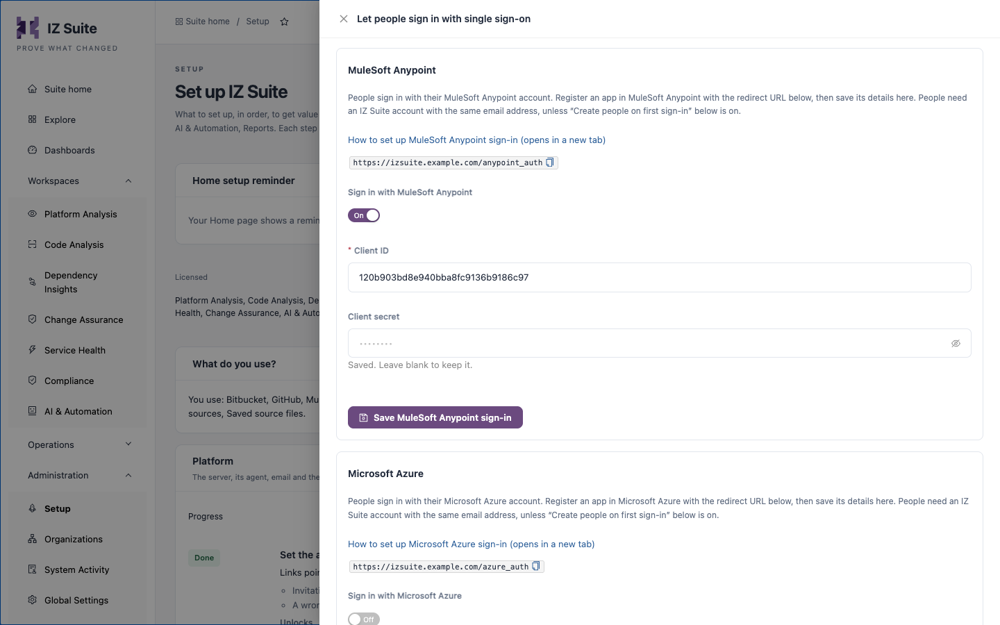

# Single Sign On

People can sign in to IZ Suite with their MuleSoft Anypoint or Microsoft Azure account instead of an email and password. You register an app with the identity provider, save its details in Setup, and choose whether IZ Suite creates an account for people who sign in for the first time.

The single sign-on step appears in Setup when your licence covers MuleSoft Anypoint or Azure.


You need a role that can change global settings to set up single sign-on.


## How single sign-on works

1. On the sign-in page, the person clicks the identity provider's option under **Sign in with**.
2. The identity provider asks them to sign in and returns them to IZ Suite's redirect URL.
3. IZ Suite looks for an enabled person with the same email address.
4. If there is one, they are signed in. If there is none, they are created with the roles you chose, but only when **Create people on first sign-in** is on; otherwise the sign-in is refused.

Two-factor authentication for single sign-on is handled by the identity provider. IZ Suite's own two-factor authentication applies to email-and-password sign-in only.

## Register the app with the identity provider

Each provider needs the redirect URL that IZ Suite shows in the Setup drawer. It is built from the server address set in Setup.



1. In Anypoint Platform, open **Access Management** → **Connected Apps** → **Create app**.
2. Enter a **Name**.
3. Choose the type **App acts on behalf of a user**.
4. Under **Grant types**, choose **Authorization Code**.
5. Enter your IZ Suite address as the **Website URL**.
6.  Enter the redirect URI:

    ```
    https://izsuite.example.com/anypoint_auth
    ```
7. Under **Who can use this application?**, choose **Members of this organization only**.
8. Click **Add scopes**, search for "Profile", select the OpenID **Profile** scope and add it.
9. Save the app and copy its **Client ID** and **Client Secret**.

This is a different connected app from the one the [Anypoint inventory sync](mulesoft-anypoint-platform.md) uses.



1. In the Azure portal, open **Microsoft Entra ID** → **App registrations** → **New registration**.
2. Enter a **Name** and choose the single-tenant option under **Supported account types**.
3.  Under **Redirect URI**, choose **Web** and enter:

    ```
    https://izsuite.example.com/azure_auth
    ```
4. Click **Register**.
5. Under **Client credentials**, click **Add a certificate or secret**, create a **New client secret** and copy its value. It is shown only once.
6. Open **API permissions** and make sure the Microsoft Graph **User.Read** permission is listed.
7. On the **Overview** page, copy the **Directory (tenant) ID** and **Application (client) ID**.

You can use a different app registration from the one the [Azure inventory sync](azure-integration-services.md) uses.



## Turn on single sign-on in IZ Suite

<figure><figcaption><p>Let people sign in with single sign-on</p></figcaption></figure>

1. Open **Administration** → **Setup** and click **Set up** (or **Review**) on **Let people sign in with single sign-on**.
2. On the provider's card (**MuleSoft Anypoint** or **Microsoft Azure**), turn on **Sign in with** _provider_.
3.  Enter the app's details:

    | Provider              | Fields                                                                        |
    | --------------------- | ----------------------------------------------------------------------------- |
    | **MuleSoft Anypoint** | **Client ID** and **Client secret**.                                          |
    | **Microsoft Azure**   | **Directory (tenant) ID**, **Application (client) ID** and **Client secret**. |
4. Click **Save MuleSoft Anypoint sign-in** or **Save Microsoft Azure sign-in**.

The sign-in page now offers the provider under **Sign in with**. Each card saves on its own; the client secret is stored encrypted and shows **Saved. Leave blank to keep it.** once saved.

## Create people on first sign-in

By default, only people you invited can sign in with single sign-on. To let anyone who can sign in at the identity provider in:

1. In the same drawer, turn on **Create people on first sign-in**.
2. Under **Roles for new people**, choose at least one role. Every person created this way gets all of these roles.
3. Click **Save**.

People created this way appear under [Users](https://knowledgebase.autorabit.com/product-guides/integral-zone/iz-suite/administration/organizations/users) like invited people, and you can change their roles later.


Anyone who can sign in through the identity provider gets these roles. Keep the roles narrow, and restrict the app to the intended people at the provider (for example **Who can use this application?** in Anypoint, or user assignment in Microsoft Entra ID).


## Turn off password sign-in

When everyone signs in with single sign-on, you can turn off email-and-password sign-in:

1. Sign in to IZ Suite with single sign-on yourself. This keeps you from being locked out.
2. In the same drawer, switch **Password sign-in** off.

With password sign-in off, the **IZ User** option leaves the sign-in page and password reset emails are not sent. Switch it on again at any time.

## Two-factor authentication and sign-in limits

The **Login Settings** setting controls two-factor authentication and the sign-in limits for email-and-password sign-in. Change it under **Administration** → **Global Settings** → **Settings**.

| Key                               | Default | Description                                                                                                                                                                                                                                                                                                                    |
| --------------------------------- | ------- | ------------------------------------------------------------------------------------------------------------------------------------------------------------------------------------------------------------------------------------------------------------------------------------------------------------------------------ |
| **MFA Enabled**                   | `false` | When `true`, people who sign in with their email and password must also enter a code from an authenticator app. People without an authenticator set one up at their next sign-in (see [Sign In](https://knowledgebase.autorabit.com/product-guides/integral-zone/iz-suite/getting-started/sign-in#two-factor-authentication)). |
| **Max Failed Login Attempts**     | `5`     | Wrong passwords or codes in a row after which the account is locked.                                                                                                                                                                                                                                                           |
| **Account Lockout Minutes**       | `15`    | How long a locked account stays locked.                                                                                                                                                                                                                                                                                        |
| **IZ User Auth Password Max Age** | `90`    | Days after which a password must be changed at the next sign-in.                                                                                                                                                                                                                                                               |
| **Session Timeout Seconds**       | `3600`  | How long a signed-in session lasts, for every sign-in option.                                                                                                                                                                                                                                                                  |

When someone loses their authenticator and their recovery codes, use **Reset MFA** on their row in [Users](https://knowledgebase.autorabit.com/product-guides/integral-zone/iz-suite/administration/organizations/users). They set up an authenticator again at their next sign-in.

## Next steps

* [Sign In](https://knowledgebase.autorabit.com/product-guides/integral-zone/iz-suite/getting-started/sign-in): what people see when they sign in.
* [Users](https://knowledgebase.autorabit.com/product-guides/integral-zone/iz-suite/administration/organizations/users): invite people, reset two-factor authentication and set temporary passwords.
* [Setup](https://knowledgebase.autorabit.com/product-guides/integral-zone/iz-suite/administration/setup#platform): the other platform steps.
* [Supported Platforms](./): back to the platform overview.
