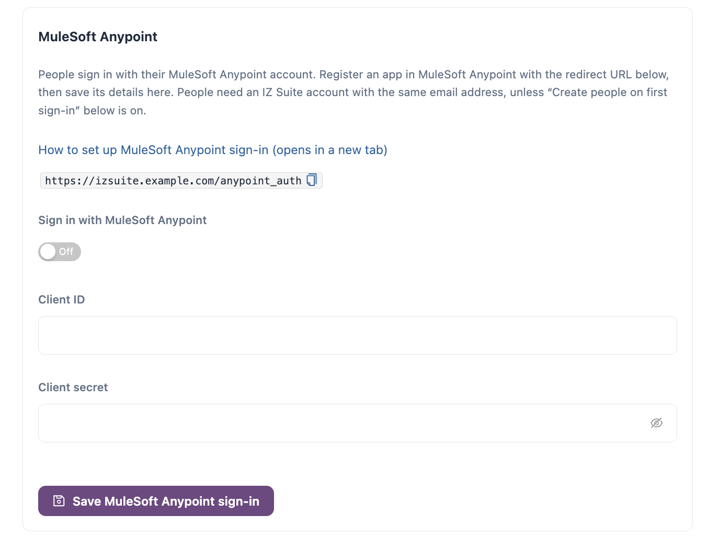

# Anypoint Platform

People can sign in to IZ Suite with their MuleSoft Anypoint Platform account. You create a connected app in Anypoint Platform that acts on behalf of the person signing in, then save its client ID and secret in IZ Suite.


You need a role that can change global settings. The **MuleSoft Anypoint** card appears in Setup when your licence covers MuleSoft Anypoint and **MuleSoft Anypoint** is ticked under **What do you use?**.


## Create the Connected App in Anypoint Platform

1. In Anypoint Platform, open **Access Management** → **Connected Apps** and click **Create app**.
2. Enter a **Name**, for example `IZ Suite Sign-In`.
3. Choose the type **App acts on behalf of a user**.
4. Under **Grant types**, choose **Authorization Code**.
5. Enter your IZ Suite address as the **Website URL**, for example `https://izsuite.example.com`.
6.  Under **Redirect URIs**, enter the redirect URL that IZ Suite shows on the **MuleSoft Anypoint** card:

    ```
    https://izsuite.example.com/anypoint_auth
    ```
7. Under **Who can use this application?**, choose **Members of this organization only**.
8. Click **Add scopes**, search for "Profile", select the OpenID **Profile** scope and click **Add scopes**.
9. Save the app and copy its **Client ID** and **Client Secret**.


This is a different connected app from the one the Anypoint inventory sync uses (see Anypoint Platform under Supported Platforms). The sign-in app acts on behalf of the person signing in and only reads their profile.


## Turn On Anypoint Sign-In in IZ Suite

<figure><figcaption><p>MuleSoft Anypoint sign-in</p></figcaption></figure>

1. Open **Administration** → **Setup** and click **Set up** (or **Review**) on **Let people sign in with single sign-on**.
2. On the **MuleSoft Anypoint** card, turn on **Sign in with MuleSoft Anypoint**.
3. Enter the connected app's **Client ID** and **Client secret**. Both are required.
4. Click **Save MuleSoft Anypoint sign-in**.

The sign-in page now offers MuleSoft Anypoint under **Sign in with**. The client secret is stored encrypted; once saved, the field shows **Saved. Leave blank to keep it.**


The redirect URL is built from the server address set in Setup. People must open IZ Suite at that same address, or Anypoint Platform refuses the sign-in.


## Next Steps

* [Single Sign-On](./): decide who gets in on first sign-in.
* [Azure](azure.md): let people sign in with their Microsoft account too.
* [IZ User](iz-user.md): keep or turn off email-and-password sign-in.
* [Sign In](../../getting-started/sign-in.md): what people see when they sign in.
