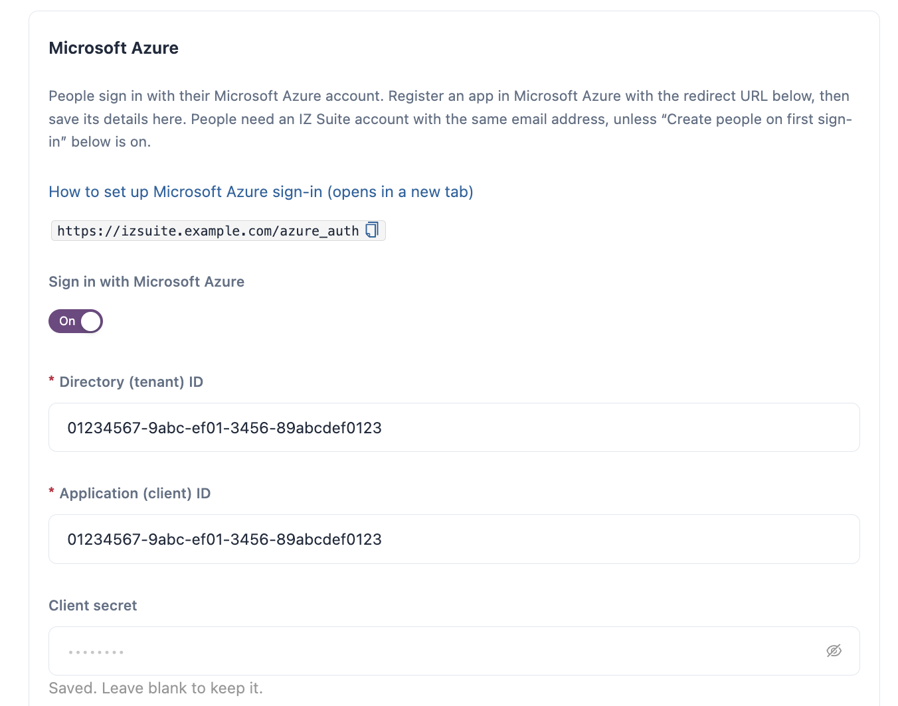

# Azure

People can sign in to IZ Suite with their Microsoft work account. You register an app in Microsoft Entra ID (formerly Azure Active Directory), then save its tenant ID, client ID and client secret in IZ Suite.


You need a role that can change global settings. The **Microsoft Azure** card appears in Setup when your licence covers Azure and **Azure** is ticked under **What do you use?**.


## Register the App in Microsoft Entra ID

1. In the Azure portal, open **Microsoft Entra ID** → **App registrations** and click **New registration**.
2. Enter a **Name**, for example `IZ Suite Sign-In`.
3. Under **Supported account types**, choose the single-tenant option (accounts in this organizational directory only).
4.  Under **Redirect URI**, choose **Web** and enter the redirect URL that IZ Suite shows on the **Microsoft Azure** card:

    ```
    https://izsuite.example.com/azure_auth
    ```
5. Click **Register**.
6. Under **Client credentials**, click **Add a certificate or secret**, then **Client secrets** → **New client secret**. Enter a description and an expiry, and click **Add**.
7. Copy the secret's **Value**. It is shown only once.
8. Open **API permissions** and make sure the Microsoft Graph **User.Read** permission is listed.
9. On the **Overview** page, copy the **Directory (tenant) ID** and the **Application (client) ID**.


You can use a different app registration from the one the Azure inventory sync uses. When the client secret expires, create a new one and save it in IZ Suite.


## Turn On Azure Sign-In in IZ Suite

<figure><figcaption><p>Microsoft Azure sign-in</p></figcaption></figure>

1. Open **Administration** → **Setup** and click **Set up** (or **Review**) on **Let people sign in with single sign-on**.
2. On the **Microsoft Azure** card, turn on **Sign in with Microsoft Azure**.
3. Enter the **Directory (tenant) ID**, the **Application (client) ID** and the **Client secret**. All three are required.
4. Click **Save Microsoft Azure sign-in**.

The sign-in page now offers Microsoft Azure under **Sign in with**. The client secret is stored encrypted; once saved, the field shows **Saved. Leave blank to keep it.**


The redirect URL is built from the server address set in Setup. People must open IZ Suite at that same address, or Microsoft Entra ID refuses the sign-in.


## Next Steps

* [Single Sign-On](./): decide who gets in on first sign-in.
* [Anypoint Platform](anypoint-platform.md): let people sign in with their Anypoint account too.
* [IZ User](iz-user.md): keep or turn off email-and-password sign-in.
* [Sign In](../../getting-started/sign-in.md): what people see when they sign in.
