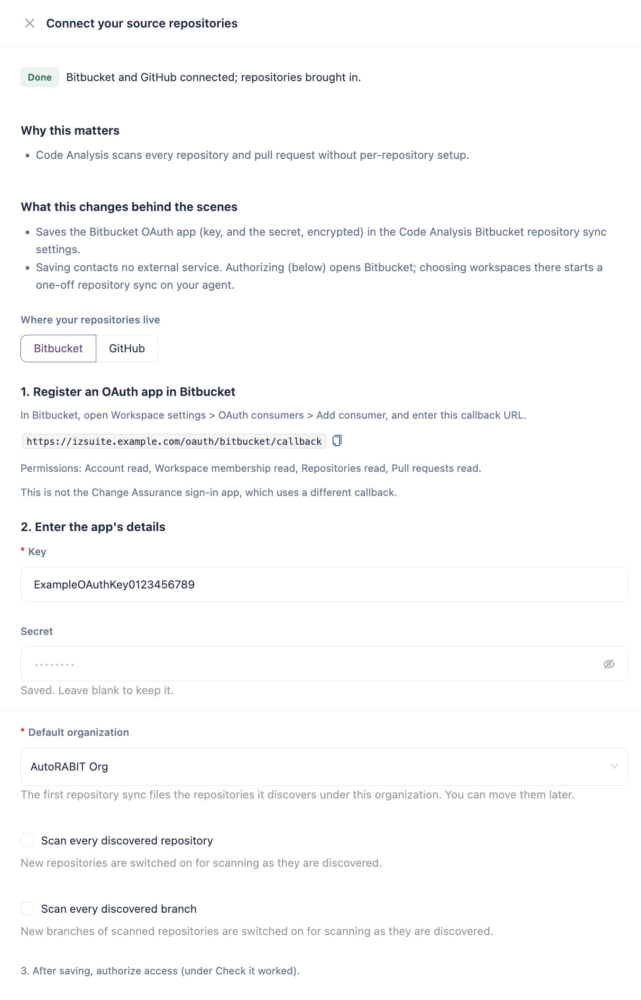

# Source Repositories

Code Analysis can scan your Bitbucket and GitHub repositories without any change to your pipelines. IZ Suite signs in with an OAuth app you register, discovers your repositories and branches, and scans the ones you enable on a schedule. Bitbucket pull requests can be scanned as soon as they are opened or updated.


Requires the **Code Analysis** licence.


To scan from your own pipeline instead, see [CI/CD Integration](../ci-cd-integration/). For Anypoint Design Center projects, see [MuleSoft Anypoint Platform](mulesoft-anypoint-platform.md).

## How Repository Scanning Works

| Step                         | What happens                                                                                                                                                           |
| ---------------------------- | ---------------------------------------------------------------------------------------------------------------------------------------------------------------------- |
| **1. Register an OAuth app** | You register an OAuth app in Bitbucket or GitHub with IZ Suite's callback URL, and save its ID and secret in IZ Suite.                                                 |
| **2. Authorize**             | You authorize the app in Bitbucket or GitHub and choose the workspaces to bring in. IZ Suite keeps the access fresh from then on.                                      |
| **3. Repository sync**       | The sync discovers the repositories and branches of the authorized workspaces (and Bitbucket pull requests) and files new repositories under the default organization. |
| **4. Eligibility**           | You choose which repositories and branches are scanned, or let IZ Suite scan every discovered one.                                                                     |
| **5. Repository scan**       | The scan checks out each enabled repository and branch, detects its [languages](supported-languages.md) and runs their rules.                                          |
| **6. Review**                | Findings and quality gates appear per branch and pull request in [Code Analysis](../workspaces/code-analysis/).                                                        |

## Register the OAuth App



1. In Bitbucket, open **Workspace settings** → **OAuth consumers** → **Add consumer**.
2.  Enter a name and the callback URL that IZ Suite shows in the Setup drawer:

    ```
    https://izsuite.example.com/oauth/bitbucket/callback
    ```
3. Give the consumer these permissions: **Account** read, **Workspace membership** read, **Repositories** read and **Pull requests** read.
4. Save it and copy its **Key** and **Secret**.



1. In GitHub, open **Settings** → **Developer settings** → **OAuth Apps** → **New OAuth App**.
2.  Enter a name, your IZ Suite address as the homepage URL, and the authorization callback URL that IZ Suite shows in the Setup drawer:

    ```
    https://izsuite.example.com/oauth/github/callback
    ```
3. Register the app, generate a client secret, and copy the **Client ID** and **Client secret**.




The callback URL is built from the address you opened IZ Suite at, so open IZ Suite at its usual address before you copy it. This app is not the Change Assurance sign-in app, which uses a different callback.


## Connect and Authorize

<figure><figcaption></figcaption></figure>

1. Open **Administration** → **Setup** and click **Set up** (or **Review**) on **Connect your source repositories**. You can also open it from **Workspaces** → **Code Analysis** → **Manage Scanning** → **Manage** (or **More**) → **Bitbucket connection & discovery** or **GitHub connection & discovery**.
2. Under **Where your repositories live**, choose **Bitbucket** or **GitHub**.
3.  Enter the app's details:

    | Field                                | Description                                                                                                        |
    | ------------------------------------ | ------------------------------------------------------------------------------------------------------------------ |
    | **Key** / **Client ID**              | The OAuth app's ID. Required.                                                                                      |
    | **Secret** / **Client secret**       | The OAuth app's secret. Stored encrypted.                                                                          |
    | **Default organization**             | The organization the first repository sync files discovered repositories under. You can move them later. Required. |
    | **Scan every discovered repository** | New repositories are switched on for scanning as they are discovered.                                              |
    | **Scan every discovered branch**     | New branches of scanned repositories are switched on for scanning as they are discovered.                          |
4. Click **Save**.
5. Under **Check it worked**, click **Authorize access**. Bitbucket or GitHub opens in a new tab.
6. Approve the app, then choose the workspaces to bring in on the page IZ Suite returns you to. The first repository sync starts.


While **Scan every discovered repository** or **Scan every discovered branch** is on, every save of this step switches every discovered repository or branch back on for scanning, including ones someone switched off.


If Bitbucket or GitHub no longer accepts the saved access (it was revoked or replaced), the drawer and **Manage Scanning** show **Reconnect**: click **Authorize again** to resume syncing.

## Choose What Is Scanned

Open **Workspaces** → **Code Analysis** → **Manage Scanning** and choose the **Bitbucket** or **GitHub** tab:

* Tick repositories and click **Enable selected** or **Exclude selected**. When you enable them, choose their organization and optionally queue a one-time scan.
* On the **Bitbucket** or **GitHub** tab, click **Configure Bitbucket connection & discovery** (or **Configure GitHub connection & discovery**) and tick **Scan every discovered repository** to scan every current and future repository of the connection.

Excluding a repository stops future scans of it and its branches; its existing results are kept. See [Manage Scanning](../workspaces/code-analysis/manage-scanning.md).

## Schedule the Sync and the Scans

Two job types do the work, each scheduled per platform:

| Job type        | What it does                                                      |
| --------------- | ----------------------------------------------------------------- |
| Repository sync | Discovers new repositories, branches and Bitbucket pull requests. |
| Repository scan | Scans the enabled repositories and branches.                      |

1. Open **Administration** → **Setup** and click **Set up** on **Turn on repository assessments** (or **Configure scan schedules** in **Manage Scanning**).
2. Under **What to assess**, keep **Repository scan** and **Repository sync**.
3. Under **When should this work run?**, choose **One time** or **Recurring** and the interval.
4. Click **Turn on assessments**.

Each scheduled type shows its current timing (for example **On · Every hour**) with **Edit schedule**. See [All Schedules](../operations/schedules/all-schedules.md).

## Scan Pull Requests

With Bitbucket, IZ Suite can scan a pull request as soon as it is opened or updated:

1. Open **Administration** → **Setup** and click **Set up** on **Scan pull requests from Bitbucket**.
2. Turn on **Scan pull requests**.
3. Enter a **Webhook secret**, or click **Generate a secret** and copy it.
4. Click **Save**.
5. In each Bitbucket repository, open **Repository settings** → **Webhooks** → **Add webhook**, enter the URL the drawer shows and the secret, and choose the triggers **Pull request created**, **updated**, **merged** and **declined**.

Pull requests are scanned only in repositories enabled for scanning. A pull request is judged on the code it adds compared with its target branch. If the target branch has never been scanned, it is scanned first and the pull request right after. For the details, and for pull-request scans from your pipeline, see [Pull Request Analysis](../ci-cd-integration/pull-request-analysis.md) and [Pull Requests](../workspaces/code-analysis/pull-requests.md).


Bitbucket lists every delivery under the webhook's **View requests**. A 401 answer means the secrets differ; a 403 means no secret is saved in IZ Suite. The server address must be reachable from Bitbucket.


## Where the Results Appear

| What                                       | Where                                                                         |
| ------------------------------------------ | ----------------------------------------------------------------------------- |
| Repositories and their eligibility         | [Manage Scanning](../workspaces/code-analysis/manage-scanning.md)             |
| Branches, their quality gates and findings | [Branches & Baselines](../workspaces/code-analysis/branches-and-baselines.md) |
| Pull requests                              | [Pull Requests](../workspaces/code-analysis/pull-requests.md)                 |
| Sync and scan runs                         | [Execution History](../operations/schedules/execution-history.md)             |

## Next Steps

* [Supported Languages](supported-languages.md): what each scan detects and checks.
* [Manage Scanning](../workspaces/code-analysis/manage-scanning.md): enable or exclude repositories.
* [Pull Request Analysis](../ci-cd-integration/pull-request-analysis.md): scan pull requests from webhooks and pipelines.
* [Supported Platforms](./): back to the platform overview.
