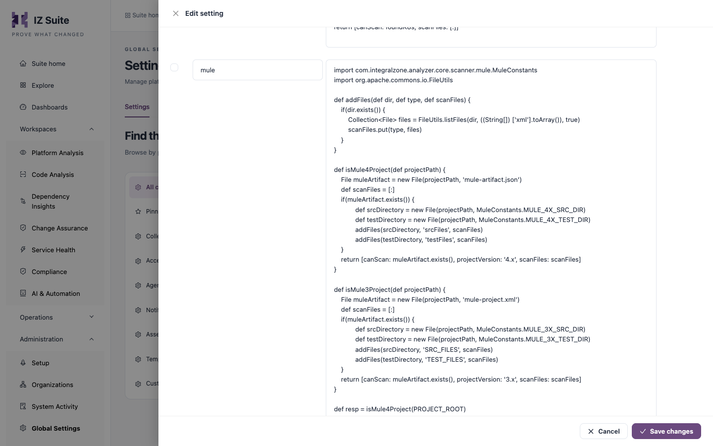

# Supported Languages

Code Analysis detects the languages of every project it scans and runs each language's rules. The same detection and rules apply wherever the scan runs: a scheduled repository scan, a Design Center scan, the CLI or Maven plugin in your pipeline, or an IDE extension.


Requires the **Code Analysis** licence. Each language is licensed separately: a language you do not license is not scanned and has no menu entry.


## Languages

| Language           | What is scanned                                                                                                          | How a project is recognized                                                                                                                                                               |
| ------------------ | ------------------------------------------------------------------------------------------------------------------------ | ----------------------------------------------------------------------------------------------------------------------------------------------------------------------------------------- |
| **Mule**           | Mule 4 and Mule 3 applications: the XML configuration under the source and test folders.                                 | A `mule-artifact.json` file at the project root (Mule 4), or a `mule-project.xml` file (Mule 3).                                                                                          |
| **API**            | RAML and OpenAPI (OAS) API specifications.                                                                               | `.raml`, `.yaml` or `.json` files that are API specifications. Files in a `build` folder are skipped.                                                                                     |
| **Java**           | Java source, including Spring and Spring Boot applications, and their `application` and `bootstrap` configuration files. | A build file at the project root: `pom.xml`, `build.gradle`, `build.gradle.kts`, `settings.gradle`, `settings.gradle.kts` or `build.xml`. Build output and generated folders are skipped. |
| **Python**         | Python source (`.py` files).                                                                                             | A `requirements.txt`, `pyproject.toml` or `poetry.lock` file at the project root.                                                                                                         |
| **PySpark**        | Python source that uses Spark.                                                                                           | The same files as Python, and at least one `.py` file that imports `pyspark` or `databricks.koalas`.                                                                                      |
| **CSharp**         | C# source (`.cs` files).                                                                                                 | A `.csproj` or `.sln` file at the project root.                                                                                                                                           |
| **Kubernetes**     | Kubernetes manifests.                                                                                                    | `.yaml` or `.yml` files whose documents have both `apiVersion` and `kind`.                                                                                                                |
| **CloudFormation** | CloudFormation and SAM templates.                                                                                        | A `template.yaml`, `template.yml`, `template.json` or `cfn.project` file at the project root. `.git`, `node_modules`, `.aws-sam` and `cdk.out` folders are skipped.                       |
| **Lambda**         | AWS Lambda function definitions.                                                                                         | A `lambda-function-definition.json` (or `.yaml`) file at the project root. Other `lambda-*` files next to it are scanned with it.                                                         |
| **Logic App**      | Azure Logic Apps workflows.                                                                                              | A `host.json` file for Logic Apps, with `workflow.json`, `definition.json`, `connections.json` or `*logicapp.json` files.                                                                 |
| **API Management** | Azure API Management policies.                                                                                           | Policy files (`policy.xml`, `inbound.xml`, `outbound.xml`, `backend.xml`, `on-error.xml`) at the root and in `global`, `products` and `apis` folders.                                     |
| **Function App**   | Azure Function Apps.                                                                                                     | A `host.json` file for Azure Functions, with the Function App's definition and function files.                                                                                            |

One project can match more than one language. A Spark project, for example, is also a Python project, so it is scanned with both rule sets and its results appear under both.


The Lambda, Logic App, API Management and Function App definitions are the same files the platform assessments collect from AWS and Azure. Keep them in a repository to check them before you deploy. See [Amazon Web Services](amazon-web-services.md) and [Azure Integration Services](azure-integration-services.md).


## Rules for each language

Each language has its own built-in quality profile, metric profile and quality gate. To see a language's rules and how many there are, open **Operations** → **Quality Control** → **Quality rules** and filter by **Technology** (see [Quality Rules](https://knowledgebase.autorabit.com/product-guides/integral-zone/iz-suite/operations/quality-control/quality-rules)). To change which rules run, edit or clone the language's [quality profile](https://knowledgebase.autorabit.com/product-guides/integral-zone/iz-suite/operations/quality-control/quality-profiles).

## Change how a language is recognized

Detection is controlled by the **Language Identifier Settings** setting. It holds one entry per language: the entry's key is the language ID (for example `mule`, `api`, `java`, `python`, `pyspark`, `csharp`, `kubernetes`, `cfn`, `lambda`, `logicapp`, `apimgmt` or `functionapp`), and its value is a Groovy script that looks at the project folder and decides whether the project is that language and which files to scan.

1. Open **Administration** → **Global Settings** → **Settings**.
2. Search for **Language Identifier Settings** and click the edit icon.
3. Change the script of the language you want to adjust.
4. Click **Save changes**.

<figure><figcaption>
The detection script of the Mule language
</figcaption></figure>

The change applies to the next scan everywhere: repository scans, Design Center scans, the CLI, the Maven plugin and the IDE extensions.


A wrong script can stop a language from being detected, so its projects are no longer scanned. Copy the current script before you change it. You need a role that can edit global settings.


## Next steps

* [Source Repositories](source-repositories.md): scan your Bitbucket and GitHub repositories.
* CI/CD Integration: scan in your pipeline.
* [Quality Profiles](https://knowledgebase.autorabit.com/product-guides/integral-zone/iz-suite/operations/quality-control/quality-profiles): choose the rules each language runs.
* [Supported Platforms](./): back to the platform overview.
