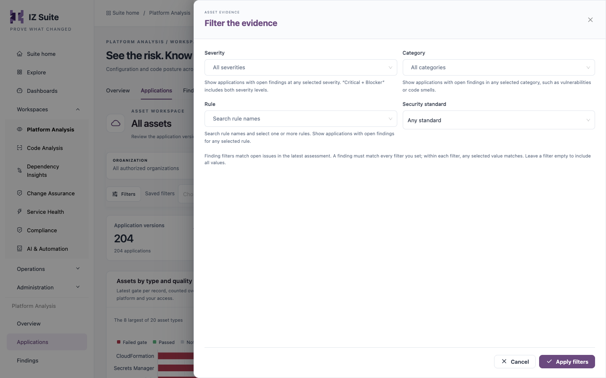

# Workspaces

A workspace collects the evidence for one area of IZ Suite: the applications, assessments, findings and decisions that belong to it. Each workspace has its own tabs, but they all share the same filters, saved filters, links and table tools, so what you learn on one applies to the others.

Open a workspace from **Workspaces** in the sidebar. When a workspace is open, its tabs are also listed at the bottom of the sidebar.


The sidebar shows only the workspaces your organization licensed and your role can open.


## The workspaces

| Workspace           | What it covers                                                                           |
| ------------------- | ---------------------------------------------------------------------------------------- |
| Platform Analysis   | Configuration and code posture of the applications deployed on your connected platforms. |
| Code Analysis       | Source quality of repository branches and pull requests, and their path to a baseline.   |
| Dependency Insights | Recorded dependencies, version exposure and lifecycle planning across applications.      |
| Change Assurance    | Change decisions, release readiness and the evidence behind them.                        |
| Service Health      | Monitors, service objectives, status pages and the readiness of your services.           |
| Compliance          | Standards and frameworks, mapped rules, risk and treatment plans.                        |
| AI & Automation     | AI reviews, their coverage, usage, budgets and access.                                   |

## Shared controls

### Header

| Control            | Description                                                                                                                                                                                 |
| ------------------ | ------------------------------------------------------------------------------------------------------------------------------------------------------------------------------------------- |
| **Live workspace** | Marks the page as a workspace over the recorded evidence of the organizations and platforms you are authorized to see.                                                                      |
| **Copy link**      | Copies the address of the current view, including the tab and filters, so a colleague opens the same view. If your browser blocks the clipboard, copy the address from the browser instead. |
| Tabs               | Switch between the views of the workspace. The same views are listed in the sidebar.                                                                                                        |

### Filters

The main filters sit in a bar above the content (for example **Organization**, **Platform** or **Source**, **Asset type**). Less frequent filters are in the **Filters** panel; the button shows how many of them are set.

<figure><figcaption>
The Filters panel
</figcaption></figure>

1. Choose values in the filter bar. The view updates at once.
2. Click **Filters** to open the panel, choose values, then click **Apply filters**. Click **Cancel** to close it without changes.
3. Each active filter appears as a chip under the bar. Click the cross on a chip to remove that filter, or click **Reset filters** to remove them all.

Within one filter, any selected value matches. Across filters, a record must match every filter you set.

### Saved filters

Saved filters keep a named set of filters for one screen. They are saved for you only.

1. Set the filters you want to keep.
2. Click **Save filters**, enter a name (for example `Production · failed gates`) and click **Save**.
3. To use them later, choose the name in **Saved filters**.
4. To rename or delete a saved set, open **Saved filters** and use the edit or delete icon next to its name.

**Save filters** is available once at least one filter is set. When filters are set, the bar also shows **Copy link**, which copies the address with the current filters.

### Table tools

Every table in a workspace has the same tools in the row above it.

| Tool                              | Description                                                                                                                                                       |
| --------------------------------- | ----------------------------------------------------------------------------------------------------------------------------------------------------------------- |
| Search                            | Searches the rows of this table. The search runs about one second after you stop typing, or at once when you press Enter.                                         |
| Count                             | The number of records that match the search and filters.                                                                                                          |
| **Refresh**                       | Reloads the table with the latest recorded evidence.                                                                                                              |
| **Columns**                       | Shows or hides columns. The button reads **Columns · N hidden** when columns are hidden; **Show all columns** restores them. Your choice is kept in this browser. |
| **Export** / **Export this page** | Downloads the rows as **CSV (opens in Excel)** or **JSON**. Tables paged on the server export the page you are on (**Export this page**).                         |
| Sorting                           | Click a column heading that shows sort arrows to sort by it; click again to reverse the order. Lists of applications start with the latest evidence first.        |
| Paging                            | Choose 10, 20, 50, 100 or 200 rows per page at the bottom of the table.                                                                                           |

### Charts

Charts have a **Show data table** button that replaces the chart with the same figures as a table, and **Show chart** to switch back. Many charts are clickable: select a bar or segment to list the records behind it.

## Next steps

* Platform Analysis: review the posture of your deployed applications.
* Code Analysis: review branches, pull requests and their findings.
* Dependency Insights: trace what a change could reach.
