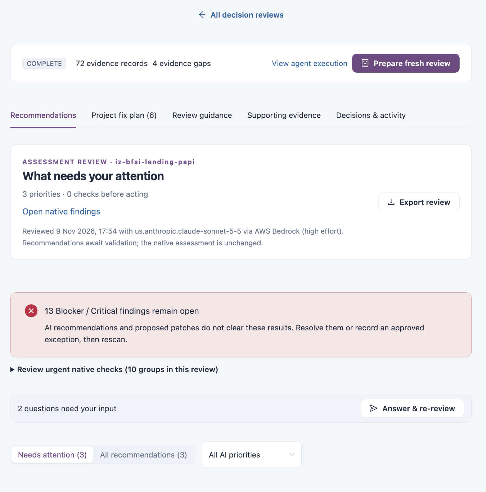

# AI & Automation

AI & Automation reviews your applications with an AI model, using the findings, metrics, configuration and, where allowed, the source code that IZ Suite already collected. It also holds the workspace-wide AI settings: the provider and model, the monthly budgets, the audit trail and which applications AI may see.

Open it from **Workspaces** → **AI & Automation** in the sidebar. Every AI & Automation screen has the same tabs at the top: **AI coverage & findings**, **Usage & budgets**, **Activity & audit** and **AI access**.


AI is not licensed separately. Three checks decide whether AI runs:

1. **AI is turned on** for your workspace, with a provider, model and budget (see **Usage & budgets**, or **Turn on AI** in Setup).
2. **AI access** allows it for the organization, environment or application.
3. An enabled **AI review profile** in **Operations** → **Quality Control** applies to the application. Enabled AI profiles run after the assessment, within your budget.


<figure><figcaption></figcaption></figure>

## Screens in AI & Automation

| Page                                                  | What you do there                                                                                             |
| ----------------------------------------------------- | ------------------------------------------------------------------------------------------------------------- |
| [AI Coverage & Findings](ai-coverage-and-findings.md) | See which assets have an AI review, read the results and prepare a new review.                                |
| [Usage & Budgets](usage-and-budgets.md)               | Choose the AI provider and model, set monthly budgets and per-action limits, and manage provider connections. |
| [Activity & Audit](activity-and-audit.md)             | See what AI reviews cost and how long they took, and search every recorded AI event.                          |
| [AI Access](ai-access.md)                             | Choose what applications get by default and add exceptions per organization, environment or application.      |

## How an AI Review Is Decided

1. AI must be turned on for the workspace in [Usage & Budgets](usage-and-budgets.md).
2. [AI Access](ai-access.md) decides whether an application may be reviewed and whether its source code may be sent.
3. A review runs only when an [AI review profile](../../operations/quality-control/ai-review-profiles.md) applies to the asset: a global, platform or asset-level profile.
4. Every model call is reserved against the budget before it is sent and settled afterwards.


You need a role that can view or run AI insights to open these screens. Changing the provider, budgets and AI access needs a role that can edit global settings.


## Next Steps

* [Usage & Budgets](usage-and-budgets.md): turn AI on and set the budget.
* [AI Access](ai-access.md): decide where AI is used.
* [AI Review Profiles](../../operations/quality-control/ai-review-profiles.md): define what an AI review checks.
