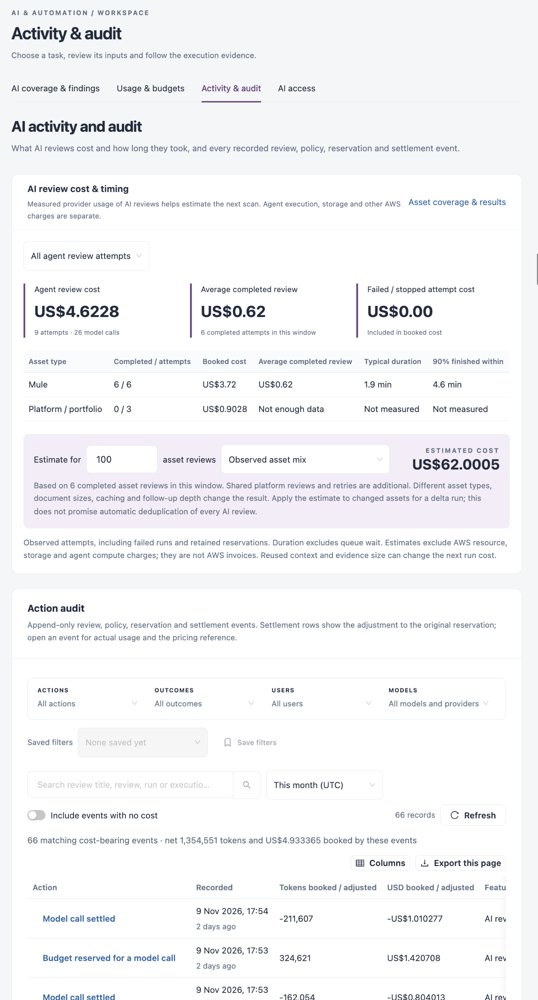

# Activity & Audit

Activity & audit answers two questions: what did AI reviews cost and how long did they take, and what exactly happened, call by call. The audit is append-only: it records every review, policy change, budget reservation and settlement.

Open it from **Workspaces** → **AI & Automation** → **Activity & audit** in the sidebar.


AI is not licensed separately. It works only when AI is turned on for your workspace in [Usage & Budgets](usage-and-budgets.md) and allowed by [AI Access](ai-access.md).


<figure><figcaption></figcaption></figure>

## AI Review Cost & Timing

This panel uses measured provider usage of AI reviews. Agent execution, storage and other cloud charges are not included. **Asset coverage & results** opens [AI Coverage & Findings](ai-coverage-and-findings.md).

Choose the time range: **All agent review attempts**, **Last hour**, **Last 24 hours** or **Last 7 days**.

| Tile                              | Description                                                                  |
| --------------------------------- | ---------------------------------------------------------------------------- |
| **Agent review cost**             | Cost booked by review attempts, with the number of attempts and model calls. |
| **Average completed review**      | Average cost of a completed review.                                          |
| **Failed / stopped attempt cost** | Cost of attempts that did not complete. It is included in the booked cost.   |

The table breaks this down per **Asset type**: **Completed / attempts**, **Booked cost**, **Average completed review**, **Typical duration** and **90% finished within**. Durations exclude time waiting in the queue.

### Estimate the Next Run

Enter a number in **Estimate for** … **asset reviews** and pick an asset type, or **Observed asset mix**. **Estimated cost** multiplies the average completed review by that number. Platform reviews, retries, document size and caching change the actual result.

## Action Audit

The audit lists each event with its **Action**, when it was **Recorded**, **Tokens booked / adjusted**, **USD booked / adjusted** and the **Feature** (with **Open review** for review events). A settlement row shows the adjustment to the original reservation, so it is often negative. The line above the table totals the net tokens and cost of the matching events.

| Filter                          | Description                                                                                                                                                                      |
| ------------------------------- | -------------------------------------------------------------------------------------------------------------------------------------------------------------------------------- |
| Search                          | Review title, review, run or execution ID.                                                                                                                                       |
| **Actions**                     | Event types, grouped as **Model calls and budget**, **Agent runs**, **Review runs**, **Reviews and decisions**, **Settings and connections** and **Source and platform access**. |
| **Outcomes**                    | **Completed**, **Failed**, **Rejected** or **Retained or needs attention**.                                                                                                      |
| **Users**                       | Who triggered the event. Shown to users who can manage AI settings.                                                                                                              |
| **Models**                      | Model and provider.                                                                                                                                                              |
| Time range                      | **Last 24 hours**, **Last 7 days**, **Last 30 days**, **This month (UTC)** (the default), **Custom range** or **All retained history**.                                          |
| **Include events with no cost** | Also show events that booked nothing, such as agent steps, evidence reads and policy changes.                                                                                    |

Use **Save filters** to keep a combination and pick it from **Saved filters**. **Refresh** reloads the list, **Columns** chooses the visible columns and **Export this page** downloads the rows shown.

### Open an Event

Click an action name. The drawer explains what happened and shows:

* **What happened**: the review, the model call number in the action, the AI feature and the model outcome.
* **Cost and tokens**: the actual cost, the reservation and the amount returned to the budget, tokens used (input, output, cache read and cache write) and the action total.
* **Who and where**: who triggered it, the provider and the model.
* **Identifiers for audit** and the **Full recorded payload**.

## Next Steps

* [Usage & Budgets](usage-and-budgets.md): change the budget or pricing behind these numbers.
* [AI Coverage & Findings](ai-coverage-and-findings.md): open the reviews these events belong to.
* [AI Access](ai-access.md): see access rule changes in context.
