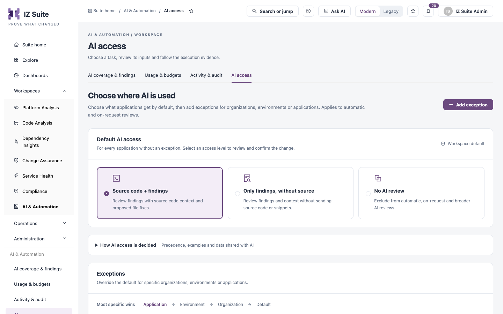
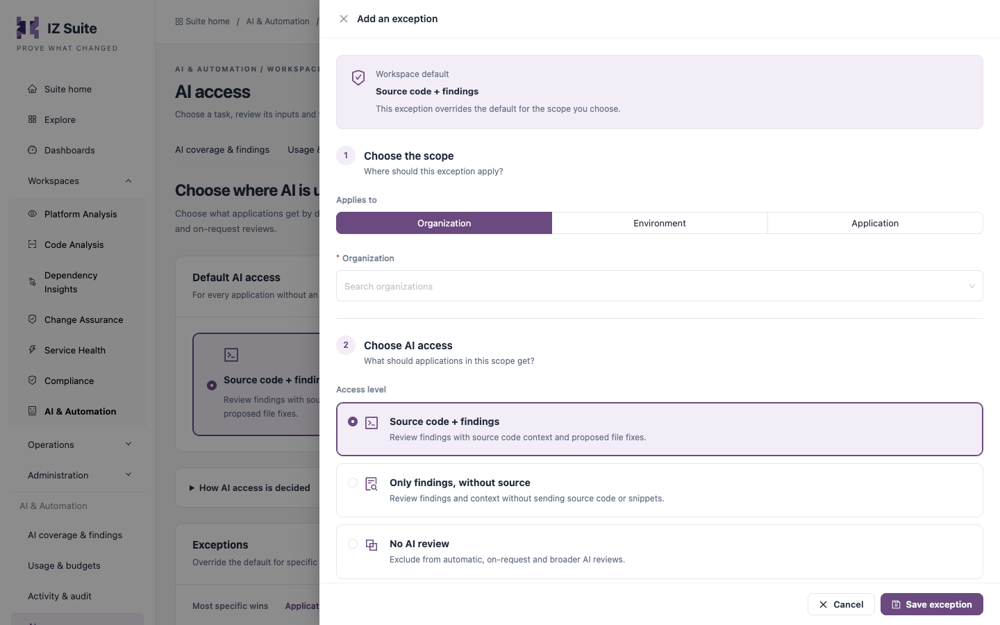

# AI Access

AI access decides, for each application, whether AI may review it and whether its source code may be sent to the AI provider. You set a workspace default, then add exceptions where an organization, environment or application needs something else. The setting applies to automatic and on-request reviews.

Open it from **Workspaces** → **AI & Automation** → **AI access** in the sidebar.


AI is not licensed separately. AI must be on for the workspace in [Usage & Budgets](/broken/pages/141b3a55abd504e600706ee949e0eb059a62bdde); when it is off, nothing uses AI, whatever is set here.


<figure><figcaption>
AI access
</figcaption></figure>

## Access levels

| Level                             | What AI gets                                                                                                                                                                                                                                              |
| --------------------------------- | --------------------------------------------------------------------------------------------------------------------------------------------------------------------------------------------------------------------------------------------------------- |
| **Source code + findings**        | Findings with source code context. AI can propose file fixes.                                                                                                                                                                                             |
| **Only findings, without source** | Findings and context without source code or code snippets. Finding descriptions are dropped too, because scanner text can quote code. Rules, file paths, line numbers, metrics, configuration and context are still used, and no file fixes are proposed. |
| **No AI review**                  | No automatic or on-request AI review. The application is also left out of other applications' and platform reviews.                                                                                                                                       |

## How access is decided

1. An application gets what its exception says.
2. When several exceptions cover it, the most specific one wins: **Application**, then **Environment**, then **Organization**.
3. An application without an exception gets the default.
4. A review then runs only when an AI review profile matches the application.

For example: the default is **Source code + findings**, organization Acme is **No AI review**, and Acme's application Billing is **Only findings, without source**. Billing is reviewed without its source code, the rest of Acme is not reviewed, and every other organization is reviewed with source code.

Expand **How AI access is decided** on the page to read the same rules.

## Change the default

1. Under **Default AI access**, select an access level.
2. In **Change default AI access?**, check the old and new level.
3. Click **Save changes**.

The default applies to every application without an exception. Existing exceptions continue to apply.

## Add an exception

<figure><figcaption>
Add an exception
</figcaption></figure>

1. Click **Add exception**.
2. Under **Choose the scope**, set **Applies to**: **Organization**, **Environment** or **Application**.
3. Search for and select the organization, environment or application (**Required**). An application exception covers every version and branch of the application.
4. Under **Choose AI access**, select the **Access level**.
5. Click **Save exception**.

## Exceptions list

The list has a search box (organizations, environments or applications) and **Refresh**.

| Column         | Description                                                                                                |
| -------------- | ---------------------------------------------------------------------------------------------------------- |
| **Applies to** | The organization, environment or application, with its context.                                            |
| **Level**      | **Organization**, **Environment** or **Application**.                                                      |
| **AI access**  | The access level of the exception.                                                                         |
| **Updated**    | When the exception last changed.                                                                           |
| **Actions**    | **Edit exception** changes the access level; the scope cannot be changed. **Remove exception** deletes it. |


When you remove an exception, a broader exception (its environment or organization) applies again, or the default if there is none. Removing a **No AI review** exception can let AI review applications again.



You need a role that can edit global settings to change the default and manage exceptions. Other users with AI access can view the settings.


## Next steps

* [Usage & Budgets](/broken/pages/141b3a55abd504e600706ee949e0eb059a62bdde): turn AI on and choose the provider.
* [AI Coverage & Findings](/broken/pages/88b3c1fbbe09ac8d1f8c3235b4cad076b2108233): see which applications have been reviewed.
* [Activity & Audit](/broken/pages/6a2d3b57339dcbc799144069be89012749b500e0): find access rule changes in the audit.
