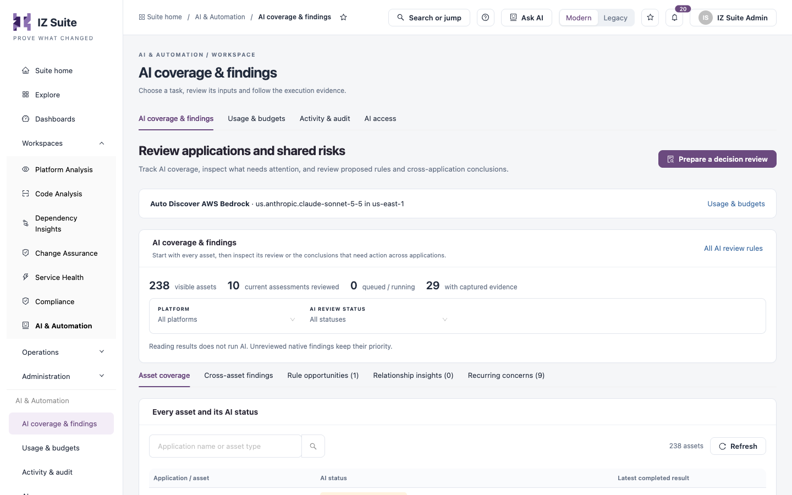
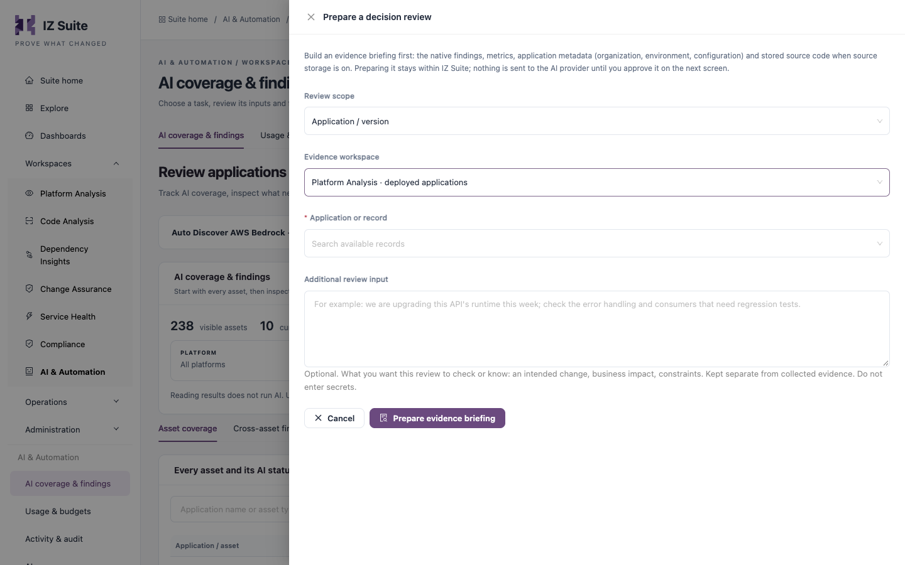

# AI Coverage & Findings

This screen lists every asset you can see with its AI review status, and gathers the conclusions that matter across applications: platform investigations, suggested rules, relationships and recurring concerns. From here you also prepare a review on request. Reading results never runs AI.

Open it from **Workspaces** → **AI & Automation** → **AI coverage & findings** in the sidebar.


AI is not licensed separately. It works only when AI is turned on for your workspace in [Usage & Budgets](/broken/pages/141b3a55abd504e600706ee949e0eb059a62bdde) and allowed by [AI Access](ai-access.md). The bar under the heading shows the AI provider and model in use, with a link to **Usage & budgets**. When AI is off, evidence briefings are still available.


<figure><figcaption>
AI coverage &#x26; findings
</figcaption></figure>

## Summary and filters

The **AI coverage & findings** panel counts **visible assets**, **current assessments reviewed**, reviews **queued / running** and assets **with captured evidence**. **All AI review rules** opens AI Review Profiles.

| Filter               | Options                                                                                                                                                                                                                                |
| -------------------- | -------------------------------------------------------------------------------------------------------------------------------------------------------------------------------------------------------------------------------------- |
| **Platform**         | **All platforms**, **AWS**, **MuleSoft**, **Azure**, **Other**.                                                                                                                                                                        |
| **AI review status** | **All statuses**, or one status with its count, such as **Reviewed current assessment**, **Not reviewed**, **Needs captured evidence**, **Review is out of date**, **Queued**, **Agent reviewing**, **Failed** or **Budget deferred**. |

## Tabs

| Tab                       | What it shows                                                                                                                                                                                                                                                                                                             |
| ------------------------- | ------------------------------------------------------------------------------------------------------------------------------------------------------------------------------------------------------------------------------------------------------------------------------------------------------------------------- |
| **Asset coverage**        | **Every asset and its AI status**: search by application name or asset type, then read each asset's **AI status** and **Latest completed result** (recommendations, additional concerns and possible false positives). **Open dossier** opens the asset; **Read AI review** or **Read older AI review** opens the result. |
| **Cross-asset findings**  | Platform and cross-platform investigations, with how many assets were in scope and inspected. **Review shared findings** opens one.                                                                                                                                                                                       |
| **Rule opportunities**    | Suggested AI review questions, native rule proposals and improvements, and possible false positives. Filter by **Type**, open a suggestion to read why and how to validate it, then **Open review**. No rule changes automatically.                                                                                       |
| **Relationship insights** | Links between applications that AI investigated: proposed additional links and interpretations of existing ones, each with a next action.                                                                                                                                                                                 |
| **Recurring concerns**    | The same native rule raised across several reviewed applications, with links to each review.                                                                                                                                                                                                                              |

Below the tabs, **Your recent review history** lists the reviews you prepared, with their status.

## Prepare a review on request

<figure><figcaption>
Prepare a decision review
</figcaption></figure>

1. Click **Prepare a decision review**.
2. Fill in the fields below.
3. Click **Prepare evidence briefing**. IZ Suite gathers the evidence; nothing is sent to the AI provider yet.
4. In the review, check the **Decision briefing** and **Supporting evidence** tabs.
5. Click **Start AI investigation**, read **Review AI inputs and budget**, tick the approval to send the displayed evidence to the configured provider and model, and click **Start AI investigation**.

| Field                       | Description                                                                                                                                                                                             |
| --------------------------- | ------------------------------------------------------------------------------------------------------------------------------------------------------------------------------------------------------- |
| **Review scope**            | **Application / version**, **Platform / connected portfolio**, **Change Assurance asset**, **Compliance standard** or **Service status page**. The choices depend on your role.                         |
| **Evidence workspace**      | For an application: **Platform Analysis · deployed applications**, **Code Analysis · code / branches** or the dependency workspace for connected applications.                                          |
| **Application or record**   | **Required.** Search the records you can access.                                                                                                                                                        |
| **Review type**             | For scopes other than an application: for example **Change readiness**, **Dependency change**, **Cross-application impact**, **Security investigation**, **Control evidence** or **Service readiness**. |
| **Review profiles applied** | For an application: the global, platform and asset-level profiles that apply. The most specific level wins where guidance conflicts.                                                                    |
| **Additional review input** | Optional, up to 4,000 characters. What you want this review to check or know, such as an intended change or business impact. Do not enter secrets.                                                      |


Known credential fields are redacted before evidence is sent, but redaction cannot guarantee that every embedded secret is found. Inspect the evidence packet before you approve.


## Read a review

A review has these tabs. A review of an application's assessment opens on **Recommendations** and does not show **Decision briefing**.

| Tab                                              | Content                                                                                                                                          |
| ------------------------------------------------ | ------------------------------------------------------------------------------------------------------------------------------------------------ |
| **Decision briefing**                            | The prepared evidence, your context, what remains unknown and the evidence boundaries.                                                           |
| **Focus report** or **Recommendations**          | AI recommendations, filterable by focus and **AI priority**. **Review fix & evidence** shows the reasoning and proposed fix.                     |
| **Project fix plan**                             | Proposed file fixes across the captured project, when available.                                                                                 |
| **Review guidance**                              | The profile guidance and context used. **Provide context & re-review** adds answers and queues a new review.                                     |
| **Supporting evidence**                          | What AI could establish and the captured evidence records.                                                                                       |
| **Decisions & work** or **Decisions & activity** | Human decisions and follow-up. **Record decision** records a disposition such as **Need more evidence** or **Disagree with the recommendation**. |

**Open native findings** opens the asset's findings; a notice says when blocker or critical findings remain open, because AI recommendations do not clear them. Use **Export review** to download a review and **Prepare fresh review** to review the current evidence again. While a review runs, **Stop investigation** stops it.


You need a role that can run AI insights to prepare and start reviews. Review conclusions are advisory: they do not change recorded verdicts, and a review decision does not suppress a finding or approve a change.


## Next steps

* [Usage & Budgets](/broken/pages/141b3a55abd504e600706ee949e0eb059a62bdde): check the provider, model and remaining budget.
* [Activity & Audit](/broken/pages/6a2d3b57339dcbc799144069be89012749b500e0): see what each review cost.
* [AI Access](ai-access.md): control which applications AI may review.
