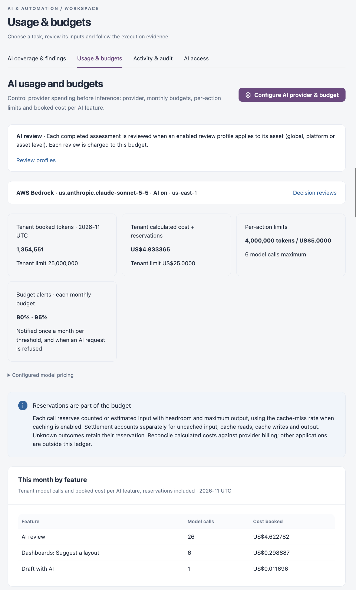
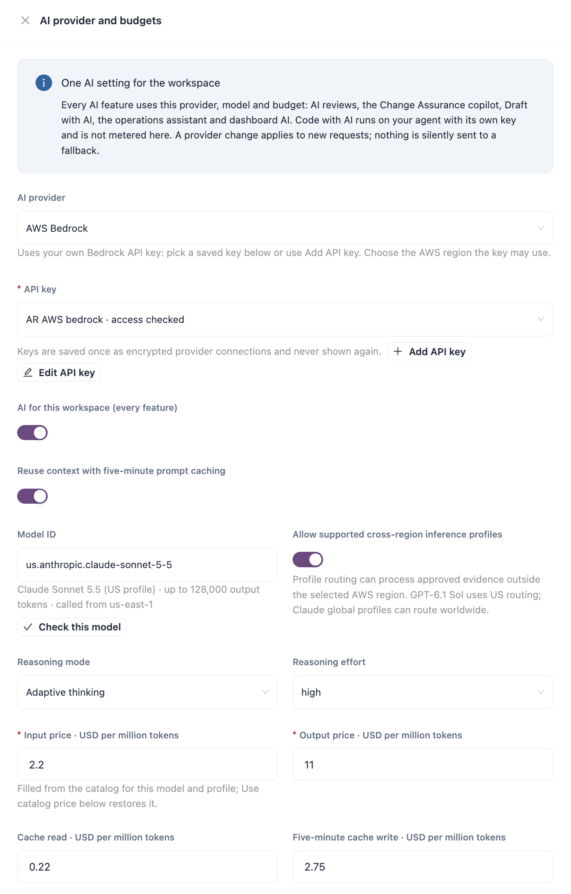

# Usage & Budgets

Usage & budgets holds the one AI setting of the workspace. Every AI feature uses the provider, model and budget chosen here: AI reviews, the Change Assurance copilot, Draft with AI, the operations assistant and dashboard AI. Spending is controlled before inference: each model call is reserved against the budget before it is sent.

Open it from **Workspaces** → **AI & Automation** → **Usage & budgets** in the sidebar.


AI is not licensed separately: it works only when AI is turned on here for your workspace and allowed by [AI Access](ai-access.md). Code with AI runs on your agent with its own key and is not metered here.


<figure><figcaption></figcaption></figure>

## What the Page Shows

| Area                                      | Description                                                                                                                                                                                                                                                              |
| ----------------------------------------- | ------------------------------------------------------------------------------------------------------------------------------------------------------------------------------------------------------------------------------------------------------------------------ |
| **AI review**                             | Whether completed assessments are reviewed automatically. With AI on, each completed assessment is reviewed when an enabled review profile applies to its asset. **Review profiles** opens [AI Review Profiles](../../operations/quality-control/ai-review-profiles.md). |
| Provider bar                              | The provider, model, whether AI is on, the region and any pricing review that is due. **Decision reviews** opens [AI Coverage & Findings](ai-coverage-and-findings.md).                                                                                                  |
| **Tenant booked tokens**                  | Tokens booked this month (UTC) against the monthly token limit.                                                                                                                                                                                                          |
| **Tenant calculated cost + reservations** | Cost booked this month, open reservations included, against the monthly cost limit.                                                                                                                                                                                      |
| **Per-action limits**                     | The token and cost cap for one action, and the maximum number of model calls in it.                                                                                                                                                                                      |
| **Budget alerts · each monthly budget**   | The percentages of each monthly budget at which subscribers are notified.                                                                                                                                                                                                |
| **Configured model pricing**              | Expand it to see the input, output and cache rates per million tokens, the pricing source and the date the price is valid through.                                                                                                                                       |
| **This month by feature**                 | Model calls and booked cost per AI feature this month.                                                                                                                                                                                                                   |


Each call reserves its input and maximum output first, then settles actual usage. Calls whose outcome is unknown keep their reservation. Reconcile calculated costs against your provider's billing.


## Configure the AI Provider and Budget

<figure><figcaption></figcaption></figure>

1. Click **Configure AI provider & budget**.
2. Fill in the fields below.
3. Click **Save AI budget**.

| Field                                                                                   | Description                                                                                                                                                                                                                                                    |
| --------------------------------------------------------------------------------------- | -------------------------------------------------------------------------------------------------------------------------------------------------------------------------------------------------------------------------------------------------------------- |
| **AI provider**                                                                         | **Auto Discover AWS Bedrock** (uses the server's own AWS identity, no API key), **AWS Bedrock** (your own Bedrock API key), **Anthropic API** or **OpenAI**. A provider change applies to new requests; nothing is sent to a fallback provider.                |
| **API key**                                                                             | **Required** for **AWS Bedrock**, **Anthropic API** and **OpenAI**. Choose a saved provider connection, or use **Add API key** / **Edit API key**.                                                                                                             |
| **Endpoint (advanced)**                                                                 | For **Anthropic API** and **OpenAI**. Optional: empty uses the provider's standard API. **Set custom endpoint** (or **Change endpoint**) routes requests through your own gateway; the endpoint is saved with the API key, so changing it needs the key again. |
| **Allow evidence processing at this provider's standard global endpoint**               | For **Anthropic API** and **OpenAI**.                                                                                                                                                                                                                          |
| **AI for this workspace (every feature)**                                               | Turns AI on or off for every feature.                                                                                                                                                                                                                          |
| **Reuse context with five-minute prompt caching**                                       | Available for models that support it.                                                                                                                                                                                                                          |
| **AWS region**                                                                          | **Required** for the AWS providers when the model ID does not already name its geography.                                                                                                                                                                      |
| **Model ID**                                                                            | **Required.** Pick a listed model or type a Bedrock model or inference profile ID, for example `us.anthropic.claude-sonnet-5-5`. For a saved key, **Check this model** tests access.                                                                           |
| **Allow supported cross-region inference profiles**                                     | AWS only. Profile routing can process approved evidence outside the selected region. Some models run only through such a profile.                                                                                                                              |
| **Reasoning mode** and **Reasoning effort**                                             | Whether the model uses extended thinking, and how much.                                                                                                                                                                                                        |
| **Input price**, **Output price**, **Cache read**, cache write · USD per million tokens | Input and output prices are **Required**. Filled from the catalog for listed models; **Use catalog price** restores them. Budgets and limits use these numbers.                                                                                                |
| **Pricing source / version**                                                            | Where the price comes from and when you checked it.                                                                                                                                                                                                            |
| **Pricing review date · UTC**                                                           | AI requests are refused after this date until an administrator updates the price.                                                                                                                                                                              |
| **Monthly token budget** and **Monthly cost budget · USD**                              | **Required.** The monthly caps for the workspace.                                                                                                                                                                                                              |
| **Per-action token limit including reservations** and **Per-action cost limit · USD**   | **Required.** The caps for one action.                                                                                                                                                                                                                         |
| **Output tokens per call · thinking and response**                                      | **Required.** The maximum output of one call.                                                                                                                                                                                                                  |
| **Model calls per action**                                                              | **Required.** From 1 to 12.                                                                                                                                                                                                                                    |
| **Budget alerts · % of each monthly budget**                                            | Up to ten whole percentages in ascending order, for example `80, 95`. Subscribers to the AI budget event are notified once per threshold each month, and when a request is refused because a budget is reached.                                                |


With a saved API key, AI features are blocked until that key passes **Check this model** for the exact model selected.


## Provider Connections

**Provider connections** lists the built-in **Auto Discover AWS Bedrock** connection and every saved API-key connection. The row tagged **In use** is the one every AI feature uses.

| Column                 | Description                                                                                                       |
| ---------------------- | ----------------------------------------------------------------------------------------------------------------- |
| **Connection**         | Name, **In use** or **Not in use**, and the provider.                                                             |
| **Access**             | **Model metadata verified**, **Check failed**, **Not verified** or **Disabled**, with the date of the last check. |
| **Model access check** | The model that **Check access** tests.                                                                            |
| **Actions**            | **Edit**, **Use for AI** (opens the budget form preset to this connection) and **Check access**.                  |

Access checks read model metadata or count tokens and never send source code. A Bedrock identity that may not count tokens gets one 1-token test call instead.

To add a connection:

1. Click **Add provider connection**.
2. Choose the **AI provider**, enter a **Connection name** and the **API key** (all **Required**). For **Anthropic API** and **OpenAI**, **Custom endpoint (advanced, optional)** takes a public HTTPS address of your own gateway or proxy for that provider's API; private and internal addresses are refused, and the key and review content are sent there.
3. Leave **Allow this connection to be selected** on, and click **Save connection**.
4. Click **Check access**, then **Use for AI** to switch to it.


API keys are encrypted on the server and never shown again. When you edit a connection, **Replace API key (optional)** replaces the stored key; leave it empty to keep it. Changing the custom endpoint needs the API key again. Saving a connection does not switch the active provider.



You need a role that can edit global settings to configure the provider and budget and to manage provider connections.


## Next Steps

* [Activity & Audit](activity-and-audit.md): see what each review and action cost.
* [AI Access](ai-access.md): decide which applications AI may see.
* [AI & Automation](./): see how the AI settings fit together.
