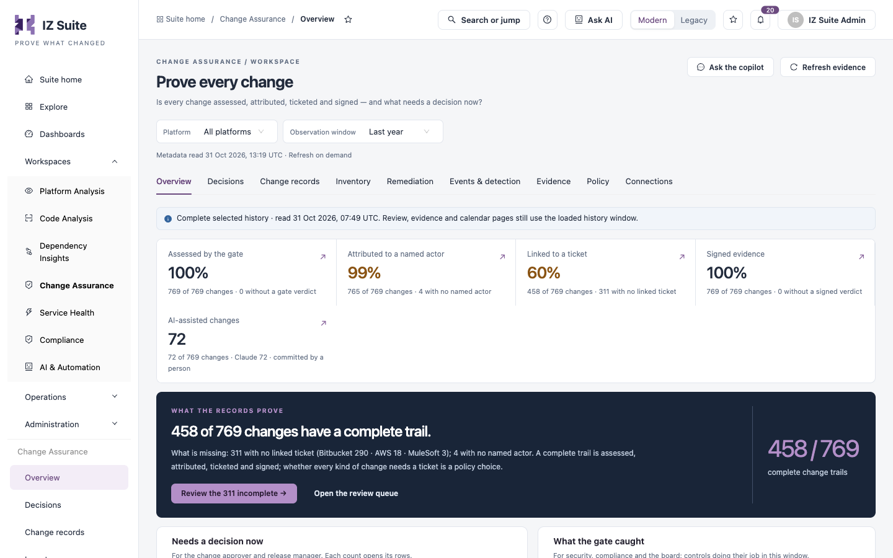

# Change Assurance

Change Assurance collects changes from the systems you connect (source control, cloud accounts, integration platforms, ticket trackers), runs each change through a gate, and keeps signed evidence of what it found. Change approvers, release managers, auditors and platform owners use it to answer four questions:

* **What changed?** Every change, asset and event your connections record.
* **Who changed it?** The person, account or AI tool behind each change.
* **Was it approved?** The gate verdict, any human decision, and the evidence behind both.
* **Is the release ready?** Which candidate changes still miss a ticket, a verdict, an approval or fall in a freeze window.

Open it from **Workspaces** → **Change Assurance** in the sidebar. The sidebar then lists the Change Assurance areas, and the same areas show as tabs under the page header.


Requires the **Change Assurance** licence.


<figure><figcaption>
Change Assurance, opened on the Overview area
</figcaption></figure>

## Areas

Each area groups several tabs. An area with several tabs shows a switcher under the area tabs.

| Area                                                                         | Tabs                                                                                                                         | Use it to                                                                        |
| ---------------------------------------------------------------------------- | ---------------------------------------------------------------------------------------------------------------------------- | -------------------------------------------------------------------------------- |
| [Overview](overview.md)                                                      | **Assurance brief**                                                                                                          | See how many changes have a complete trail and what needs a decision now.        |
| [Decisions](decisions.md)                                                    | **Review queue**, **Approvals**, **Release readiness**                                                                       | Review changes, record approvals and check a release set.                        |
| [Change Records](change-records.md)                                          | **Calendar & freezes**, **Timeline**, **Ticket lineage**, **All changes**, **People**                                        | Browse every recorded change, its ticket and its author; declare freeze windows. |
| [Inventory](inventory.md)                                                    | **All assets**, **By platform**, **Explore impact**, **Relationship review**, **Environment progression**, **Delivery flow** | Review the assets your connections found and how they relate.                    |
| [Remediation](remediation.md)                                                | **My tasks**, **Run history**, **Playbooks & routing**                                                                       | Track follow-up work and the actions people can run.                             |
| [Events & Detection](/broken/pages/9dd1c5e817ddef48356d2329928c7f94c8f0a10c) | **Event explorer**, **Anomalies**, **Drift**, **Delivery performance**                                                       | Search raw events and review anomaly and drift findings.                         |
| [Evidence](evidence.md)                                                      | **Evidence & controls**, **Raw ledger**, **Configuration trail**                                                             | Export evidence, verify the signed ledger and audit setup changes.               |
| [Policy](policy.md)                                                          | **Gate policies**, **Approval rules**, **Templates**, plus the **More policy settings** tabs                                 | Decide which changes need a person, who signs off and how assets are linked.     |
| [Connections](connections.md)                                                | **Connections**, **Collection coverage**                                                                                     | Connect source systems and check what they collect.                              |


Each tab shows only when your role can read its data. If a tab is missing, ask an administrator for a role that can view that part of Change Assurance.


## Page header

Most Change Assurance pages share the same header.

| Control                | Description                                                                                                      |
| ---------------------- | ---------------------------------------------------------------------------------------------------------------- |
| **Platform**           | Limits the page to one connected platform, or **All platforms**.                                                 |
| **Observation window** | The period of activity the page reads, for example **Last year**.                                                |
| **Ask the copilot**    | Opens the assistant with the current page as context.                                                            |
| **Refresh evidence**   | Reads the latest stored evidence again. Pages read on demand; the time of the last read shows under the filters. |
| **Export this view**   | Downloads what the current page shows.                                                                           |

Pages that open from a list show **Back to assurance brief** instead of the header filters.

## Lists

Lists in Change Assurance share one set of tools.

| Control                              | Description                                                                                                                        |
| ------------------------------------ | ---------------------------------------------------------------------------------------------------------------------------------- |
| Filter bar                           | Drop-down filters above the list (for example **STATUS**, **PLATFORM**, **PERIOD**). Each active filter shows as a removable chip. |
| **Saved filters** / **Save filters** | Save the current filters under a name and pick them again later.                                                                   |
| **Copy link** / **Reset filters**    | Copy a link to the filtered view, or clear every filter.                                                                           |
| Tiles                                | The counts above a list. Select a tile to filter the list to its rows.                                                             |
| Search                               | Searches the list after you stop typing.                                                                                           |
| **Refresh**                          | Reloads the list.                                                                                                                  |
| **Columns**                          | Shows or hides columns.                                                                                                            |
| **Export** / **Export this page**    | Downloads the rows.                                                                                                                |

## Next steps

* [Overview](overview.md): start with the assurance brief.
* [Connections](connections.md): connect the systems Change Assurance collects from.
* [Policy](policy.md): decide which changes need a human decision.
